<p align="center"></p>

<h1 align="center">JS.Net</h1>

<p align="center"><b>Write it like JavaScript. Ship it as .NET.</b><br/>
A modern programming language with JavaScript/TypeScript syntax that compiles to standard CIL, runs on CoreCLR and uses the entire .NET ecosystem.</p>

<p align="center"><i>Created by <b>Gravicode Studios</b>, led by <b>Kang Fadhil</b>. · Dibuat oleh Gravicode Studios dipimpin oleh Kang Fadhil.</i></p>

<p align="center"><a href="README.id.md">🇮🇩 Baca dalam Bahasa Indonesia</a></p>

---

```jsnet
import System.Text;

interface Product { name: string; price: number; }

export class Cart {
    private items = new Array<Product>();

    add(item: Product): Cart { this.items.push(item); return this; }

    get total(): number { return this.items.reduce((sum, p) => sum + p.price, 0); }
}

const cart = new Cart().add({ name: "Keyboard", price: 49.9 }).add({ name: "Mouse", price: 19.5 });
console.log(`Total: ${cart.total.toFixed(2)}`);           // Total: 69.40

const sb = new StringBuilder().Append("Any .NET API, ").Append("no bindings.");
console.log(sb.ToString());
await delay(100);                                         // async/await on Tasks
```

## Why JS.Net

- **Familiar** — `let`/`const`, arrow functions, classes, interfaces, generics, `async`/`await`, destructuring, template literals, `console.log`, `JSON`, `Promise`, `map`/`filter`/`reduce`.
- **A native .NET citizen** — JS.Net classes are real CLR classes, generics are CLR generics, `Promise<T>` is `Task<T>`. Use any NuGet package; call JS.Net from C#, F# and VB.NET and vice versa.
- **Fast** — typed code compiles to the same IL as C#. Works with tiered JIT, ReadyToRun and **NativeAOT** (a JS.Net console app publishes to a ~2 MB native executable).
- **Every app model** — console, class libraries, ASP.NET Core (minimal APIs and controllers), Blazor, WPF, WinForms, Avalonia, .NET MAUI, Orleans, Aspire, worker services and xUnit tests.
- **Real tooling** — `dotnet build/run/publish`, an MSBuild SDK, errors mapped to `.jsn` lines, a language server with .NET-aware completion and rename, VS Code / Visual Studio / JetBrains support, custom analyzer rules written in JS.Net, native Rust tools and a browser playground.
- **AI-native** — `ai function` and `prompt` declarations on Microsoft.Extensions.AI, with tools, streaming and structured output.

## Quick start

```bash
dotnet new install JSNet.Templates          # project templates
dotnet tool install -g JSNet.Cli            # optional: the jsnet CLI (run scripts, LSP, formatter)

dotnet new jsnet -n HelloJsNet               # console app
cd HelloJsNet
dotnet run
```

Run a single file without a project:

```bash
jsnet run hello.jsn
jsnet emit hello.jsn     # show the C# the compiler lowers it to
```

A JS.Net project file:

```xml
<Project Sdk="JSNet.Sdk/0.1.1">
  <PropertyGroup>
    <OutputType>Exe</OutputType>
    <TargetFramework>net10.0</TargetFramework>
  </PropertyGroup>
</Project>
```

For other SDKs (Web, Worker, WindowsDesktop) add JS.Net on top: `<Project Sdk="Microsoft.NET.Sdk.Web"> <Sdk Name="JSNet.Sdk" Version="0.1.1" />`.

### Templates

| Template | Short name |
|---|---|
| Console app | `jsnet` / `jsnet-console` |
| Class library | `jsnet-classlib` |
| ASP.NET Core Web API | `jsnet-webapi` |
| ASP.NET Core empty web app | `jsnet-web` |
| Blazor Web App | `jsnet-blazor` |
| WPF app | `jsnet-wpf` |
| Windows Forms app | `jsnet-winforms` |
| Avalonia app | `jsnet-avalonia` |
| Worker service | `jsnet-worker` |
| xUnit tests | `jsnet-xunit` |
| .NET MAUI app (Android, iOS, macOS, Windows) | `jsnet-maui` |
| Orleans grains (silo + client) | `jsnet-orleans` |
| .NET Aspire app host + API | `jsnet-aspire` |

## JS.Net Gallery

Twenty-seven runnable samples — language features, async, LINQ, .NET interop, JSON, AI-native functions and real use cases — written in JS.Net and presented by four native front-ends. Each sample can be flipped to the **C# the compiler lowers it to**.

| Blazor (web) | WPF |
|---|---|
| 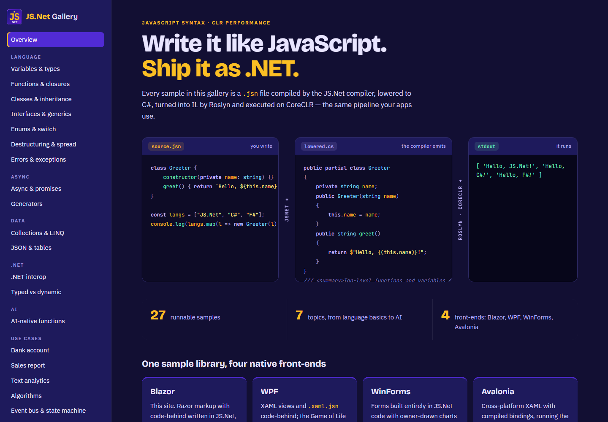 | 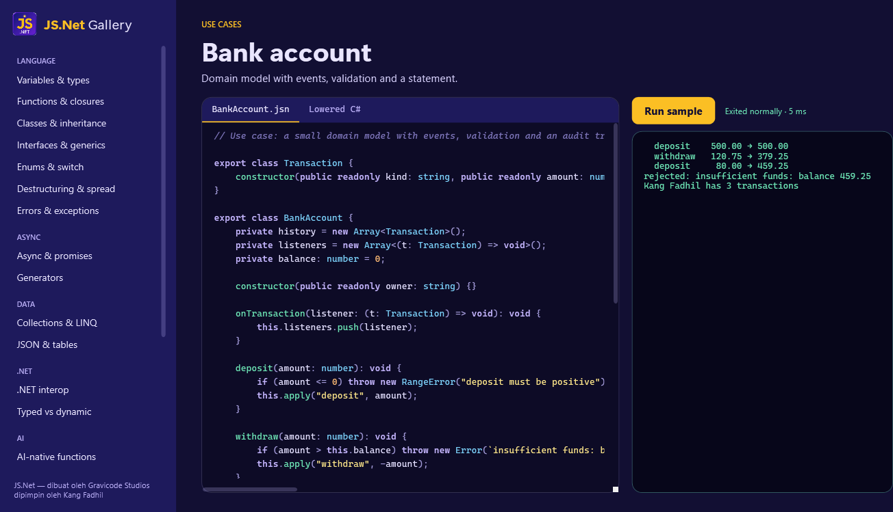 |
| 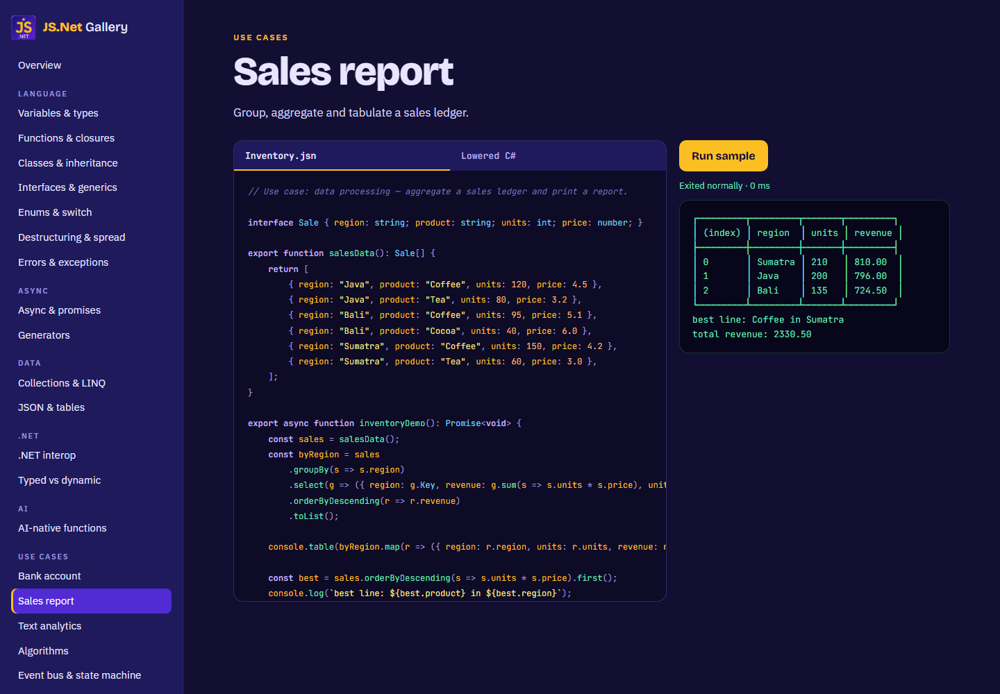 | 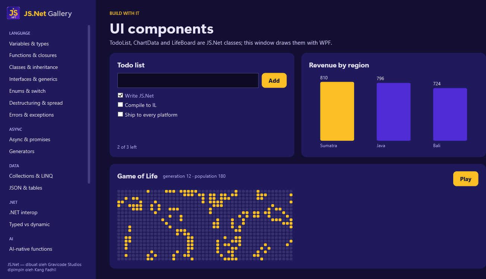 |

| Avalonia (cross-platform) | WinForms |
|---|---|
| 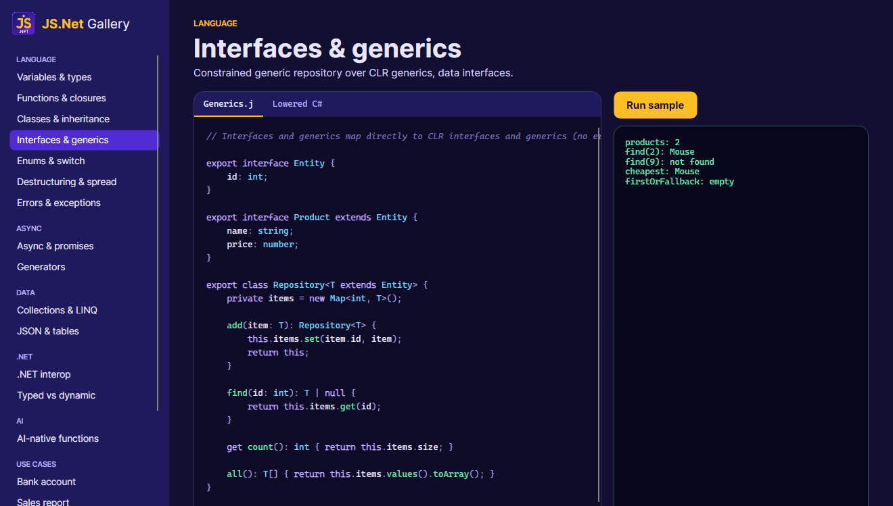 | 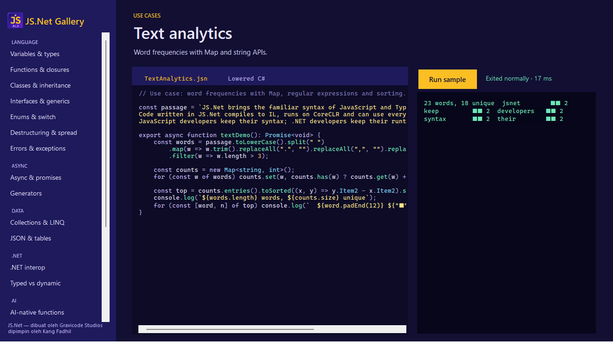 |
| 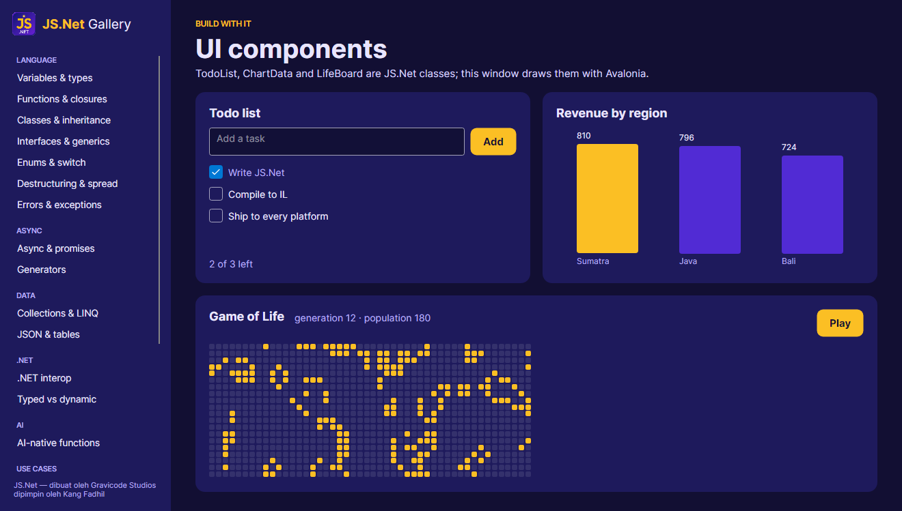 | 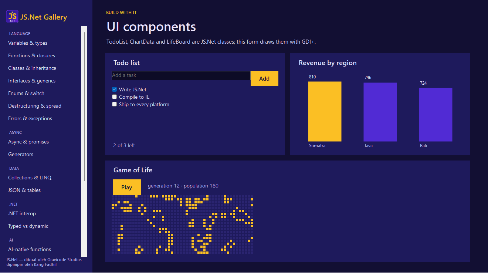 |

```bash
dotnet run --project gallery/JSNet.Gallery.Web        # http://localhost:5170
dotnet run --project gallery/JSNet.Gallery.Wpf
dotnet run --project gallery/JSNet.Gallery.WinForms
dotnet run --project gallery/JSNet.Gallery.Avalonia
```

**Ecosystem samples** use real NuGet libraries from JS.Net: reinforcement learning (Gravicode.RLNet), charts (Matplotlib.Net), machine learning (GraviLearn), Hugging Face tokenizers, MediaPipe text classification, Modbus/IoT (IoTCom.Net) and 3D scenes (ThreeNet).

| Ecosystem: RLNet | Ecosystem: MediaPipeNet |
|---|---|
| 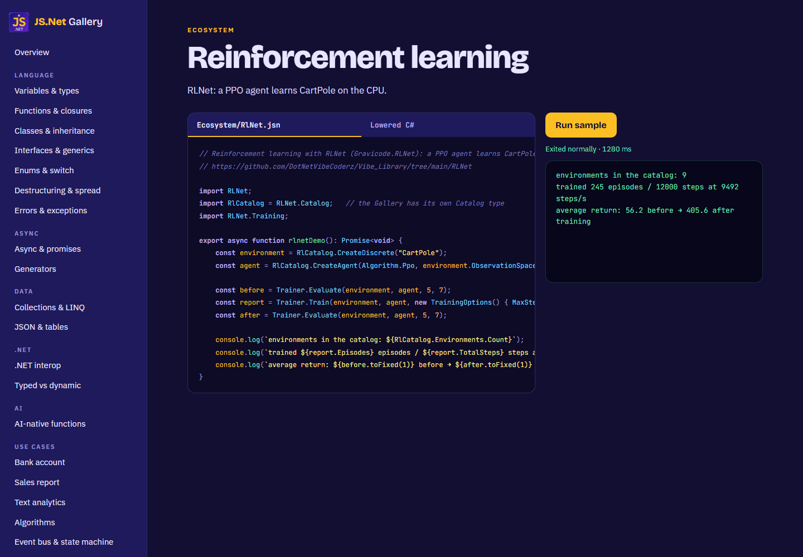 | 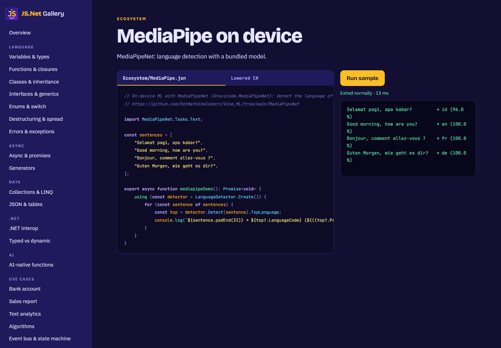 |

**WebAssembly playground** — the JS.Net compiler and Roslyn running entirely in the browser; no server compiles or runs your code (`dotnet run --project gallery/JSNet.Playground`, `?example=N&run=1` links).

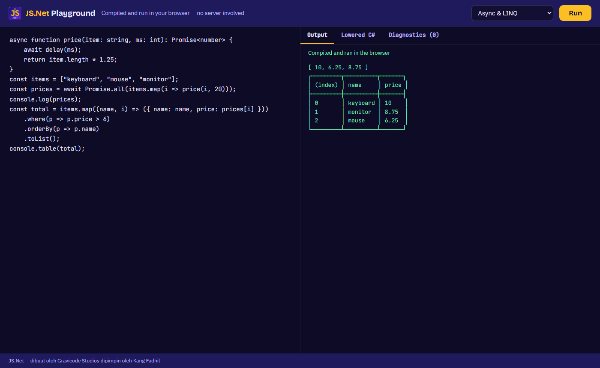

**.NET MAUI** — the `jsnet-maui` template on Windows:

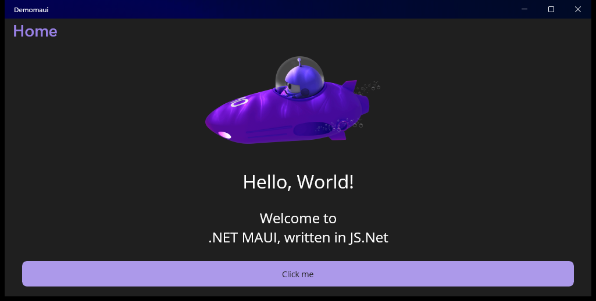

## How it works

```text
.jsn source ──► JS.Net front end ──► C# (with #line maps) ──► Roslyn ──► IL ──► CoreCLR (JIT / NativeAOT)
               lexer · parser · binder ·
               type inference · analyzers
```

JS.Net uses the **Roslyn backend strategy** from the design: the JS.Net front end parses, binds and type-checks `.jsn` files, then lowers them to C#. Roslyn produces IL, portable PDBs (pointing back at `.jsn` lines via `#line`), source generators, analyzers and NativeAOT compatibility. No new runtime: JS.Net programs run on CoreCLR with the standard GC and JIT. See [docs/en/architecture.md](docs/en/architecture.md).

## Repository layout

| Path | Contents |
|---|---|
| `src/JSNet.Syntax` · `JSNet.Parser` · `JSNet.Semantics` · `JSNet.CodeGen` · `JSNet.Compiler` | The compiler pipeline |
| `src/JSNet.Runtime` | Runtime library (console, JSON, Math, Promise, Date, fetch, timers, JS-style APIs, `@Service`) |
| `src/JSNet.AI` | `ai function` / `prompt` runtime on Microsoft.Extensions.AI |
| `src/JSNet.Sdk` | MSBuild project SDK (`JSNet.Sdk`) |
| `src/JSNet.Web` · `JSNet.EntityFramework` · `JSNet.Blazor` · `JSNet.Reactive` | Companion packages (Express-style routing, async EF Core, `JsComponent`, RxJS-style observables) |
| `src/JSNet.Analyzers` | API for custom `rule` analyzers |
| `src/JSNet.Scripting` | In-memory Roslyn backend (`jsnet run`, playground, tests) |
| `src/JSNet.Cli` | The `jsnet` tool (also bundled in the SDK) |
| `src/JSNet.LanguageServer` | Language Server Protocol implementation |
| `rust/jsnet-tools` | Native Rust tools: formatter, fast checker, tokenizer, statistics |
| `visualstudio/` · `jetbrains/` | Visual Studio extension, JetBrains (LSP4IJ) setup |
| `templates/` · `vscode/` · `gallery/` · `samples/` · `tests/` · `docs/` | Templates, VS Code extension, gallery, samples, tests, documentation |

## Documentation

| English | Bahasa Indonesia |
|---|---|
| [Getting started](docs/en/getting-started.md) | [Memulai](docs/id/getting-started.md) |
| [Language guide](docs/en/language-guide.md) | [Panduan bahasa](docs/id/language-guide.md) |
| [.NET interop & runtime](docs/en/interop-and-runtime.md) | [Interop .NET & runtime](docs/id/interop-and-runtime.md) |
| [Tooling (CLI, SDK, LSP, VS Code, Rust)](docs/en/tooling.md) | [Tooling](docs/id/tooling.md) |
| [Architecture](docs/en/architecture.md) | [Arsitektur](docs/id/architecture.md) |
| [Diagnostics reference](docs/en/diagnostics.md) | [Referensi diagnostik](docs/id/diagnostics.md) |

Roadmap: [PLAN.md](PLAN.md) · Progress: [Progress.md](Progress.md) · Original design: [architecture-design.md](architecture-design.md)

## Building from source

Requirements: .NET 10 SDK; Rust (optional, for `jsnet-tools`); Node.js (optional, for the VS Code extension).

```bash
dotnet build JSNet.slnx
dotnet test tests/JSNet.Tests
pwsh build/pack.ps1          # Release build + tests + NuGet packages in artifacts/packages
```

## License

MIT © Gravicode Studios. JS.Net is created by **Gravicode Studios**, led by **Kang Fadhil**.
