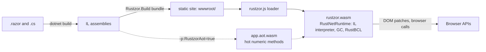

# Rustzor

**Aplikasi web C# di browser, berjalan di atas runtime .NET yang ditulis dengan Rust dan dikompilasi ke WebAssembly.**

[English](README.md) · [Dokumentasi](docs/id/README.md) · [Contoh Aplikasi](docs/id/samples.md) · [Roadmap](PLAN.md) · [Progress](Progress.md)


Rustzor adalah platform web untuk C#. Anda menulis Razor component dan kode C# biasa; `dotnet build` mengubahnya menjadi situs statis. Di browser, [RustNetRuntime](https://github.com/DotNetVibeCoderz/Vibe_Runtime) memuat assembly Anda lalu menjalankannya. RustNetRuntime adalah runtime ECMA-335 yang ditulis dengan Rust: IL interpreter, garbage collector, dan base class library-nya semuanya Rust, dikompilasi menjadi satu modul WebAssembly berukuran sekitar 1,8 MB. Tidak ada Mono dan tidak ada runtime di sisi server.

Model pemrogramannya sama dengan Blazor: file `.razor`, `@code`, `@bind`, `EventCallback`, routing, layout, dependency injection, dan form. Di sekelilingnya tersedia component kit, library C# untuk setiap API browser, framework untuk data, game, grafis, dan AI, integrasi dengan library UI dan chart JavaScript populer, serta client untuk SignalR dan gRPC-Web.

> **Preview.** Ini adalah versi `0.1.0-preview.2`. Bagian inti sudah berfungsi dan diuji per aplikasi (enam sample app dan dua puluh satu template hasil generate berjalan di Chrome), tetapi API masih bisa berubah sebelum 1.0. Lihat [apa saja yang belum didukung](docs/id/limitations.md).

## Memulai aplikasi

Anda hanya butuh [.NET 10 SDK](https://dotnet.microsoft.com/download). Tidak perlu yang lain: runtime-nya sudah termasuk di dalam package `Rustzor.Sdk`.

```bash
dotnet tool install -g Rustzor.Cli --prerelease
rustzor new app HelloRustzor
cd HelloRustzor
rustzor serve --open          # mem-build ulang dan me-reload halaman setiap kali Anda menyimpan
```

Atau secara manual:

```xml
<!-- HelloRustzor.csproj -->
<Project Sdk="Rustzor.Sdk/0.1.0-preview.2">
  <ItemGroup>
    <PackageReference Include="Rustzor.UI" Version="0.1.0-preview.2" />
  </ItemGroup>
</Project>
```

```csharp
// Program.cs
using Rustzor.Components;

var builder = RustzorHostBuilder.CreateDefault(args);
builder.RootComponents.Add<HelloRustzor.App>("#app");
await builder.Build().RunAsync();
```

```razor
@* Pages/Home.razor *@
@page "/"
<Card Title="Hello from Rustzor">
    <p>Clicked @count times</p>
    <button class="rz-btn primary" @onclick="() => count++">Click</button>
</Card>

@code { private int count; }
```

Tambahkan `App.razor` (sebuah `Router`), `_Imports.razor`, dan `wwwroot/index.html`, lalu jalankan `dotnet build`. Situsnya ada di `bin/Debug/net10.0/wwwroot`; sajikan dengan static file server apa saja. [Panduan memulai](docs/id/getting-started.md) memuat semua file tersebut secara lengkap.

## Apa yang bisa Anda bangun

| | |
| --- | --- |
|  **Nusantara CRM.** Papan pipeline dengan drag and drop, perusahaan, kontak, aktivitas, dan laporan SQL di atas SQLite di dalam browser. |  **Kedai Senja POS.** Mesin kasir kafe: pilihan minuman, kode promo, pajak PB1, tunai, QRIS dan kartu, struk, laporan shift, di atas IndexedDB. |
|  **Serambi chat.** Channel, thread, reaksi, dan indikator mengetik antar-tab browser tanpa server, ditambah rekan tim simulasi. |  **API Playground.** REST, WebSocket, SignalR, dan gRPC-Web ke server ASP.NET Core, dengan setiap frame yang lewat di jaringan ditampilkan. |
|  **Jati Lestari ERP.** Workshop mebel Jepara: pembelian, penjualan dengan PPN 11%, produksi dari bill of materials, tiga gudang, dan pembukuan berpasangan yang menerima jurnal dari setiap transaksi. |  **Arus grid dashboard.** Simulasi jaringan listrik Jawa–Bali secara langsung: beban, frekuensi, pembangkitan per sumber, dan diagram satu garis jaringan 500 kV. |
|  **Ruang Redaksi video call.** Panggilan WebRTC antar-tab browser tanpa server: berbagi layar, tally pembicara aktif, chat, angkat tangan, dan rekaman yang digabung di browser. |  **Rupa, tool desain.** Editor vektor ala Figma: kanvas tak terbatas, snapping dan garis jarak, auto layout, komponen dengan override, gaya warna, ekspor SVG dan PNG. |
|  **Kamar Gelap, editor foto.** Editor ala Photoshop yang digabung dengan WebGL2: layer dengan blend mode dan masker, adjustment layer, brush, seleksi, filter, riwayat, ekspor PNG, JPEG, dan WebP. |  **Siaga Citarum, peta banjir.** GIS untuk meja pusdalops BPBD dengan mesin peta kanvas sendiri: layer dan gaya, identifikasi, tabel atribut, menggambar dan menyunting verteks, pengukuran geodesik, buffer, GeoJSON dan CSV, serta laporan situasi. |
|  **Tilik, tinjauan desain.** CAD viewer untuk gear reducer dua tingkat yang dimodelkan di Blender: WebGL2 dengan tutup potongan berarsir, dimensi dengan snap ke verteks, x-ray, explode, catatan yang disematkan di model, tampilan tersimpan, daftar material, dan .glb atau .stl apa saja. |  **Loket, meja layanan.** Asisten dwibahasa untuk kantor kelurahan yang menjawab dari dokumennya sendiri: streaming dengan tombol Hentikan, empat alat yang tampil sebagai kartu, pencarian BM25 dengan kutipan, unggah PDF, suara, Azure OpenAI, OpenAI, Claude, endpoint apa pun yang kompatibel dengan OpenAI, atau model demo luring. |

Semua sample app, beserta screenshot lainnya: [docs/id/samples.md](docs/id/samples.md).

## Cara kerjanya



- **Mode interpreted** (default): RustNetRuntime meng-interpret IL Anda. Reflection penuh, build cepat, dan runtime yang sama dengan yang berjalan di desktop maupun mikrokontroler.
- **Mode AOT** (`-p:RustzorAot=true`): build juga mengompilasi method static numerik yang sering dipanggil (hot) ke WebAssembly; sisanya tetap di-interpret, sehingga hasilnya tidak pernah berubah, hanya kecepatannya. Lihat [mode build](docs/id/aot.md).

Component di-render ke virtual DOM di C#; runtime hanya mengirimkan patch-nya ke browser. Setiap library membawa JavaScript-nya sendiri (`rustzor.module.js`, di-embed di dalam assembly-nya), sehingga aplikasi hanya mengunduh kode browser dari library yang benar-benar di-reference. [Arsitektur](docs/id/architecture.md).

## Package

| Kelompok | Package |
| --- | --- |
| Inti | `Rustzor.Sdk`, `Rustzor.Components` (model component yang kompatibel dengan Blazor), `Rustzor.Core` (bridge JavaScript, JSON, timer), `Rustzor.UI` (component kit), `Rustzor.Cli` (perintah `rustzor`), `Rustzor.Templates` (`dotnet new`) |
| API Browser | `Rustzor.Browser.*`: DOM, Fetch, WebSocket, Storage, FileSystem, Notifications, Push, BackgroundSync, Workers, Location, Sensors, Media, Audio, Video, Canvas, OffscreenCanvas, WebGL, WebGPU, WebRTC, WebXR, Bluetooth, USB, Serial, HID, NFC, Gamepad, AI |
| Framework | `Rustzor.Data` (SQLite, IndexedDB, DuckDB), `Rustzor.Game`, `Rustzor.Graphics`, `Rustzor.AI` |
| Integrasi | `Rustzor.UI.Bootstrap`, `Rustzor.UI.Tailwind`, `Rustzor.UI.Mui`, `Rustzor.Charts.ChartJs`, `Rustzor.Charts.ECharts`, `Rustzor.Charts.D3` |
| Jaringan | `Rustzor.Net.SignalR`, `Rustzor.Net.GrpcWeb` |

## Tooling

- **CLI `rustzor`**: `new`, `serve` dengan live reload dan overlay error build di halaman, `publish` dengan laporan ukuran, `add`, `info`.
- **Template `dotnet new`**: `rustzor`, `rustzor-empty`, `rustzorlib`.
- **Extension VS Code**: command, tombol serve, snippet.
- **[Katalog package](docs/catalog/index.html)**: setiap package beserta perintah instalasinya.

Selengkapnya di [docs/id/tooling.md](docs/id/tooling.md).

## RustzorAppGen

Editor desktop (Avalonia) untuk membuat aplikasi Rustzor dengan bantuan asisten AI, **Jack - The Code Bender**, dan galeri berisi 21 template: game, sains, bisnis, industri, edukasi, simulator, dan tools. Jack menulis file, melakukan build, menjalankan, dan memperbaiki aplikasinya. [docs/id/appgen.md](docs/id/appgen.md)


## Dokumentasi

English: [docs/en](docs/en/README.md) · Bahasa Indonesia: [docs/id](docs/id/README.md)

Memulai · Arsitektur · Component, routing, dan form · Interop JavaScript · Rustzor.UI · API Browser · Framework · Integrasi · Jaringan · Mode build · Contoh Aplikasi · Tooling · Package · RustzorAppGen · Build dari source · Keterbatasan

## Build dari source

```bash
bash scripts/build-runtime.sh          # RustNetRuntime ke WebAssembly (butuh Rust + wasm32-unknown-unknown)
dotnet build src/Rustzor.Build -c Release
dotnet build Rustzor.slnx
node tools/dev/serve.mjs samples/Crm/bin/Debug/net10.0/wwwroot 5240
```

Detail, pengujian, dan packaging: [docs/id/building-from-source.md](docs/id/building-from-source.md).

## Kredit

Dibuat oleh Gravicode Studios dipimpin oleh Kang Fadhil.
*Built by Gravicode Studios, led by Kang Fadhil.*

Dirilis di bawah lisensi MIT.
