# Rustzor

**C# web apps in the browser, on a .NET runtime written in Rust and compiled to WebAssembly.**

[Bahasa Indonesia](README.id.md) · [Documentation](docs/en/README.md) · [Samples](docs/en/samples.md) · [Roadmap](PLAN.md) · [Progress](Progress.md)

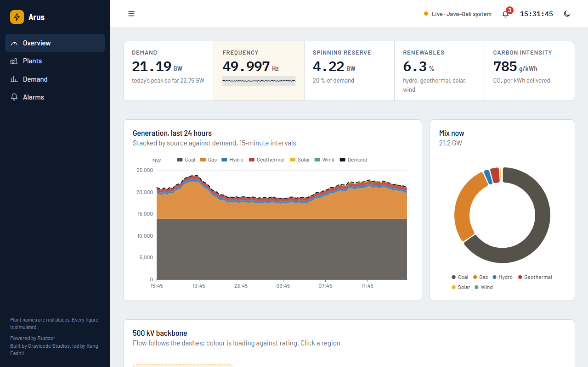

Rustzor is a web platform for C#. You write Razor components and ordinary C#; `dotnet build` turns them into a static site. In the browser, [RustNetRuntime](https://github.com/DotNetVibeCoderz/Vibe_Runtime) loads your assemblies and runs them. RustNetRuntime is an ECMA-335 runtime written in Rust: the IL interpreter, the garbage collector and the base class library are Rust, compiled to one WebAssembly module of about 1.8 MB. There is no Mono and no server-side runtime.

The programming model is Blazor's: `.razor` files, `@code`, `@bind`, `EventCallback`, routing, layouts, dependency injection and forms. Around it sit a component kit, a C# library for each browser API, frameworks for data, games, graphics and AI, integrations with popular JavaScript UI and chart libraries, and clients for SignalR and gRPC-Web.

> **Preview.** This is `0.1.0-preview.2`. The core works and is tested app by app (six sample apps and twenty-one generated templates run in Chrome), but APIs may change before 1.0. See [what is not supported yet](docs/en/limitations.md).

## Start an app

You need the [.NET 10 SDK](https://dotnet.microsoft.com/download). Nothing else: the runtime comes inside the `Rustzor.Sdk` package.

```bash
dotnet tool install -g Rustzor.Cli --prerelease
rustzor new app HelloRustzor
cd HelloRustzor
rustzor serve --open          # rebuilds and reloads the page on every save
```

Or by hand:

```xml
<!-- HelloRustzor.csproj -->
<Project Sdk="Rustzor.Sdk/0.1.0-preview.2">
  <ItemGroup>
    <PackageReference Include="Rustzor.UI" Version="0.1.0-preview.2" />
  </ItemGroup>
</Project>
```

```csharp
// Program.cs
using Rustzor.Components;

var builder = RustzorHostBuilder.CreateDefault(args);
builder.RootComponents.Add<HelloRustzor.App>("#app");
await builder.Build().RunAsync();
```

```razor
@* Pages/Home.razor *@
@page "/"
<Card Title="Hello from Rustzor">
    <p>Clicked @count times</p>
    <button class="rz-btn primary" @onclick="() => count++">Click</button>
</Card>

@code { private int count; }
```

Add `App.razor` (a `Router`), `_Imports.razor` and `wwwroot/index.html`, then `dotnet build`. The site is in `bin/Debug/net10.0/wwwroot`; serve it with any static file server. The [getting-started guide](docs/en/getting-started.md) has every file in full.

## What you can build

| | |
| --- | --- |
| 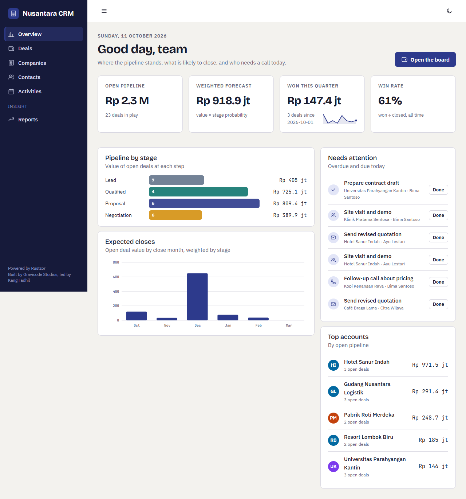 **Nusantara CRM.** Pipeline board with drag and drop, companies, contacts, activities and SQL reports on SQLite in the browser. | 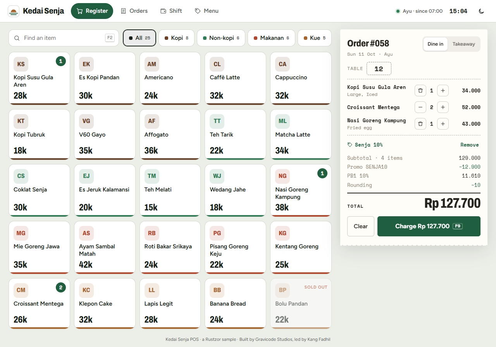 **Kedai Senja POS.** A café till: drink options, promo codes, PB1 tax, cash, QRIS and card, receipts, shift reports, on IndexedDB. |
| 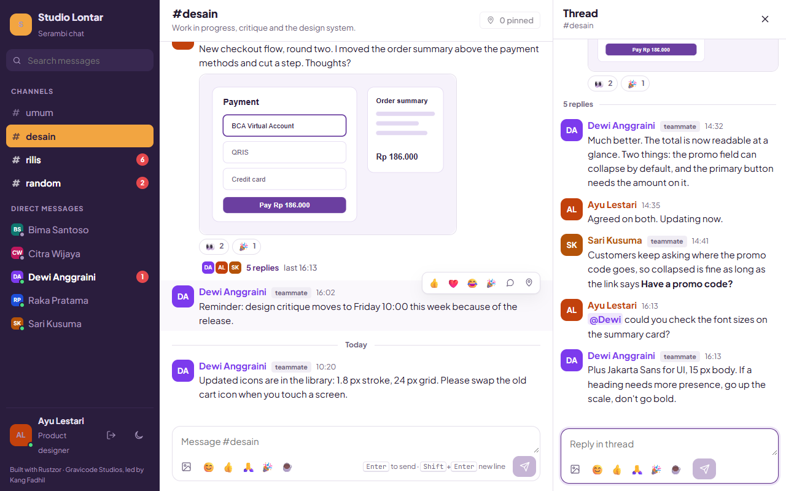 **Serambi chat.** Channels, threads, reactions and typing indicators across browser tabs with no server, plus simulated teammates. | 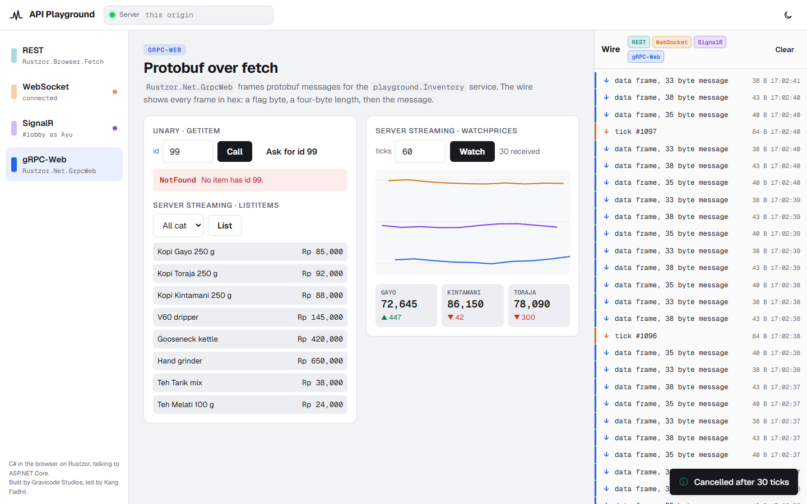 **API Playground.** REST, WebSocket, SignalR and gRPC-Web against an ASP.NET Core server, with every frame on the wire shown. |
| 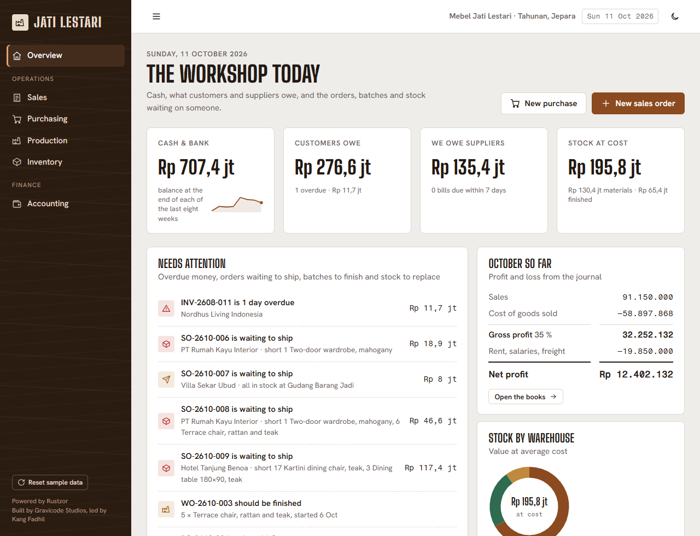 **Jati Lestari ERP.** A Jepara furniture workshop: purchasing, sales with PPN 11%, production from bills of materials, three warehouses, and double-entry books every action posts to. | 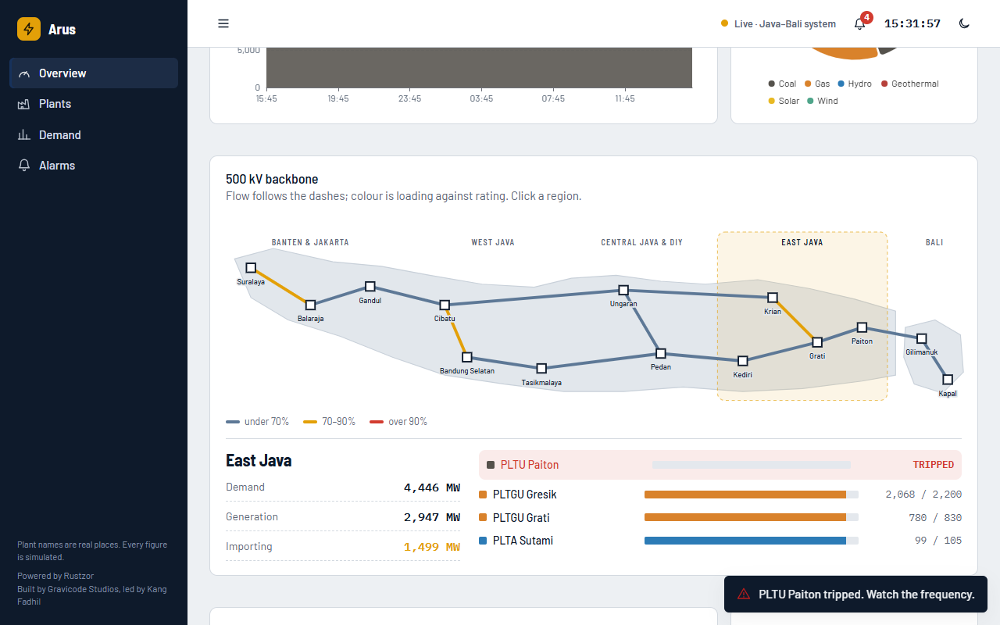 **Arus grid dashboard.** A live, simulated Java–Bali power grid: demand, frequency, generation by source and a one-line diagram of the 500 kV backbone. |
| 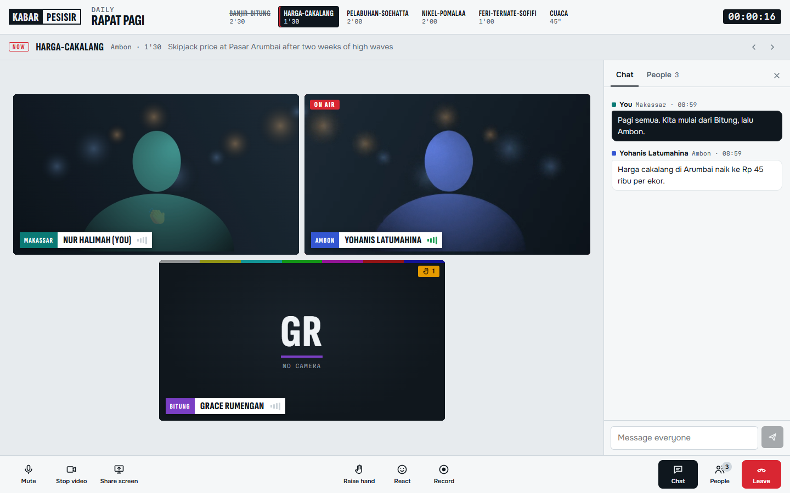 **Ruang Redaksi video calls.** WebRTC calls between browser tabs with no server: screen sharing, an active-speaker tally, chat, raised hands, and recordings mixed in the browser. | 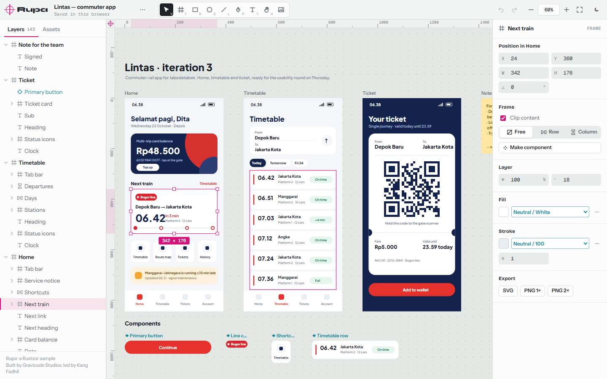 **Rupa design tool.** A Figma-like vector editor: infinite canvas, snapping and spacing guides, auto layout, components with overrides, colour styles, SVG and PNG export. |
| 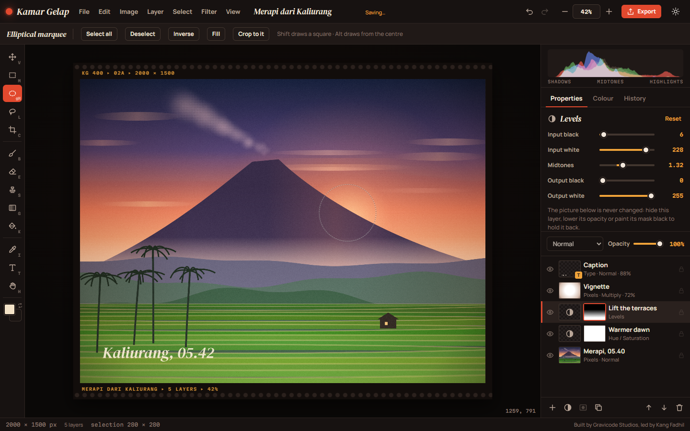 **Kamar Gelap photo editor.** A Photoshop-like editor composited in WebGL2: layers with blend modes and masks, adjustment layers, brushes, selections, filters, history, PNG, JPEG and WebP export. | 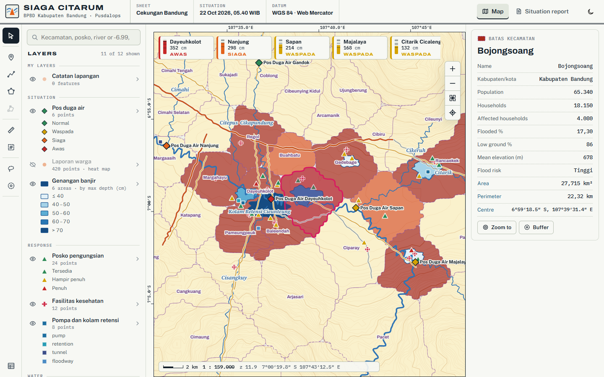 **Siaga Citarum flood map.** A GIS for a BPBD flood desk on its own canvas map engine: layers and styles, identify, an attribute table, drawing and vertex editing, geodesic measurement, buffers, GeoJSON and CSV, and a situation report. |
| 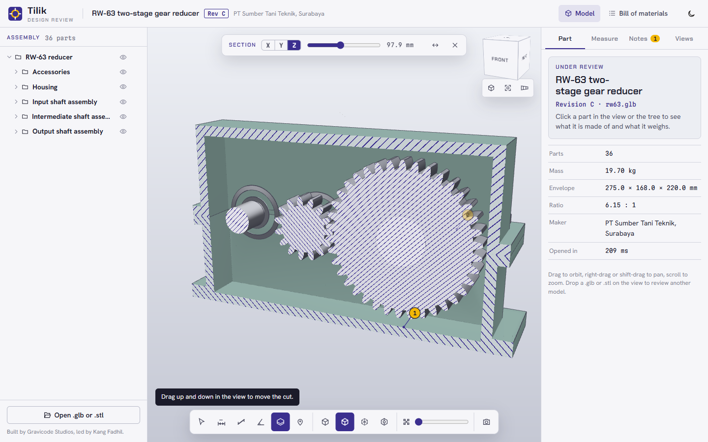 **Tilik design review.** A CAD viewer for a two-stage gear reducer modelled in Blender: WebGL2 with hatched section caps, vertex-snapped dimensions, x-ray, explode, notes pinned to the model, saved views, a bill of materials, and any .glb or .stl. | 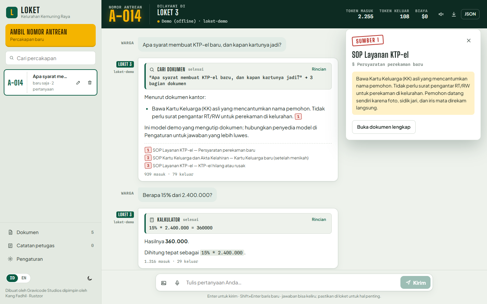 **Loket front desk.** A bilingual assistant for a neighbourhood office that answers from its own documents: streaming with Stop, four tools shown as cards, BM25 search with citations, PDF upload, voice, Azure OpenAI, OpenAI, Claude, any OpenAI-compatible endpoint, or an offline demo model. |
| 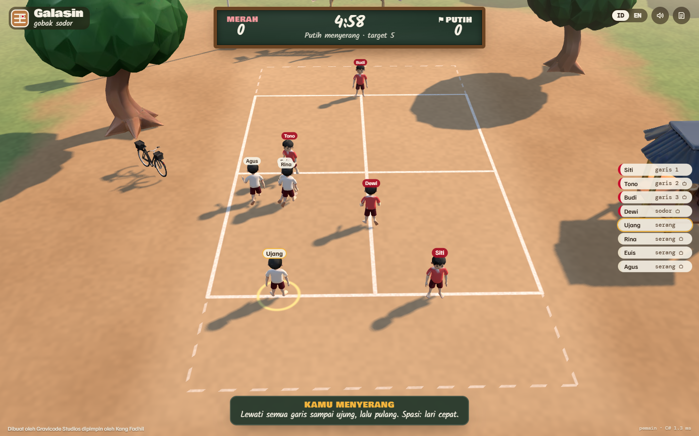 **Galasin, gobak sodor.** The kampung chalk-line game in 3D for eight players across browser tabs, no server: one tab referees and hands over when it closes, bots fill the teams, and the kids were made with Rodin and rigged and animated in Blender. | |

Every sample, with more screenshots: [docs/en/samples.md](docs/en/samples.md).

## How it works

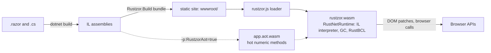

- **Interpreted mode** (the default): RustNetRuntime interprets your IL. Full reflection, fast builds, the same runtime that runs on desktops and microcontrollers.
- **AOT mode** (`-p:RustzorAot=true`): the build also compiles the app's hot numeric static methods to WebAssembly; everything else stays interpreted, so results never change, only speed. See [build modes](docs/en/aot.md).

Components render into a virtual DOM in C#; the runtime sends the browser only the patches. Each library carries its own JavaScript (`rustzor.module.js`, embedded in its assembly), so an app downloads the browser code of exactly the libraries it references. [Architecture](docs/en/architecture.md).

## Packages

| Group | Packages |
| --- | --- |
| Core | `Rustzor.Sdk`, `Rustzor.Components` (Blazor-compatible component model), `Rustzor.Core` (JavaScript bridge, JSON, timers), `Rustzor.UI` (component kit), `Rustzor.Cli` (the `rustzor` command), `Rustzor.Templates` (`dotnet new`) |
| Browser APIs | `Rustzor.Browser.*`: DOM, Fetch, WebSocket, Storage, FileSystem, Notifications, Push, BackgroundSync, Workers, Location, Sensors, Media, Audio, Video, Canvas, OffscreenCanvas, WebGL, WebGPU, WebRTC, WebXR, Bluetooth, USB, Serial, HID, NFC, Gamepad, AI |
| Frameworks | `Rustzor.Data` (SQLite, IndexedDB, DuckDB), `Rustzor.Game`, `Rustzor.Graphics`, `Rustzor.AI` |
| Integrations | `Rustzor.UI.Bootstrap`, `Rustzor.UI.Tailwind`, `Rustzor.UI.Mui`, `Rustzor.Charts.ChartJs`, `Rustzor.Charts.ECharts`, `Rustzor.Charts.D3` |
| Networking | `Rustzor.Net.SignalR`, `Rustzor.Net.GrpcWeb` |

## Tooling

- **`rustzor` CLI**: `new`, `serve` with live reload and an in-page build-error overlay, `publish` with a size report, `add`, `info`.
- **`dotnet new` templates**: `rustzor`, `rustzor-empty`, `rustzorlib`.
- **VS Code extension**: commands, a serve button, snippets.
- **[Package catalog](docs/catalog/index.html)**: every package with its install command.

More in [docs/en/tooling.md](docs/en/tooling.md).

## RustzorAppGen

A desktop editor (Avalonia) for generating Rustzor apps with an AI assistant, **Jack - The Code Bender**, and a gallery of 21 templates: games, science, business, industry, education, simulators and tools. Jack writes the files, builds, runs and fixes. [docs/en/appgen.md](docs/en/appgen.md)

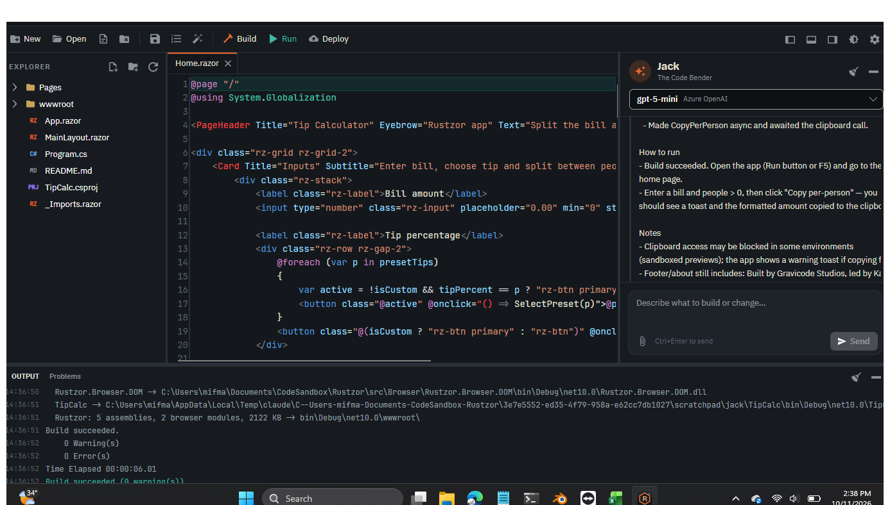

## Documentation

English: [docs/en](docs/en/README.md) · Bahasa Indonesia: [docs/id](docs/id/README.md)

Getting started · Architecture · Components, routing and forms · JavaScript interop · Rustzor.UI · Browser APIs · Frameworks · Integrations · Networking · Build modes · Samples · Tooling · Packages · RustzorAppGen · Building from source · Limitations

## Build from source

```bash
bash scripts/build-runtime.sh          # RustNetRuntime to WebAssembly (needs Rust + wasm32-unknown-unknown)
dotnet build src/Rustzor.Build -c Release
dotnet build Rustzor.slnx
node tools/dev/serve.mjs samples/Crm/bin/Debug/net10.0/wwwroot 5240
```

Details, tests and packaging: [docs/en/building-from-source.md](docs/en/building-from-source.md).

## Credits

Built by Gravicode Studios, led by Kang Fadhil.
*Dibuat oleh Gravicode Studios dipimpin oleh Kang Fadhil.*

Released under the MIT license.
