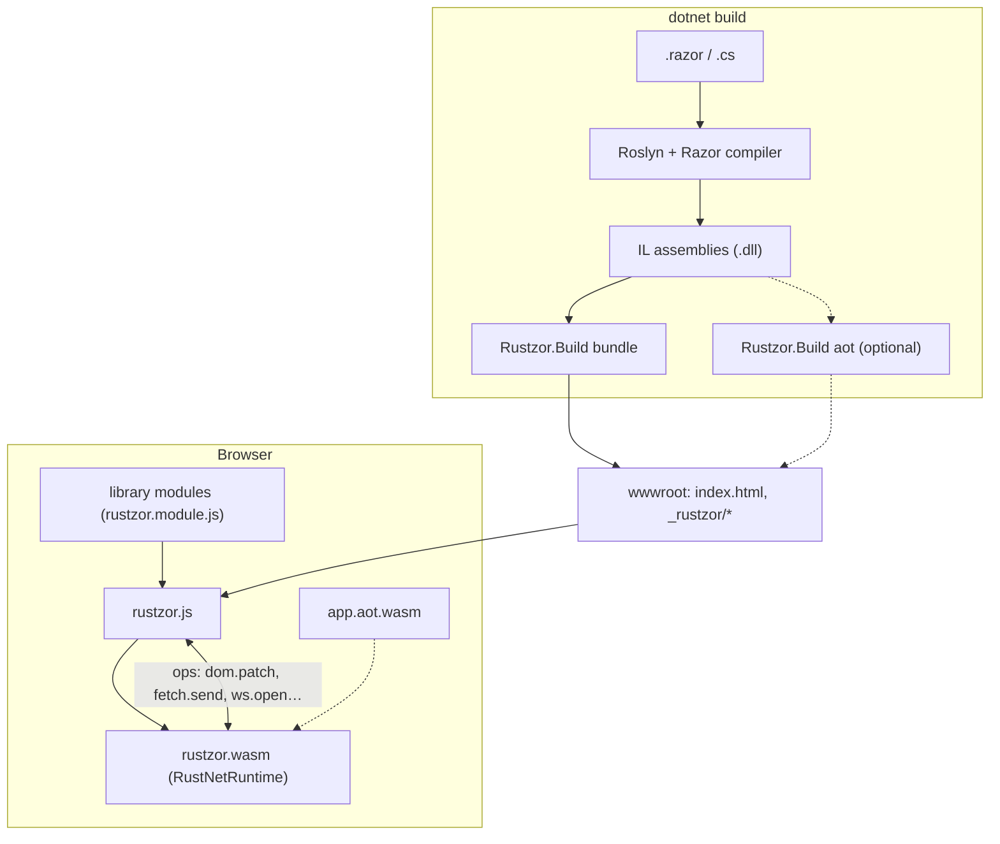

# Architecture

Rustzor puts three things together: the .NET toolchain you already use, a .NET runtime written in Rust, and a thin bridge to the browser.



## The runtime

[RustNetRuntime](https://github.com/DotNetVibeCoderz/Vibe_Runtime) is an implementation of ECMA-335 in Rust:

- **Metadata reader**: reads PE/COFF images and the metadata tables of the assemblies `dotnet build` produced.
- **Loader and type system**: types, generics, interfaces, virtual dispatch, statics, across assemblies.
- **IL interpreter**: executes method bodies, with exception handling, `async`/`await` and delegates.
- **Garbage collector**: a handle-based mark-and-sweep heap.
- **RustBCL**: the base class library as native Rust: strings, formatting, collections, LINQ, tasks, reflection, `decimal`, `DateTime`/`DateTimeOffset`, regular expressions, JSON-friendly text handling.

The same source runs on a desktop (`rustnet` CLI), on microcontrollers and, compiled to `wasm32-unknown-unknown`, in the browser. Rustzor adds only the browser seam: `runtime/rustzor-wasm` exports a small ABI (`rz_init`, `rz_load`, `rz_run_main`, `rz_invoke`, `rz_alloc`…) and imports a few host functions (`host_call`, `host_now`, `host_write`…).

Bugs found while building Rustzor are fixed in RustNetRuntime itself, each with a conformance check that runs the same program on .NET and on the runtime and compares the output.

## The bridge

C# talks to the browser through **ops**: named operations with JSON arguments, implemented in JavaScript.

```csharp
var dpr = Js.Call("js.eval", Js.Args("code", "devicePixelRatio")).AsDouble();   // synchronous
Js.Send("doc.title", Js.Args("title", "Orders"));                               // fire and forget
var r = await Js.CallAsync("fetch.send", request);                              // promise-backed
```

`rustzor.js` defines the core ops (DOM patching, navigation, timers, `js.get`/`js.set`/`js.call` for arbitrary objects). Every library adds its own ops in its embedded `rustzor.module.js`. See [JavaScript interop](interop.md).

Calls from JavaScript into C# (events, timers, promise completions) all enter through one method, `Rustzor.Interop.Callbacks.Dispatch`, with a callback id and a JSON payload.

## Rendering

`Rustzor.Components` implements Blazor's component model (`ComponentBase`, `RenderTreeBuilder`, `EventCallback`, `@bind`) in C#. A render produces a render tree; the renderer diffs it against the previous one and sends the browser a batch of DOM patches through the `dom.patch` op. DOM events come back as `handlerId|type|json` and are dispatched to the right `EventCallback`.

The Razor compiler only treats types as components when they come from an assembly named `Microsoft.AspNetCore.Components` (or one referencing it), so that is the assembly name of the `Rustzor.Components` package. No ASP.NET Core code is involved.

## Libraries and modules

Each library is an ordinary .NET assembly. When it needs browser code, it embeds `rustzor.module.js` (and optionally `rustzor.module.css`) as a resource. At build time the bundler extracts these to `_rustzor/modules/<Assembly>.js` and lists them in `boot.json`; `rustzor.js` imports each module and calls its `install(context)` before starting the runtime. An app therefore downloads the JavaScript of exactly the libraries it references, and libraries that wrap a large third-party script (ECharts, Chart.js, Bootstrap, React for MUI) load it from a pinned CDN URL the first time a component needs it.

## Startup

1. `rustzor.js` fetches `boot.json`, then the runtime, the library modules and the assemblies in parallel. Each assembly URL carries its content hash, so a new build is never served a stale file from cache.
2. It installs the library modules and instantiates `rustzor.wasm`.
3. `rz_init` creates the interpreter and installs RustBCL and the browser bindings.
4. Each assembly is loaded in dependency order with `rz_load`.
5. If the build was AOT, `app.aot.wasm` is instantiated and installed (`rz_aot_install`).
6. `rz_run_main` runs your `Program.cs`, which mounts the root component.

A typical sample starts in 50 to 150 ms after the files have arrived.

## Build modes

- **Interpreted** (default): everything runs on the IL interpreter.
- **AOT** (`-p:RustzorAot=true`): `Rustzor.Build aot` compiles the app's eligible static methods to a second WebAssembly module; the interpreter calls into it. See [build modes](aot.md).

## Repository layout

| Path | What |
| --- | --- |
| `runtime/rustzor-wasm` | The browser seam over RustNetRuntime (Rust) |
| `js/rustzor.js` | Loader, core ops, DOM patcher, module system |
| `src/Rustzor.Core` | `Js`, `JsObject`, `Callbacks`, `Scheduler`, JSON |
| `src/Rustzor.Components` | Component model, routing, DI, forms |
| `src/Rustzor.Build` | The bundler and the AOT compiler (runs at build time) |
| `src/Rustzor.Sdk` | The MSBuild SDK package |
| `src/Rustzor.Cli` | The `rustzor` command (a .NET tool) |
| `src/Rustzor.Templates` | The `dotnet new` templates |
| `src/Rustzor.UI` | The component kit |
| `src/Browser`, `src/Frameworks`, `src/Integrations`, `src/Net` | The libraries |
| `samples/` | Complete apps |
| `tools/RustzorAppGen` | The AI-assisted app generator |
| `tools/vscode-rustzor` | The VS Code extension |
| `tools/e2e`, `tools/dev` | Browser tests and a development server |
