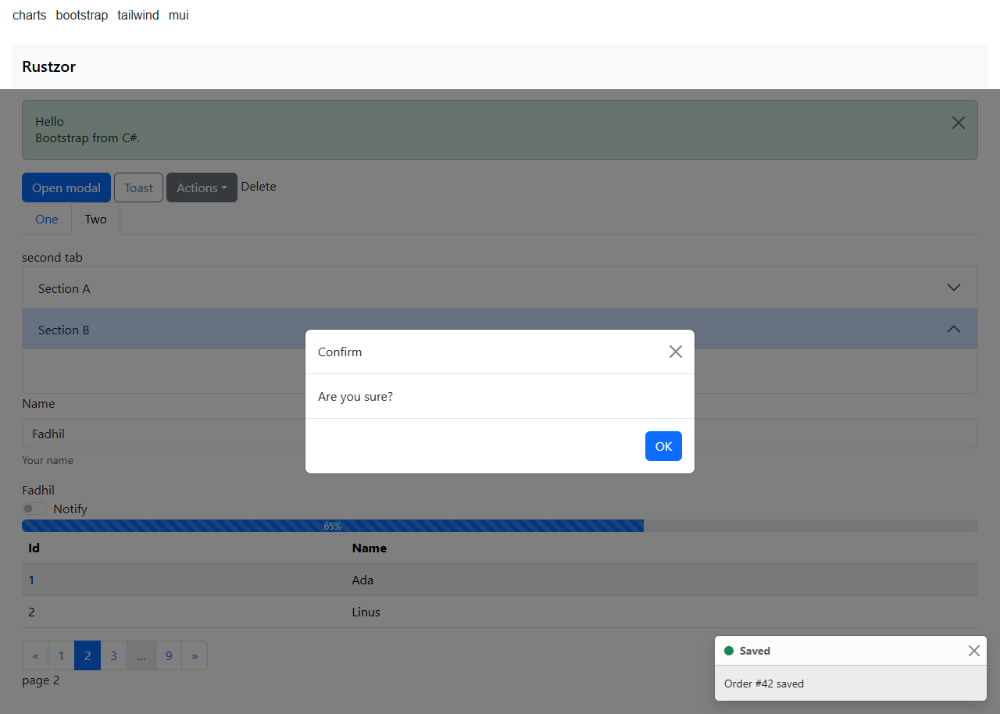
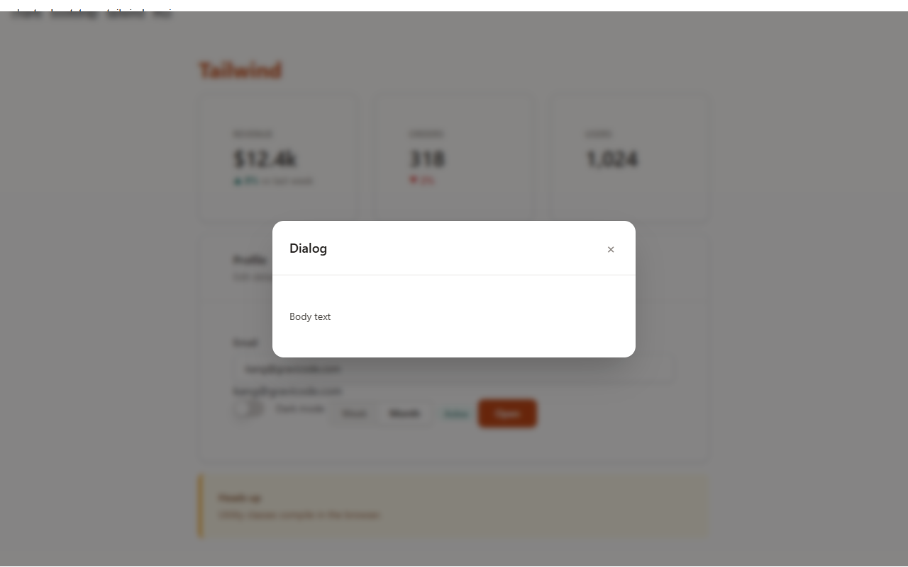
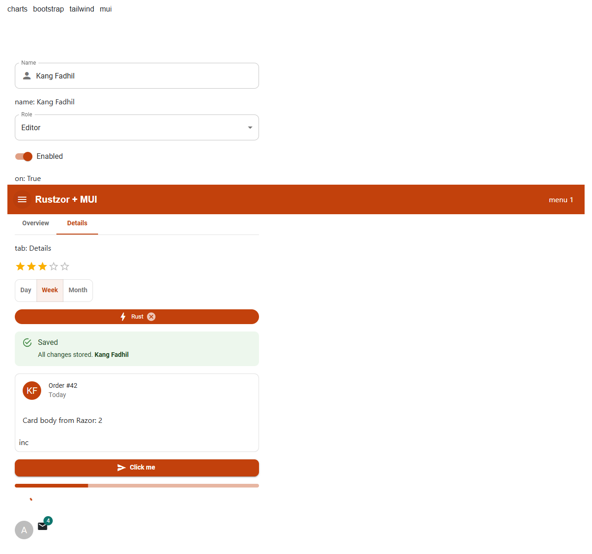
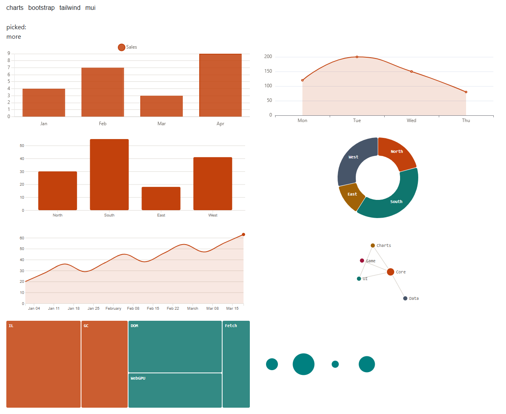

# Integrations

Established JavaScript UI and chart libraries as Razor components, with state in C#. Each integration loads its library from a pinned CDN version the first time a component needs it; set `window.RustzorCdn` before `start()` to serve them from your own host (for offline apps or a strict CSP).

```html
<script>window.RustzorCdn = { echarts: "/vendor/echarts.min.js" };</script>
```

## UI kits

### Bootstrap 5.3: `Rustzor.UI.Bootstrap`

`BsButton`, `BsAlert`, `BsBadge`, `BsCard`, `BsModal`, `BsNavbar`, `BsTabs`/`BsTab`, `BsAccordion`/`BsAccordionItem`, `BsDropdown`, `BsInput`, `BsSwitch`, `BsProgress`, `BsSpinner`, `BsTable`, `BsPagination`, `BsToastHost` with `BsToasts.Show`.

```razor
<BsAlert Color="@BsColor.Success" Heading="Hello" Dismissible="true">Bootstrap from C#.</BsAlert>
<BsButton Color="@BsColor.Primary" OnClick="Save">Save</BsButton>
```



### Tailwind 3.4: `Rustzor.UI.Tailwind`

The Tailwind compiler runs in the browser, so utility classes in your `.razor` files just work. Components: `TwButton`, `TwCard`, `TwBadge`, `TwInput`, `TwToggle`, `TwAlert`, `TwModal`, `TwTabs`, `TwStat`, `TwTable`; helpers `Tw.Css(...)` (conditional classes) and `Tw.SetTheme(...)`.

```razor
<div class="grid grid-cols-3 gap-4">
    <TwStat Label="Revenue" Value="Rp 12.4 jt" Delta="8%" Caption="vs last week" />
</div>
```



### Material UI 5: `Rustzor.UI.Mui`

MUI's React components rendered as islands, driven from C#: `MuiButton`, `MuiTextField`, `MuiSelect`, `MuiSwitch`, `MuiSlider`, `MuiTabs`, `MuiChip`, `MuiAlert`, `MuiCard`, `MuiAppBar`, `MuiProgress`, `MuiRating`, `MuiToggleGroup`, and `MuiIsland` with `Mui.El(...)` for anything else in the library.

```razor
<MuiTextField Label="Name" @bind-Value="name" StartIcon="person" />
```



## Charts

### Apache ECharts 5: `Rustzor.Charts.ECharts`

`EChart` takes any ECharts option, as an anonymous object, a `JsonValue`, or the `EChartOption` builder (`Line`, `Bar`, `Pie`, `Gauge`, `Heatmap`, `AddLine`, `AddBar`, `Title`, `Set`). A new option is merged into the chart; the chart follows the page's light or dark theme and the `--rz-chart-*` colours.

```razor
<EChart Option="option" Height="280" OnClick="c => picked = c.Name" />

@code {
    private object option = EChartOption.Line(new[] { "Mon", "Tue", "Wed" })
        .AddLine("Visits", new double[] { 120, 200, 150 }, area: true);
}
```

The [Arus dashboard](samples.md#arus-grid-dashboard) uses ECharts for stacked areas, donuts and a heatmap, updated every two seconds.

### Chart.js 4: `Rustzor.Charts.ChartJs`

```razor
<ChartJs Type="bar" Labels="labels" Datasets="sets" Height="220" OnClick="c => picked = c.Label" />
```

### D3 7: `Rustzor.Charts.D3`

`D3Chart` draws `bar`, `line`, `pie`, `force` (a force-directed graph) and `treemap` from data; `D3Script` runs your own D3 code against an element.

```razor
<D3Chart Kind="bar" Data="data" Height="220" OnSelect="s => picked = s" />
```



If you only need bar, line, donut and sparkline charts, `Rustzor.UI` draws them in SVG from C# without downloading a chart library.
