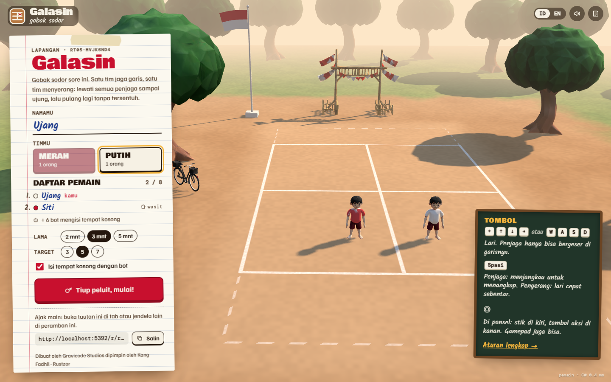
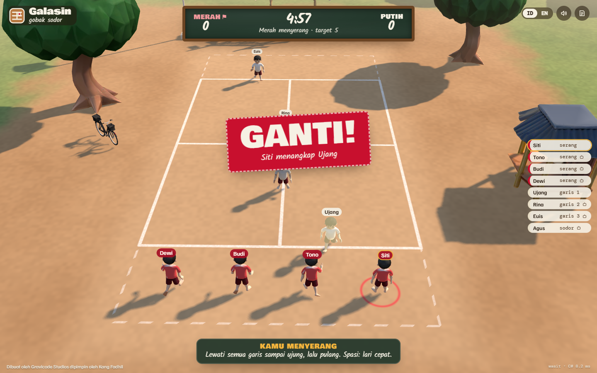
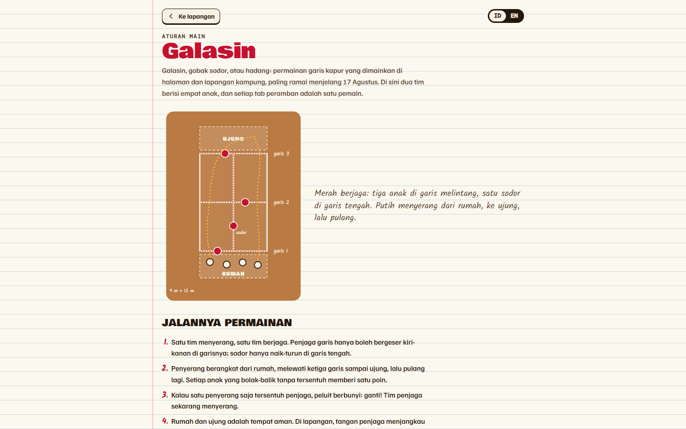
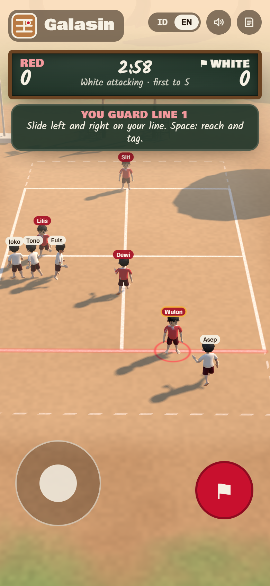
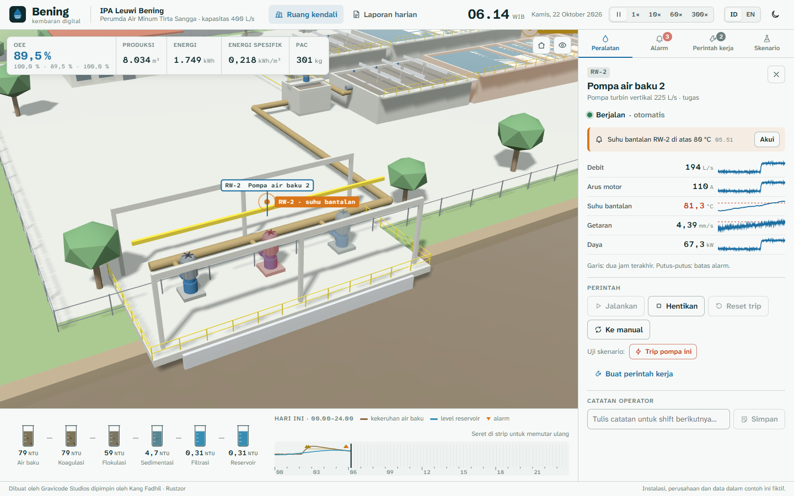
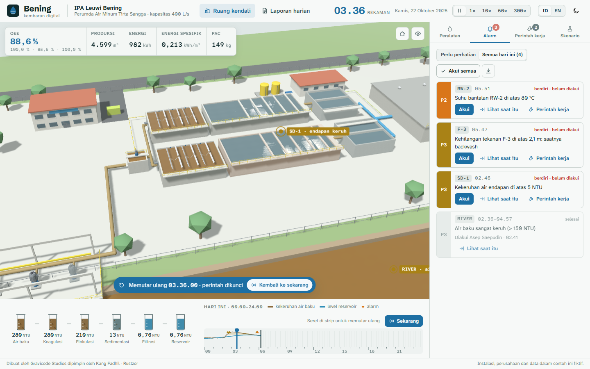
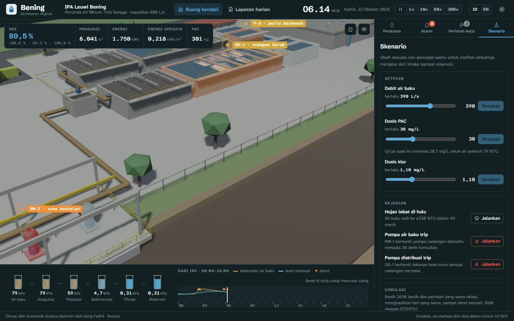
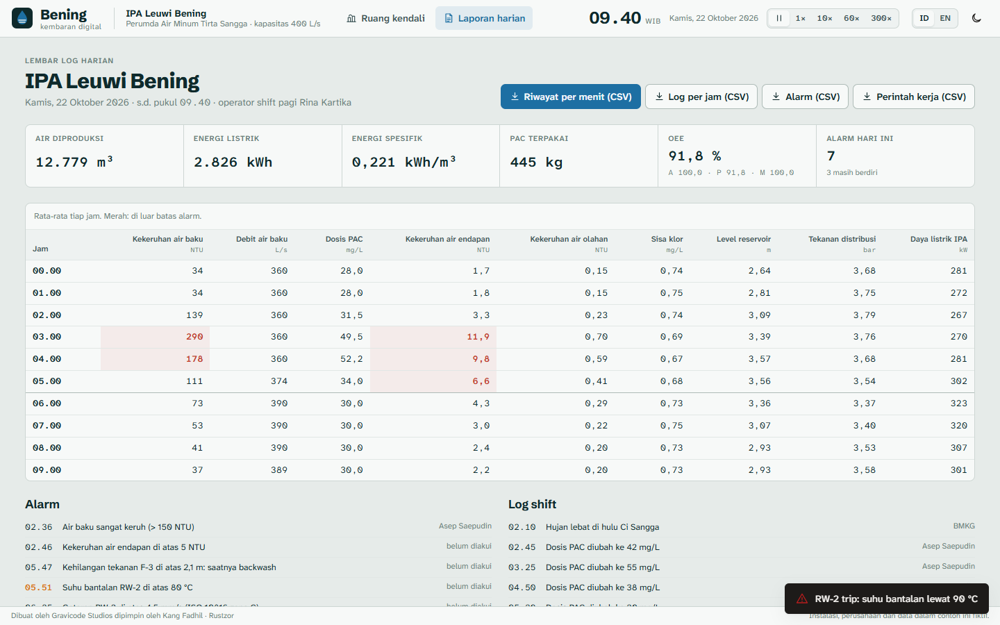
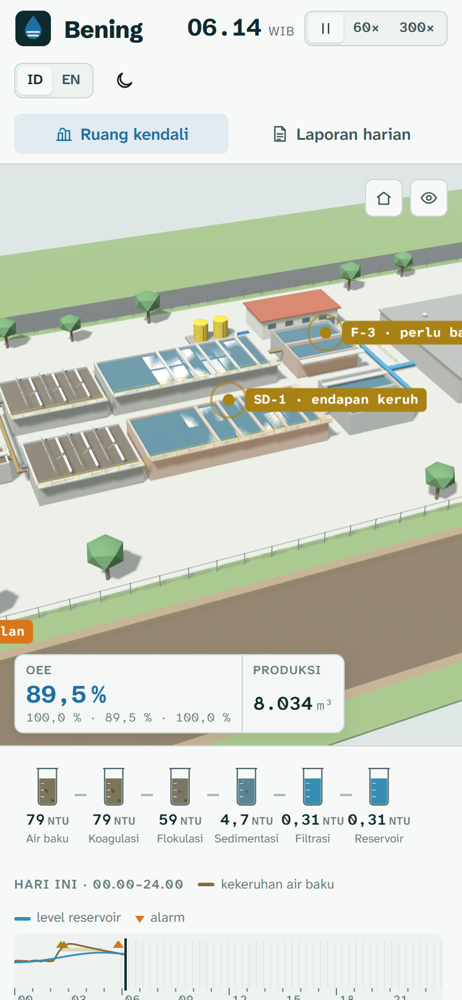

# Samples

Complete apps in `samples/`, each with its own visual identity. They are the best way to see how the pieces fit together, and each was driven end to end in Chrome while it was built.

To run one from a checkout (after [building from source](building-from-source.md)):

```bash
dotnet build samples/Crm/Crm.csproj
node tools/dev/serve.mjs samples/Crm/bin/Debug/net10.0/wwwroot 5240
# open http://localhost:5240
```

Every sample keeps its data in the browser, so a reload keeps your changes; each has a reset action to start over.

## Nusantara CRM

`samples/Crm` · `Rustzor.UI`, `Rustzor.Data` (SQLite)

A B2B CRM for a coffee-equipment supplier. An overview with pipeline funnel, weighted forecast and the activities that need attention today; a deal board with drag and drop between stages; companies with detail pages (deals, people, activity timeline); contacts; activities grouped by due date; and reports computed in SQL, with an "ask the database" box that runs your own `select`.

| | |
| --- | --- |
|  |  |
|  |  |

Shows: `AppShell`, `DataGrid`, charts, drag and drop events, route parameters (`/companies/{Id:long}`), SQLite with persistence, `decimal` money.

## Kedai Senja POS

`samples/Pos` · `Rustzor.UI`, `Rustzor.Data` (IndexedDB), `Rustzor.Browser.DOM`

A café till built for a counter tablet. A product grid by category; drink options (size, hot or iced, sugar, extras); the open order drawn as a strip of thermal paper; promo codes, PB1 10% restaurant tax and rounding to Rp 100; payment by cash with tender buttons and change, QRIS or card; a printable 58 mm receipt; order history with void and reprint; a shift report with sales by hour and method, best sellers and the cash-drawer count; and a menu editor with a sold-out switch. F2 searches, F9 charges.

| | |
| --- | --- |
|  |  |
|  |  |

Shows: a custom layout without a sidebar, keyboard shortcuts (`Window.OnKeyDown`), modals, print CSS, IndexedDB stores, a phone layout with a bottom order bar.

## Jati Lestari ERP

`samples/Erp` · `Rustzor.UI`, `Rustzor.Data` (IndexedDB)

The back office of a teak furniture workshop in Tahunan, Jepara. Purchasing (a purchase order, a goods receipt that raises stock and the bill, payment on the supplier's terms); sales (an order, a delivery note, an invoice with PPN 11%, payment; overdue invoices flagged); production (bills of materials with the craftsmen's wages, work orders that take timber, fabric and fittings out of the raw-material store and put finished pieces in at what they cost); inventory in three warehouses at moving-average cost, with a stock card per item and transfers to the Semarang showroom; and double-entry accounting that every one of those actions posts to: the journal, a trial balance, profit and loss by period, and a balance sheet. The inventory page checks each stock group against its ledger account. Eleven weeks of history are generated by playing the same actions, so every figure comes from a document.

| | |
| --- | --- |
|  |  |
|  |  |

Shows: a domain model whose every change posts a balanced journal entry, `decimal` money, reports computed from the journal, route parameters (`/sales/{Id}`), query strings, modals with editable order lines, IndexedDB stores, a phone layout.

## Arus grid dashboard

`samples/Dashboard` · `Rustzor.UI`, `Rustzor.Charts.ECharts`

A control-room view of a simulated Java–Bali power system that ticks every two seconds: demand, frequency, spinning reserve, renewables share and carbon intensity; 24-hour generation stacked by source; a one-line diagram of the 500 kV backbone where dashes run with the flow and colour shows loading; plants, demand forecasts and a week-by-hour heatmap; an alarm log; and a drill that trips a plant so you can watch the frequency dip and recover. Plant names are real places; every number is simulated.

| | |
| --- | --- |
|  |  |
|  |  |

Shows: live updates with `Scheduler.SetInterval`, ECharts options built from C# objects, an SVG diagram generated in Razor with CSS animation.

## Serambi chat

`samples/Chat` · `Rustzor.UI`, `Rustzor.Data`, `Rustzor.Browser.WebSocket` (`BroadcastChannel`), `Rustzor.Browser.Storage`, `Rustzor.Browser.FileSystem`

A team chat for a small studio. Each browser tab signs in as a person; open a second tab as someone else and the two talk live, with no server: messages are kept in IndexedDB and announced to other tabs over `BroadcastChannel`. Channels and direct messages with unread counts, threads, reactions, pins, editing, image attachments, search, typing indicators, Markdown-lite with escaped HTML, @mentions, and three simulated teammates who answer when you mention them.

| | |
| --- | --- |
|  |  |
|  |  |

Shows: real-time between tabs, `MarkupString` with escaping, per-tab identity in `sessionStorage`, components that subscribe to a store.

## Ruang Redaksi video calls

`samples/Meet` · `Rustzor.Browser.WebRTC`, `Rustzor.Browser.Media`, `Rustzor.Browser.WebSocket` (`BroadcastChannel`), `Rustzor.UI`

The call rooms of Kabar Pesisir, a cooperative of five coastal newsrooms (Makassar, Ambon, Bitung, Kendari, Ternate): the 07.00 editorial meeting, a bureau desk and a flood desk. Real video calls between tabs of one browser, with no server: each tab in a room announces itself on a `BroadcastChannel`, the two tabs of each pair swap an offer, an answer and ICE candidates there, and from then on picture, sound and a data channel go peer to peer. Open a room in two tabs, join as two reporters, and they see and hear each other.

- A pre-join check: the camera on a preview monitor with title-safe guides, the microphone on a PPM, camera and microphone pickers, your name strap and bureau, and who is already in the room.
- The call: a grid that sizes every tile to the stage; a lower-third strap on each tile; the red tally lamp on whoever is talking (from audio levels); mute, camera and screen share (the shared screen takes the spotlight); chat, raised hands in order and reactions over the data channel; the meeting's rundown, which anyone can move on for everyone; a timecode; leave, or end for everyone.
- Recording: the call is mixed in the tab into one 1280×720 video (everyone's picture in a grid with their name, and all the voices), announced to the others while it runs, and saved under Recordings for download.
- Without a camera you join with the microphone alone and the others see your initials on a slate; without either you can still watch, listen and chat.

| | |
| --- | --- |
|  |  |
|  |  |

Shows: `PeerConnection` with signalling over `BroadcastChannel`, a perfect pairing rule (the smaller id calls) so nobody offers twice, `ReplaceTrackAsync` for screen sharing without renegotiating, `MediaMixer` and `MediaRecorder`, audio levels for an active speaker, container query units for the grid.

`node tools/e2e/meet.mjs http://localhost:5260` drives it in headless Chrome with fake devices: two tabs see each other's video, chat, mute, hands, reactions, the rundown, the tally, recording (the saved video is checked frame by frame), screen sharing, a third tab without a camera, leaving, ending for everyone, and a 400 px phone.

## Rupa design tool

`samples/Rupa` · `Rustzor.UI`, `Rustzor.Browser.FileSystem`, `Rustzor.Browser.Storage`, `Rustzor.Browser.DOM`, and a browser module of its own (`rustzor.module.js`)

A vector design tool in the manner of Figma, dressed as a prepress proof: graphite chrome, a tracing-paper canvas, process-magenta selection and guides, cyan for components, registration marks on the rulers. It opens on Lintas, three screens of an invented commuter-rail app for Jabodetabek (home, timetable, ticket) with its components and colour styles.

- An infinite canvas: pan with Space-drag, the middle button, the trackpad or the hand tool; zoom with Ctrl+wheel or a pinch, towards the pointer; Shift+1 fits everything, Shift+2 the selection. Rulers in canvas units mark the selection.
- Frames, rectangles, ellipses, lines, a pen for straight-segment paths, text typed on the canvas, and images from a file, a drop or the clipboard.
- Select, Shift+click, marquee, Ctrl+click into groups, double-click into frames and groups; move with snapping to neighbours' edges and centres and to the frame, with guide lines and spacing readouts; resize from eight handles (Shift keeps the shape, Alt resizes from the centre); turn from just outside a corner (Shift in 15° steps). Group, ungroup, z-order, duplicate, copy, paste, delete, nudge; undo and redo of every change.
- Layers with nesting, rename, hide and lock; properties for position, size, rotation, opacity, radius, fill, stroke and type; auto layout for frames (row or column, gap, padding, alignment, hug).
- Components: a frame becomes one with Ctrl+Alt+K; its instances follow every change and keep their own text, edited in the panel; instances detach into plain frames. Colour styles are shared by every layer that uses them.
- Export the selection or every frame to SVG and PNG (1× or 2×, with the typefaces inlined). Files live in the browser (origin-private file system) with autosave; save a copy as `.rupa.json` and open it again.

| | |
| --- | --- |
|  |  |
|  |  |

Shows: SVG drawn from Razor with one view per layer that renders only when its layer changes (moving one shape among three hundred redraws that shape), a drag shown by the browser while C# keeps the model and redraws on release, snapping by binary search over sorted edges, a whole-document undo history, an app embedding its own browser module.

`node tools/e2e/rupa.mjs http://localhost:5310` drives it in headless Chrome with the mouse and keyboard and checks the model after each step (drawing, snapping, resizing, grouping, undo and redo, a component change reaching six instances, overrides, text, the pen, SVG and PNG export, autosave across a reload) and times drags with 300 shapes on the page: about 12 ms of work per move and 56 frames a second (the frame rate headless Chrome runs at). `node tools/e2e/rupa-shots.mjs` takes the screenshots above.

## Kamar Gelap photo editor

`samples/KamarGelap` · `Rustzor.UI`, `Rustzor.Browser.FileSystem`, and a browser module of its own (`rustzor.module.js`) that does the pixel work in WebGL2

A layered photo editor in the manner of Photoshop, kept like a darkroom: warm black chrome, safelight red for whatever is active, developer amber for numbers, and the picture held in a strip of film whose edge prints the frame number, size, layer count and zoom. It opens on *Merapi dari Kaliurang*, a 2000 × 1500 dawn over Merapi and the rice terraces, painted by the app itself (nothing downloaded, nothing licensed), with the edits a photographer would stack on it: a warmer sky, a masked Levels lift for the terraces, a multiply vignette and a caption.

- Layers with opacity, eight blend modes (normal, multiply, screen, overlay, darken, lighten, soft light, difference), visibility, lock, rename, drag to reorder, and layer masks (reveal all, from the selection, enable, apply, delete; Q switches between painting the mask and the pixels). Real thumbnails for layers and masks.
- Adjustment layers that never touch the pixels below: brightness and contrast, levels, hue and saturation, black and white with a tint. Each has its own mask.
- Filters on a pixel layer, inside the selection, with a live preview: Gaussian blur, sharpen (unsharp mask), add noise.
- Tools: move, rectangular and elliptical marquee, lasso (marching ants), crop (Shift keeps the proportions), brush and eraser with size, hardness, opacity, flow and pen pressure, clone stamp (Alt-click the source), gradient (linear, radial, to transparent), paint bucket with tolerance, eyedropper, type layers, hand. Photoshop's shortcuts: V M L C B E S G I T H, X, D, [ and ], 1–0, Ctrl+J, Ctrl+D, Alt+Backspace.
- Fill and clear the selection, select all, inverse, crop to the selection; a history of the last 40 steps that you can click back through; zoom to the pointer, pan, fit, actual pixels; a live histogram; a colour picker with swatches.
- Open a photo (or drop one to place it as a layer), export PNG, JPEG or WebP with a quality setting, save and open a `.kamar` project with every layer and mask, and an autosave in IndexedDB that the start page offers to continue.

| | |
| --- | --- |
|  |  |
|  |  |

Shows: C# owning the document (layers, adjustments, selection, history order) and sending it to a browser module as JSON, while the pixels stay in the browser: one 2D canvas per layer and mask, a WebGL2 compositor that blends the stack with each layer's mode, opacity and mask and runs adjustment layers as shaders, filters as shader passes, and copy-on-write snapshots for the history. The layers under the active one are cached, so a brush frame recomposites only from there up, and only where it painted. Per-pixel work in interpreted C# would cost about 1.4 µs a pixel, roughly four seconds for one pass over this picture; on the GPU a whole frame takes about 2 ms.

`node tools/e2e/kamargelap.mjs http://localhost:5320` drives it in headless Chrome and reads the pixels back after each step: a brush stroke, a multiply layer filled inside a selection (the composite equals the base times the fill colour inside it and is unchanged outside), a black & white layer switched on and off (every value comes back), a Gaussian blur (the variance of the terraces halves), undo and redo, a crop to 1000 × 700, a PNG export decoded at that size, and the autosave after a reload. On the 2000 × 1500 sample with five layers, with the GPU waited on, a brush frame takes about 2 ms (p95 2.5 ms), a 20 px Gaussian blur about 50 ms, sharpen about 35 ms and noise about 25 ms (Intel UHD 620). `node tools/e2e/kamargelap-shots.mjs` takes the screenshots above.

## Siaga Citarum flood map

`samples/Siaga` · `Rustzor.UI`, `Rustzor.Data` (IndexedDB), `Rustzor.Browser.FileSystem`, `Rustzor.Browser.Location`, and a browser module of its own (`rustzor.module.js`): the map engine

The flood desk of a BPBD (the regional disaster agency) during a Citarum flood in the Bandung basin, drawn like a topographic map sheet: a title block with the sheet, the situation time and the datum; contours in sienna, water in blue with its names in italic serif, kecamatan boundaries in dash-dot purple; a collar of graticule ticks in degrees and minutes that follows the view; the area outside the sheet shaded behind a neatline. The only loud colours are the four Indonesian alert levels (Normal, Waspada, Siaga, Awas), on the river-gauge board across the top of the map. The places are real; every shape, reading and report is generated.

- Its own map engine, offline: Web Mercator, pan with inertia, zoom to the pointer with the wheel or a pinch, labels that make room for each other, a scale bar, the scale as a ratio and the pointer's coordinates in degrees, minutes and seconds. An OpenStreetMap background can be switched on when online, with its attribution; offline it says so and turns itself off.
- Eleven layers in about 1 MB of GeoJSON (46,000 vertices): contours every 25 m, kecamatan, rivers, the Saguling reservoir, flood extents, roads, citizen reports, pumps and retention ponds, health facilities, posko (shelters) and river gauges.
- A layer panel with visibility, order, opacity and style: one colour, by category, graduated classes of any number field (quantile or equal interval, four colour ramps), or a heat map, each with its legend.
- Identify (Shift adds to the selection); an attribute table that filters, sorts and stays in step with the map; search by name or by coordinates.
- Draw points, lines and areas, edit their vertices (drag, add at a midpoint, Alt-click to remove), name and annotate them; they stay in this browser.
- Measure distance (Haversine) and area (geodesic, on the sphere); select everything inside a drawn area; buffer any feature (a river, a gauge, a road, your own drawing) and list what lies within the distance, nearest first.
- Import GeoJSON or a CSV with lat and lon columns (pick, drop or paste), export your layers as GeoJSON; "my location" through the Geolocation API, explaining itself when permission is denied.
- `/laporan`, a printable situation report from the same layers: gauges against their marks, flooded areas measured geodesically, households affected by kecamatan, posko occupancy and the night's reports by the hour.

| | |
| --- | --- |
|  |  |
|  |  |

Shows: C# owning the layers, styles, attributes, the user's features and every measurement and query, while a browser module draws: the GeoJSON is projected once into metres and kept as `Path2D` objects, so a frame is one transform and a few fills and strokes, and panning never crosses into C#. Hit testing, the sketch rubber band and vertex handles answer within the frame in the module; clicks, finished sketches and edits come back to C#.

`node tools/e2e/siaga.mjs http://localhost:5330` drives it in headless Chrome and checks the answers against numbers it works out from the same GeoJSON files: the projection against the EPSG:3857 formula and its round trip, panning and zooming, identify at a gauge's coordinates, the table and the map selecting each other, a drawn square's geodesic area and Haversine perimeter (within 1%), a 3 km buffer and a select-by-area against its own distance and point-in-polygon tests, pasted GeoJSON exported back unchanged, a vertex edit, drawings and imports surviving a reload, reset, and location without permission. Panning and zooming over all 46,000 vertices draws a frame in about 4 ms (p95 7 ms). `node tools/e2e/siaga-shots.mjs` takes the screenshots above; `node samples/Siaga/data/make-data.mjs` regenerates the data.

## Tilik design review

`samples/Tilik` · `Rustzor.UI`, `Rustzor.Browser.Storage`, and a browser module of its own (`rustzor.module.js`): the viewer engine

A product engineer at a Surabaya maker of farm machinery reviews revision C of the RW-63, a two-stage gear reducer, before it is released to the shop. The look is the machine shop's: brushed-steel neutrals with a violet cast, machinist's layout-dye violet for structure, caution yellow only for what is selected or pinned. The signature is drafting convention: a section fills every cut part with crosshatch (neighbouring parts hatched the other way, steel finer than cast iron), and a measurement is drawn as a dimension line with arrowheads and its value in a feature-control frame.

- The model is a real assembly: 36 parts in five groups (housing base and cover with eight bolts; input, intermediate and output shaft assemblies with their gears, bearings, caps, seals and keys; breather, drain plug and sight glass), 45,000 triangles in a 1.15 MB glTF binary. It was modelled in Blender by a script, `samples/Tilik/assets-src/make_rw63.py`: involute spur gears (z14/z34 at module 2.5, z15/z38 at module 3, so 6.15 : 1), a split housing built with exact booleans and bevelled like a casting, and each part's number, material, density and make/buy written into the glTF extras. Run the script in Blender to rebuild the file; it works in its own scene and leaves the open file as it was.
- Its own engine, in WebGL2: the GLB (and STL) parsed in the browser, each part in its own buffers; orbit with inertia, pan, zoom to the pointer, pinch; fit, standard views and a view cube that turns with the camera; perspective or orthographic.
- Shaded, shaded with edges (feature edges found where faces meet at more than 35°), wireframe and x-ray.
- The assembly tree: hide, isolate, select; a click in the view selects the part under the pointer and opens its branch. The details panel gives material, density, volume (from the closed mesh), mass, envelope and triangle count.
- A section on X, Y or Z, moved with a slider or by dragging in the view, with every cut capped and hatched: a stencil pass per part counts where the plane is inside the solid.
- Measure point to point, an edge's whole length (collinear segments joined) and an angle through three points; points snap to the nearest corner of the part under the pointer, the one nearest the surface you clicked.
- Notes pinned to the model, numbered, resolvable, kept in the browser; pins behind the model fade. Saved views keep the camera, display mode, section, explode and what is hidden.
- An exploded view on a slider; a PNG of the view with its dimensions and pins; open any `.glb` or `.stl` by button or by dropping it on the view.
- `/bom`, the bill of materials rolled up by part number (eight bolts, four 6204 bearings), with masses from volume and density, and a CSV download.

| | |
| --- | --- |
|  |  |
|  |  |

Shows: C# owning the review (the tree, what is shown, selection, measurements, notes, saved views, the bill of materials) while a browser module owns everything a frame needs: parsing, drawing, the section caps, ray-cast picking and snapping, and the dimensions on a 2D overlay. Orbiting never crosses into C#; picks, measurements and note places come back to it.

`node tools/e2e/tilik.mjs http://localhost:5340` drives it in headless Chrome and checks it against the GLB itself: the part count, a click on the breather selecting it in the view and the tree, hiding the cover (out of the draw list and the pixels) and isolating the output assembly (its 8 parts), a Y section that leaves nothing above the plane and moves when dragged, a snapped distance between two bolt heads (140.00 mm, as in the file), an edge (36.00 mm) and an angle (90.0°) on the input key, the explode slider, a note and a saved view surviving a reload, the BOM CSV (23 lines, 36 parts), an STL cube's 8 cm³, a PNG screenshot, and frame times. The model opens in about 0.45 s; orbiting it draws a frame in 0.6 ms (p95 0.9 ms) and keeps the display's 60 fps. `node tools/e2e/tilik-shots.mjs` takes the screenshots above.

## Loket front desk

`samples/Loket` · `Rustzor.AI`, `Rustzor.UI`, `Rustzor.Browser.Storage`, `Rustzor.Browser.FileSystem`, `Rustzor.Browser.Audio`, `Rustzor.Browser.DOM`, and a small browser module (`rustzor.module.js`)

The front desk of Kelurahan Kemuning Raya, a neighbourhood office in the (invented) Kota Sentosa. Residents ask, in Indonesian or English, what to bring for an identity card, a family card, a birth certificate or a letter of domicile, and the assistant answers from the office's own procedures, citing a source for each claim. The look is the service counter's: a queue board with the ticket number in marigold, every conversation a numbered queue ticket, citations as small red rubber stamps, tool calls as the slips the desk fills in. Indonesian is the default; the interface switches to English in one tap, and replies follow the language of the question.

- **Streaming chat with Stop.** Text renders as it arrives; Stop aborts the HTTP request in the browser and keeps what was written.
- **Safe Markdown.** Headings, lists, tables, quotes, links (http, https and mailto only), and code blocks with a Copy button. Every character is escaped first, so a `<script>` or `` in a question or a reply is shown as text.
- **Conversations** listed as queue tickets: search, rename, delete, all kept in this browser; export to Markdown or JSON.
- **Providers:** a built-in offline demo model (no key, no network, the same tools), Azure OpenAI, OpenAI, Anthropic Claude, and any OpenAI-compatible endpoint (Ollama, LM Studio, vLLM, DeepSeek, Groq), with a connection test. The key stays in this browser's storage and goes only to the chosen provider. A persona (system prompt) editor with three presets.
- **Four tools**, shown as cards with their input and result: an exact calculator (it reads `2.400.000` and `15% dari` the way Indonesians write them), the office clock (WIB, and whether the office is open now), document search, and a note for the staff that lands on `/catatan`.
- **The documents** (`/dokumen`): five seeded procedures, plus any `.md`, `.txt` or `.pdf` dropped or picked (PDF text through pdf.js). Each is cut into passages by section and searched with BM25 in the browser, with a light Indonesian stemmer; no embedding model or server is needed. A citation opens the passage it came from, and the archive opens on it, highlighted.
- **Pictures** for models that can see them (shrunk to 1280 px before sending); **voice input** through the Web Speech API where the browser has it, and **spoken replies** through speech synthesis. Where either is missing, the button is hidden or the desk stays silent.
- **Usage:** tokens in and out per answer and per conversation (the provider's own counts when it sends them), and a cost from editable per-million prices.

| | |
| --- | --- |
|  |  |
|  |  |

Shows: `Rustzor.AI` tool calling (`ChatTool`, `ToolAgent`, `IToolChatModel`) and streaming with cancellation, the same code path for a local model and three remote APIs, and retrieval-augmented answers with citations done entirely in the browser.

`node tools/e2e/loket.mjs http://localhost:5360` drives it in headless Chrome against the demo model: a reply streaming in piece by piece, Stop ending one early with nothing arriving after, Markdown tables, lists and a code block with Copy, a calculator call whose card reads `15% * 2.400.000 = 360000`, a note on the staff list, a `<script>` and an `` shown as text and never run, a dropped Markdown file found by a question and cited (the citation opens its passage), token counts, conversations surviving a reload, and a deletion that stays deleted. It also runs the OpenAI-compatible provider over real HTTP against a local mock server that streams a tool call in pieces. With `LOKET_AZURE_ENDPOINT`, `LOKET_AZURE_KEY` and `LOKET_AZURE_MODEL` set it adds a live run: a real calculator call, a streamed answer, a cited document search, and the provider's token counts. `node tools/e2e/loket-shots.mjs` takes the screenshots above.

## Galasin, gobak sodor

`samples/Galasin` · `Rustzor.Game` (`NetSession`), `Rustzor.Browser.WebSocket` (`BroadcastChannel`), `Rustzor.Browser.Storage`, `Rustzor.UI`, and a 3D engine of its own (`rustzor.module.js`)

Gobak sodor (also galasin or hadang), the chalk-line game of kampung yards, for up to eight players, one per browser tab, in 3D. One team keeps the lines: three guards slide along the cross lines and the sodor runs the centre line. The other team attacks from home, slips past every guard to the far side, and comes back. A guard's touch on the court swaps the teams; each round trip home scores a point. The yard is drawn at five in the afternoon: packed earth and lime chalk, a pos ronda, a mango tree, an onthel bicycle, a bamboo gapura and a flag that waves. The score is kept on a school chalkboard in turus (four strokes and a fifth across), the sign-up sheet is a page of an exercise book, and a tag gets a red stamp: GANTI! Indonesian first, English in one tap.

- **Multiplayer with no server.** Open the court's link in more tabs or windows and each one joins the sign-up sheet. One tab referees: it runs the rules and the bots at 20 Hz and broadcasts a snapshot over a `BroadcastChannel`. The others send their own player's position and draw everyone else between snapshots. The referee is the on-screen player tab with the smallest id; if it closes or goes off screen, the next tab carries on from the last snapshot, and a bot plays for anyone who leaves (and hands the kid back if they return). A tab that opens mid-match watches.
- **Controls that never wait for the network.** Each tab moves its own player itself, held to its role: a line guard cannot leave the line, the sodor stays on the centre line, attackers stay inside the sidelines. Arrow keys or WASD, Space to reach out (guards) or sprint (attackers), a touch stick and an action button on phones, and gamepads.
- **The rules in C#:** reach (0.7 m, 1.15 m while lunging), the safe home and far boxes, round trips, the swap, the clock and the target score, and the bots. Bot attackers wait for a guard to be drawn to one side and slip through on the other; bot guards shadow the nearest attacker a beat late.
- **The 3D models** were generated with Rodin (Hyper3D) from text and finished in Blender through its MCP server by `samples/Galasin/assets-src/make_galasin.py`: decimated to about 4,000 faces each, rigged with heat-map weights (19 bones), animated (Idle, Run, Tag, Cheer, Sad), given a vertex mask so one model wears either team's shirt, and exported as two GLB files of 1.1 MB together. The flag waves on four bones of its own.
- **The engine** (WebGL2): glTF loading, GPU skinning with cross-faded clips, a 2048² shadow map from the low sun, a procedural dirt-and-chalk court, sky, fog, name tags, and the referee's whistle and the kentongan synthesised with Web Audio.

| | |
| --- | --- |
|  |  |
|  |  |



Shows: `Rustzor.Game`'s `NetSession` between tabs with host election and hand-over; C# keeping the state and the rules at 20 Hz while JavaScript draws at 60 fps; snapshots as compact strings of whole numbers (formatting JSON numbers is the expensive part in the interpreter); and `BroadcastChannel.PostRaw`, which sends JSON as an object, so it is neither escaped on the way out nor parsed twice on the way in.

`node tools/e2e/galasin.mjs http://localhost:5392` plays it in headless Chrome with two tabs: both sign up, a match without bots starts in both, the arrow keys move a player and the other tab draws the move where it ended, a guard cannot leave the line, a guard within reach of an attacker behind the home line does not tag, a touch on the court swaps the teams in both tabs, half a trip scores nothing and a round trip scores one (shown in turus), coming home twice does not score twice, the first to the target wins, and the winner cheers while the loser hangs their head. A second match with bots checks that both tabs hold every bot in the same place, that snapshots arrive 20 times a second, frame and referee tick times, that a third tab watches, that the match goes on when the referee's tab closes (with a bot for the player who left), the language toggle, the rules page and the phone layout. `node tools/e2e/galasin-shots.mjs` takes the screenshots above.

## Bening water plant twin

`samples/Bening` · `Rustzor.UI`, `Rustzor.Browser.Storage`, and a simulator and 3D engine of its own (`rustzor.module.js`)

A digital twin of IPA Leuwi Bening, a 400 L/s conventional water treatment plant on the Ci Sangga river. The plant is fictional, and so is its utility, Perumda Air Minum Tirta Sangga. The river comes in through three raw water pumps and is dosed with PAC in a flash mixer. It is then flocculated, settled, filtered through four rapid sand filters, chlorinated, stored in a 4,000 m³ reservoir and pumped to the city. The morning shift opens at 06.00, after a night of heavy rain upstream. The night operator's dose changes are in the log, RW-2's bearing has been running hot for days, and filter F-3 is due a backwash. Indonesian first, English in one tap.

- **The jar row.** The jar test every plant runs, laid out as the plant: one beaker per stage, filled with the water as it leaves that stage, from the river's brown to the reservoir's clear blue. The 3D water surfaces are tinted the same way, so a stage that stops working shows in both places.
- **A seeded, deterministic simulation** of the whole plant, in JavaScript, taking a sample every 10 simulated seconds. It models:
  - river turbidity and rain events
  - pumps on duty and standby, with bearing wear and protection trips
  - PAC demand from the turbidity: dose too little and the floc does not form
  - settling, and filter head loss with automatic backwash
  - chlorine demand and residual
  - the reservoir, between production and the city's daily demand curve
  - distribution pressure

  The same seed and the same commands give the same day, sample for sample. So every viewer starts from the same night, and a reload rebuilds the run exactly.
- **Alarms as ISA-18.2 describes them.** C# defines the 27 rules: limit, deadband, delay, priority and the equipment each belongs to. The engine judges every sample against them. Standing and unacknowledged alarms come first, by priority. Beacons pulse over the equipment in 3D until someone acknowledges them. The night shift's alarms that came and went are already acknowledged.
- **What-if, within the plant's rules.** You can start, stop, trip and reset pumps, backwash a filter or take it out of service, move the flow, PAC and chlorine setpoints, or bring rain down the river. Then speed the clock up (1× to 300×) and watch the change travel from the intake to the reservoir. C# refuses what an operator may not do:
  - reset a trip before its alarm is acknowledged
  - stop the last running pump
  - backwash two filters at once, or leave fewer than three in service
  - sign off a repair on a running pump
  - command anything while replaying
- **Replay.** The day is on a strip showing raw turbidity, reservoir level and a mark for each alarm. Drag it to go back, and the 3D view, the jars, the readings and the alarm beacons all show that moment. "See it happen" on an alarm replays from a minute before it.
- **Work orders, notes and views.** Raise a work order from an alarm or from any equipment, assign it, start it and close it; closing a repair puts the pump back as new. Notes on equipment, saved camera views, acknowledgements and the run itself are kept in the browser across reloads.
- **The daily log sheet** (`/laporan`) shows:
  - today's production, energy, specific energy, PAC used, and OEE (availability × performance × quality)
  - hourly means, with out-of-limit cells marked
  - the alarm record and the shift log

  It exports four CSV files: the history by minute, the hourly log, the alarm log and the work orders.
- **The 3D model** is procedural. `samples/Bening/assets-src/make_ipa.py` builds it in Blender through Blender's MCP server: basins, pumps, motors, pipes, the chemical house, and the reservoir with its level gauge. That is 8,200 faces merged into 137 meshes (812 KB). Custom properties tell the engine which nodes are equipment, which parts turn (motor fans, couplings, the mixer, the flocculator paddles), which surfaces are water and which bar is the gauge. The engine draws the model in WebGL2 with a shadow map, picks with a GPU id buffer, and tints equipment by its state.

| | |
| --- | --- |
|  |  |
|  |  |



Shows:
- a simulation that runs every sample in JavaScript, while C# owns the model, the rules and the record
- values crossing to C# twice a second as one string of numbers, parsed straight from slices (`double.Parse` over a `ReadOnlySpan<char>`)
- components that re-render only when what they show changes at the precision they show it
- per-viewer state that survives a reload, by replaying a seeded run

`node tools/e2e/bening.mjs http://localhost:5361` drives the sample in headless Chrome and checks that:
- every mesh of the GLB is drawn, and every piece of equipment C# knows about is in it
- the same seed gives the same eight hours twice and another seed does not, and the live run matches one made separately
- the alarms standing that morning are there, with the night shift's acknowledgements
- clicking RW-2 in 3D opens its inspector, with the engine's values and sparklines drawn from the history
- an acknowledgement reaches the engine
- tripping RW-1 stops it, raises a P1 alarm, brings RW-3 on 30 seconds later, and returns the flow to the setpoint
- the reset is refused until the trip is acknowledged
- underdosing PAC clouds the settled water and its jar two hours later
- dragging the timeline to 03.30 shows the rain and locks the controls, and "See it happen" and "Back to now" work
- a work order raised from an alarm is refused while the pump runs and goes through once it is stopped
- a saved view, a note, the acknowledgements and the run itself survive a reload
- the history, hourly and alarm CSVs match the engine
- the language toggle works
- frames stay fast while orbiting with the clock at 60×
- the phone layout has no sideways scroll

`node tools/e2e/bening-shots.mjs` takes the screenshots above.

## API Playground

`samples/ApiPlayground` · `Rustzor.Browser.Fetch`, `Rustzor.Browser.WebSocket`, `Rustzor.Net.SignalR`, `Rustzor.Net.GrpcWeb`

A small ASP.NET Core .NET 10 server (`Server/`) and a Rustzor client (`Client/`) that tries the four ways a browser talks to a backend, with a "wire" log of every request, response and frame.

- **REST**: a request builder with presets for a book catalogue (`/api/books`): list, search, get, create, replace, delete, validation errors, 404, a slow call, any status. Pretty-printed responses with timings and headers, and the equivalent C#.
- **WebSocket**: `/ws` echoes what you send and pushes a server tick every two seconds.
- **SignalR**: `/hubs/chat` with rooms and presence, `InvokeAsync<int>("Add")`, a streamed countdown and a method that always fails.
- **gRPC-Web**: `playground.Inventory`: a unary call, NOT_FOUND, a streamed list and live prices with cancellation, with each frame in hex.

| | |
| --- | --- |
|  |  |
|  |  |

Run it (the server also serves the built client):

```bash
dotnet build samples/ApiPlayground/Client
dotnet run --project samples/ApiPlayground/Server --urls http://localhost:5250
# open http://localhost:5250
```

To serve the client elsewhere, put the server's address in the top bar; the server allows cross-origin calls.

## More apps

[RustzorAppGen](appgen.md) ships 21 templates (games, science, business, industry, education, simulators, tools) that are complete apps too.
