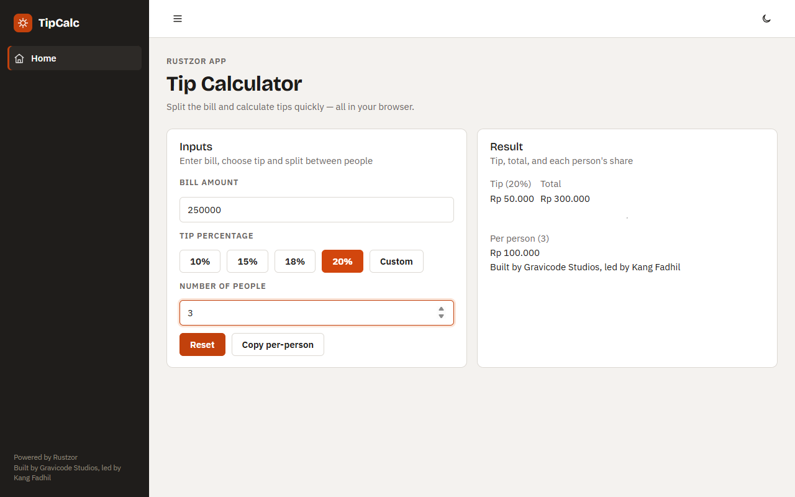

# RustzorAppGen

RustzorAppGen (`tools/RustzorAppGen`) adalah code editor desktop, dibangun dengan Avalonia, untuk membuat aplikasi Rustzor bersama asisten AI: **Jack - The Code Bender**.


## Fitur

- Layout ala VS Code: file explorer, code editor dengan nomor baris dan syntax highlighting, panel log, dan status bar.
- Menu dan toolbar: New Project (kosong atau dari template), Open Project/File, Close Project, Go To Line, Format Code, Build, Run, Deploy, Exit.
- Panel chat dengan Jack: pilih model, lampirkan gambar, `Ctrl+Enter` untuk mengirim, bersihkan thread; ukuran panel bisa diubah dan panel bisa disembunyikan.
- Dialog pengaturan untuk provider AI, model, API key, endpoint, temperature, dan system prompt, yang disimpan di `app.config`.

## Jack

Jack bekerja melalui tool (function Semantic Kernel): membuat project dari template; menampilkan daftar, membaca, menulis, mengedit, menghapus, dan mencari file project; mencari panduan Rustzor dan API library; menambahkan package; mem-build project dan membaca error compiler untuk memperbaiki kode yang ditulisnya; serta menjalankan aplikasi. Jack juga bisa mencari di web, membaca halaman, dan mengerjakan tugas utilitas kecil (tanggal dan zona waktu, konversi satuan, format JSON, palet warna, hashing). Jack memahami aturan Rustzor (apa yang didukung runtime, bagaimana perilaku async handler dan route parameter) dari file pengetahuan bawaan, sehingga kode yang dihasilkannya ditujukan untuk Rustzor, bukan Blazor generik.

Provider: OpenAI, Azure OpenAI, Anthropic Claude, Google Gemini, dan Ollama (lokal).



## Template

New Project menawarkan 21 template, masing-masing berupa aplikasi lengkap yang bisa di-build dan dijalankan:

| Kelompok | Template |
| --- | --- |
| Game | arcade-breakout, space-dodger, physics-sandbox |
| Sains | lorenz-explorer, stats-lab, periodic-table |
| Pekerjaan | kanban-board, invoice-maker, crm-lite |
| Industri | machine-monitor, warehouse-inventory |
| Pendidikan | quiz-master, math-flashcards |
| Simulator | epidemic-sir, solar-system |
| Tool | markdown-notes, unit-converter, pomodoro-timer |
| AI | ai-chat |
| Data | sales-dashboard |
| | blank |

`tools/RustzorAppGen/scripts/test-templates.sh` meng-generate setiap template, mem-build-nya, lalu membukanya di Chrome headless; ke-21 template lolos.

## Menjalankan

```bash
dotnet run --project tools/RustzorAppGen
```

Masukkan API key untuk salah satu provider di Settings (atau `app.config`), pilih template atau project kosong, lalu minta Jack membuat apa yang Anda inginkan.
