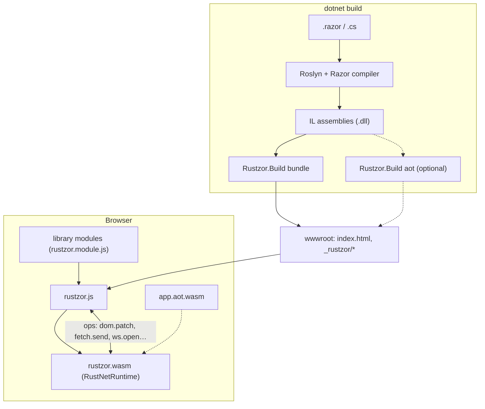

# Arsitektur

Rustzor menggabungkan tiga hal: toolchain .NET yang sudah Anda pakai, runtime .NET yang ditulis dengan Rust, dan bridge tipis ke browser.



## Runtime

[RustNetRuntime](https://github.com/DotNetVibeCoderz/Vibe_Runtime) adalah implementasi ECMA-335 dalam Rust:

- **Metadata reader**: membaca image PE/COFF dan tabel metadata dari assembly yang dihasilkan `dotnet build`.
- **Loader dan type system**: type, generic, interface, virtual dispatch, static, lintas assembly.
- **IL interpreter**: mengeksekusi body method, lengkap dengan exception handling, `async`/`await`, dan delegate.
- **Garbage collector**: heap mark-and-sweep berbasis handle.
- **RustBCL**: base class library sebagai Rust native: string, formatting, collection, LINQ, task, reflection, `decimal`, `DateTime`/`DateTimeOffset`, regular expression, serta penanganan teks yang ramah JSON.

Source yang sama berjalan di desktop (CLI `rustnet`), di mikrokontroler, dan, setelah dikompilasi ke `wasm32-unknown-unknown`, di browser. Rustzor hanya menambahkan lapisan penghubung ke browser: `runtime/rustzor-wasm` mengekspor ABI kecil (`rz_init`, `rz_load`, `rz_run_main`, `rz_invoke`, `rz_alloc`…) dan mengimpor beberapa fungsi host (`host_call`, `host_now`, `host_write`…).

Bug yang ditemukan selama membangun Rustzor diperbaiki langsung di RustNetRuntime, masing-masing disertai conformance check yang menjalankan program yang sama di .NET dan di runtime ini lalu membandingkan output-nya.

## Bridge

C# berkomunikasi dengan browser melalui **ops**: operasi bernama dengan argumen JSON, yang diimplementasikan di JavaScript.

```csharp
var dpr = Js.Call("js.eval", Js.Args("code", "devicePixelRatio")).AsDouble();   // sinkron
Js.Send("doc.title", Js.Args("title", "Orders"));                               // fire and forget
var r = await Js.CallAsync("fetch.send", request);                              // berbasis promise
```

`rustzor.js` mendefinisikan ops inti (DOM patching, navigasi, timer, `js.get`/`js.set`/`js.call` untuk objek apa pun). Setiap library menambahkan ops-nya sendiri di `rustzor.module.js` yang di-embed. Lihat [Interop JavaScript](interop.md).

Panggilan dari JavaScript ke C# (event, timer, penyelesaian promise) semuanya masuk lewat satu method, `Rustzor.Interop.Callbacks.Dispatch`, dengan callback id dan payload JSON.

## Rendering

`Rustzor.Components` mengimplementasikan model component Blazor (`ComponentBase`, `RenderTreeBuilder`, `EventCallback`, `@bind`) di C#. Setiap render menghasilkan render tree; renderer membandingkannya (diff) dengan render tree sebelumnya dan mengirimkan sekumpulan DOM patch ke browser melalui op `dom.patch`. Event DOM kembali dalam bentuk `handlerId|type|json` dan diteruskan ke `EventCallback` yang tepat.

Razor compiler hanya memperlakukan type sebagai component jika type tersebut berasal dari assembly bernama `Microsoft.AspNetCore.Components` (atau assembly yang me-reference-nya), karena itulah nama assembly dari package `Rustzor.Components` dibuat demikian. Tidak ada kode ASP.NET Core yang terlibat.

## Library dan modul

Setiap library adalah assembly .NET biasa. Jika membutuhkan kode browser, library tersebut meng-embed `rustzor.module.js` (dan opsional `rustzor.module.css`) sebagai resource. Saat build, bundler mengekstraknya ke `_rustzor/modules/<Assembly>.js` dan mencantumkannya di `boot.json`; `rustzor.js` mengimpor setiap modul dan memanggil `install(context)` miliknya sebelum menjalankan runtime. Dengan begitu, aplikasi hanya mengunduh JavaScript dari library yang benar-benar di-reference, dan library yang membungkus script pihak ketiga berukuran besar (ECharts, Chart.js, Bootstrap, React untuk MUI) memuatnya dari URL CDN yang versinya dikunci saat pertama kali sebuah component membutuhkannya.

## Startup

1. `rustzor.js` mengambil `boot.json`, lalu runtime, modul library, dan assembly secara paralel. Setiap URL assembly membawa content hash-nya, sehingga build baru tidak pernah mendapatkan file lama dari cache.
2. Loader memasang modul library dan menginstansiasi `rustzor.wasm`.
3. `rz_init` membuat interpreter serta memasang RustBCL dan binding browser.
4. Setiap assembly dimuat sesuai urutan dependensi dengan `rz_load`.
5. Jika build-nya AOT, `app.aot.wasm` diinstansiasi dan dipasang (`rz_aot_install`).
6. `rz_run_main` menjalankan `Program.cs` Anda, yang me-mount root component.

Sample app pada umumnya mulai berjalan dalam 50 hingga 150 ms setelah semua file selesai diunduh.

## Mode build

- **Interpreted** (default): semuanya berjalan di IL interpreter.
- **AOT** (`-p:RustzorAot=true`): `Rustzor.Build aot` mengompilasi method static aplikasi yang memenuhi syarat ke modul WebAssembly kedua; interpreter memanggilnya. Lihat [mode build](aot.md).

## Struktur repository

| Path | Isi |
| --- | --- |
| `runtime/rustzor-wasm` | Lapisan penghubung browser di atas RustNetRuntime (Rust) |
| `js/rustzor.js` | Loader, ops inti, DOM patcher, sistem modul |
| `src/Rustzor.Core` | `Js`, `JsObject`, `Callbacks`, `Scheduler`, JSON |
| `src/Rustzor.Components` | Model component, routing, DI, form |
| `src/Rustzor.Build` | Bundler dan AOT compiler (berjalan saat build) |
| `src/Rustzor.Sdk` | Package MSBuild SDK |
| `src/Rustzor.Cli` | Perintah `rustzor` (sebuah .NET tool) |
| `src/Rustzor.Templates` | Template `dotnet new` |
| `src/Rustzor.UI` | Component kit |
| `src/Browser`, `src/Frameworks`, `src/Integrations`, `src/Net` | Library-library |
| `samples/` | Aplikasi lengkap |
| `tools/RustzorAppGen` | Generator aplikasi berbantuan AI |
| `tools/vscode-rustzor` | Extension VS Code |
| `tools/e2e`, `tools/dev` | Test browser dan development server |
