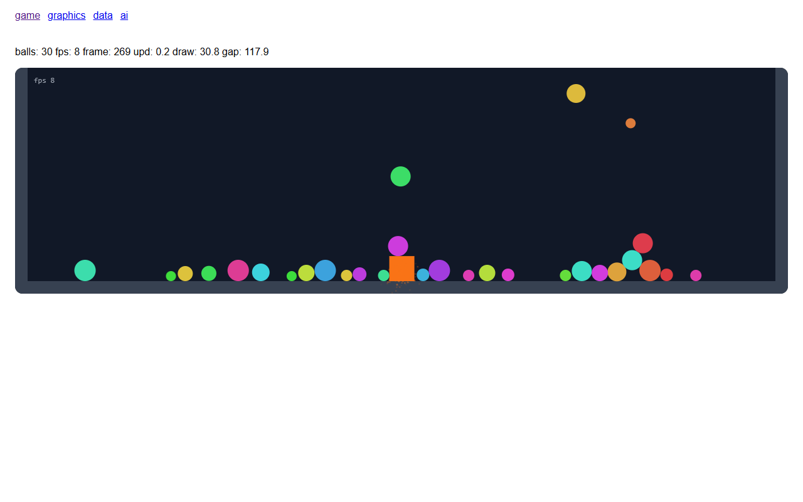
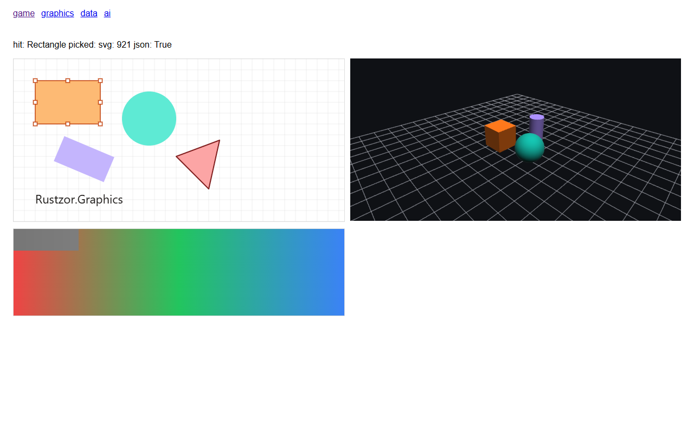
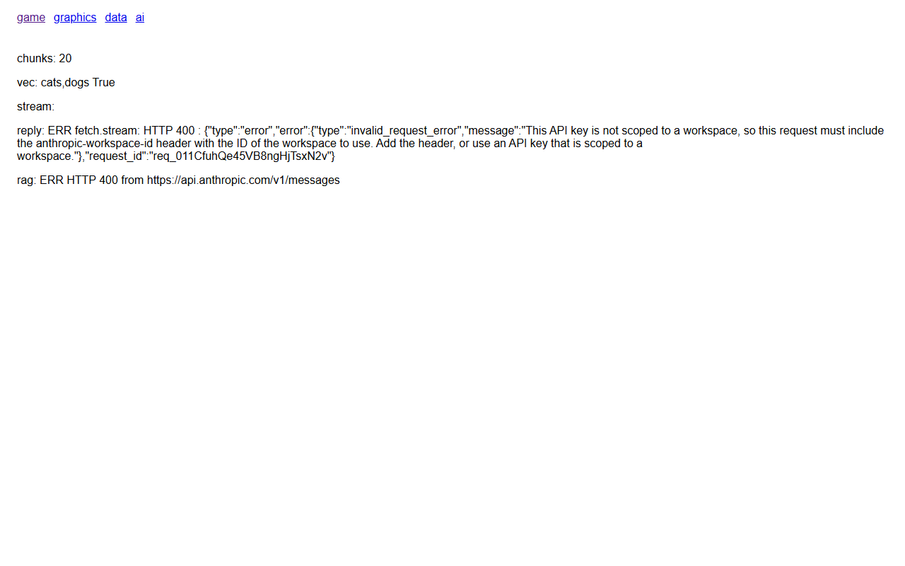

# Frameworks

Ada empat package tingkat tinggi yang dibangun di atas browser API.

## Rustzor.Data

Database di browser, tanpa perlu memasang apa pun di server.

| Type | Fungsi |
| --- | --- |
| `SqliteDb` | SQLite (sql.js) di memori, disimpan ke IndexedDB dengan sebuah key sehingga tetap ada setelah reload. `OpenAsync`, `QueryAsync`, `RunAsync`, `TransactionAsync`, `SaveAsync`, `ExportAsync` |
| `IndexedDb`, `ObjectStore<T>` | IndexedDB dengan store bertipe: `PutAsync`, `PutManyAsync`, `GetAsync`, `AllAsync`, `WhereAsync` (sebuah index), `RangeAsync`, `DeleteAsync`, `ClearAsync`, `CountAsync` |
| `DuckDb` | DuckDB WASM untuk analitik atas CSV dan Parquet: `QueryAsync`, `RegisterUrlAsync`, `RegisterTextAsync`, `InsertAsync` |
| `QueryResult` | `Rows`, `Columns`, `Scalar`, `As<T>()` (memetakan baris ke objek berdasarkan nama kolom), `ToCsv()` |
| `Csv` | `Csv.Parse` |

```csharp
using Rustzor.Data;

var db = await SqliteDb.OpenAsync(persistKey: "my-shop");
await db.RunAsync("create table if not exists items (id integer primary key, name text, price real)");
await db.RunAsync("insert into items (name, price) values (?, ?)", "Kopi Gayo", 85000);
await db.SaveAsync();                                   // ke IndexedDB

var cheap = (await db.QueryAsync("select name, price from items where price < ? order by price", 90000)).As<Item>();
```

```csharp
var idb = await IndexedDb.OpenAsync("kanban", 1, new StoreSchema("cards", "id", Indexes: new IndexSchema("byColumn", "column")));
var cards = idb.Store<Card>("cards");
await cards.PutAsync(new Card { Id = "c1", Column = "todo", Title = "Write docs" });
var todo = await cards.WhereAsync("byColumn", "todo");
```

[Sample CRM](samples.md#nusantara-crm) memakai SQLite; sample [POS](samples.md#kedai-senja-pos) dan [chat](samples.md#serambi-chat) memakai IndexedDB.

## Rustzor.Game

Framework game 2D: loop dengan langkah tetap (fixed-step), input, fisika rigid-body, entity-component system, kamera, partikel, tween, timer, suara, dan networking sederhana.

```razor
<GameView Height="360" OnStart="Start" OnUpdate="Update" OnDraw="Draw" />

@code {
    private Body? player;

    private void Start(GameContext g)
    {
        g.Physics.Gravity = new Vec2(0, 600);
        g.Physics.Add(Body.Box(new Vec2(g.Width / 2, g.Height - 10), g.Width, 20, 0));   // massa 0: lantai statis
        player = g.Physics.Add(Body.Box(new Vec2(g.Width / 2, g.Height - 60), 40, 40));
    }

    private void Update(GameContext g, double dt)
    {
        player!.Velocity = new Vec2(g.Input.Axis().X * 320, player.Velocity.Y);
        if (g.Input.WasPressed("Space") && player.OnGround) player.Velocity = new Vec2(player.Velocity.X, -420);
    }

    private void Draw(GameContext g)
    {
        g.Canvas.Fill("#111827").FillRect(0, 0, g.Width, g.Height);
        g.Canvas.Fill("#f97316").FillRect(player!.Position.X - 20, player.Position.Y - 20, 40, 40);
    }
}
```

`GameContext` menyediakan `Canvas`, `Loop` (`Fps`, `Paused`, `TimeScale`), `Input` (`IsDown`, `WasPressed`, `WasReleased`, `Axis`, `Pointer`), `Physics` (`Body.Circle`, `Body.Box`, collision), `World` (entity), `Camera`, `Particles`, `Tweens`, `Timers`, `Random`, `Width`, `Height`. Keyboard, pointer, sentuhan, dan gamepad semuanya masuk ke `Input`.



### Multipemain

`NetSession` menggabungkan pemain ke dalam satu ruang: `NetSession.Local(room)` antar-tab dalam satu browser lewat `BroadcastChannel`, atau `await NetSession.Connect("wss://…", room)` lewat relay WebSocket. Setiap pesan adalah amplop kecil `{from, type, data}`; peer mengumumkan dirinya dan mengirim heartbeat, sehingga `Peers`, `OnPeerJoined`, dan `OnPeerLeft` mencatat siapa yang ada.

```csharp
var net = NetSession.Local("rt05");
net.On("move", m => Move(m.From, m.Data["x"].AsDouble(), m.Data["y"].AsDouble()));
net.Send("move", new { x = 3.5, y = 1.2 });
net.SendJson("snap", snapshotJson);   // sudah JSON: ditulis sekali, tidak ditelusuri lagi
```

Untuk keadaan yang dikirim berkali-kali per detik, tulis sekali dengan `JsonWriter` dan kirim dengan `SendJson`; antar-tab ia lalu menyeberang sebagai objek (`BroadcastChannel.PostRaw`), tanpa ada yang di-escape atau di-parse dua kali. [Sample Galasin](samples.md#galasin-gobak-sodor) menjalankan pertandingan 3D untuk delapan pemain antar-tab dengan cara ini: satu tab menjadi wasit pada 20 Hz dan menyerahkan tugasnya ketika ditutup.

## Rustzor.Graphics

Scene graph untuk editor dan viewer.

- `Scene2D`: node (`Node.Rect`, `Ellipse`, `Line`, `Path`, `Label`, `Picture`, `Group`), hit testing, seleksi, viewport dengan pan dan zoom, rendering ke `Canvas2D`, ekspor ke SVG serta ke JSON dan sebaliknya.
- `Scene3D`: `Model` yang dibangun dari `Mesh.Cube`, `Box`, `Sphere`, `Cylinder`, `Plane`, atau file `.obj` yang di-parse, sebuah `OrbitCamera`, picking, dan di-render oleh `Renderer3D` di atas WebGL.
- `Color`, `Transform2D`, dan `PixelOps` (grayscale, blur, dan filter per-piksel lainnya).

```csharp
var scene = new Scene2D { GridSize = 20 };
scene.Add(Node.Rect(40, 40, 120, 80, "#fdba74", 10));
scene.Add(Node.Label(40, 160, "Rustzor.Graphics", 22, "#1c1917"));
scene.Render(canvas, selection);
string svg = scene.ToSvg();

var renderer = new Renderer3D(gl);
var world = new Scene3D();
world.Add(new Model(Mesh.Sphere(0.9), "#14b8a6") { Position = new Vec3(1.2, 0.9, 0) });
renderer.Render(world);
```



## Rustzor.AI

Language model langsung dari browser.

| Type | Fungsi |
| --- | --- |
| `IChatModel` | `CompleteAsync(messages, options)` dan `StreamAsync` |
| `OpenAiChat` | OpenAI dan endpoint yang kompatibel; `OpenAiChat.Azure(...)`, `OpenAiChat.Ollama(...)`; `EmbedAsync` |
| `ClaudeChat` | Messages API dari Anthropic |
| `IToolChatModel`, `ChatTool`, `ToolCall`, `ToolAgent` | Tool calling: alat sebagai JSON Schema, panggilan yang di-stream lalu dirangkai, dan perulangan yang menjalankannya; bisa dibatalkan |
| `BuiltInChat` | Model bawaan browser, jika tersedia |
| `Conversation` | Percakapan dengan riwayat dan system prompt; `SendAsync(text, onPiece)` melakukan streaming |
| `RagPipeline` | Jawaban dengan retrieval-augmented generation: `IndexAsync(id, text)`, `AskAsync(question)` beserta sumbernya |
| `VectorStore`, `TextChunker`, `IEmbedder`, `LocalEmbedder`, `RemoteEmbedder` | Komponen-komponen penyusun pipeline RAG |
| `LocalAi` | Model kecil yang berjalan di browser: embedding, klasifikasi, generation |

```csharp
using Rustzor.AI;

IChatModel model = new ClaudeChat(apiKey, "claude-sonnet-5-5");
var chat = new Conversation(model, "You answer in one short sentence.");
await chat.SendAsync("Name the capital of Indonesia.", piece => { reply += piece; StateHasChanged(); });
```

Tool calling: `IToolChatModel` (`OpenAiChat`, `ClaudeChat`) melakukan streaming satu giliran dengan `StreamTurnAsync(messages, tools, onText, options, cancellationToken)` dan mengembalikan teks, tool call (argumennya dirangkai dari potongan yang di-stream), pemakaian token, dan alasan berhenti. `ToolAgent` menjalankan perulangannya: memanggil alat yang Anda daftarkan, mengirim hasilnya kembali, dan berhenti saat model menjawab dengan teks. Membatalkan token membatalkan permintaan di browser.

```csharp
var agent = new ToolAgent(OpenAiChat.Azure(endpoint, key, "gpt-5-mini"))
{
    OnText = piece => { reply += piece; StateHasChanged(); },
    OnToolCall = call => Console.WriteLine($"{call.Name} {call.Arguments}"),
};
agent.Register(new ChatTool("calculator", "Evaluate an arithmetic expression.",
    """{"type":"object","properties":{"expression":{"type":"string"}},"required":["expression"]}"""),
    call => Calc.Evaluate(call.Args["expression"].AsString()).ToString());
var turn = await agent.RunAsync(messages, new ChatOptions { MaxTokens = 4096 }, stop.Token);
```

[Sample Loket](samples.md#loket-meja-layanan) memakai semuanya, dengan model demo luring di balik antarmuka yang sama.

API key yang dipakai di browser bisa dilihat oleh siapa pun yang membuka halaman tersebut. Untuk aplikasi publik, panggil model dari server Anda ([API Playground](samples.md#api-playground) menunjukkan server yang berdampingan dengan client Rustzor) atau gunakan proxy yang menyimpan key-nya; simpan key di browser hanya untuk tool pribadi dan demo.


