# Sample

Aplikasi lengkap di `samples/`, masing-masing dengan identitas visualnya sendiri. Sample-sample ini adalah cara terbaik untuk melihat bagaimana semua bagian saling terhubung, dan setiap sample diuji secara end to end di Chrome selama dibangun.

Untuk menjalankan salah satunya dari hasil checkout (setelah [build dari source](building-from-source.md)):

```bash
dotnet build samples/Crm/Crm.csproj
node tools/dev/serve.mjs samples/Crm/bin/Debug/net10.0/wwwroot 5240
# buka http://localhost:5240
```

Setiap sample menyimpan datanya di browser, sehingga perubahan Anda tetap ada setelah reload; masing-masing punya aksi reset untuk memulai dari awal.

## Nusantara CRM

`samples/Crm` · `Rustzor.UI`, `Rustzor.Data` (SQLite)

CRM B2B untuk pemasok peralatan kopi. Halaman overview dengan funnel pipeline, forecast berbobot, dan aktivitas yang perlu ditangani hari ini; papan deal dengan drag and drop antar-tahap; daftar perusahaan dengan halaman detail (deal, orang, timeline aktivitas); kontak; aktivitas yang dikelompokkan berdasarkan tenggat; dan laporan yang dihitung dengan SQL, lengkap dengan kotak "ask the database" untuk menjalankan `select` Anda sendiri.

| | |
| --- | --- |
|  | 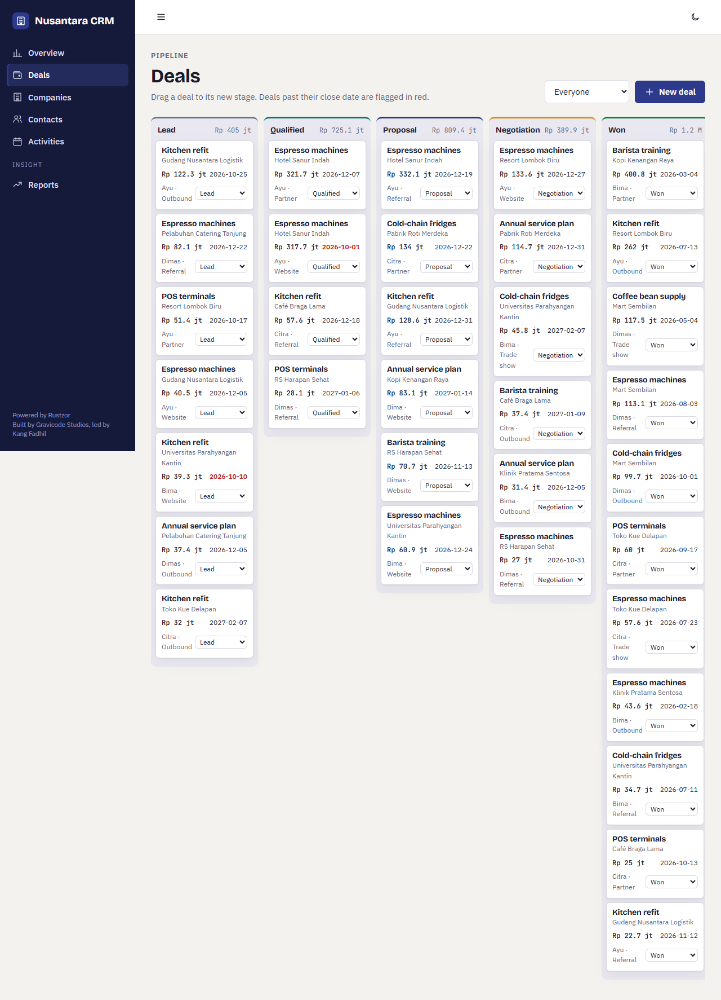 |
| 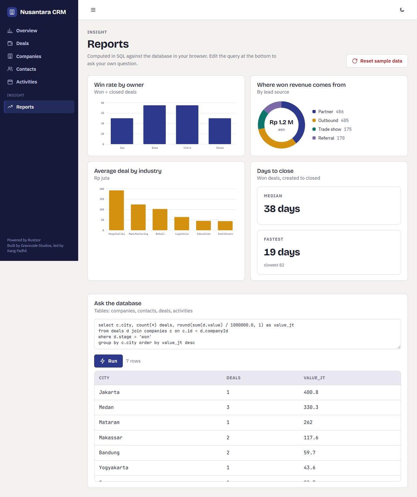 | 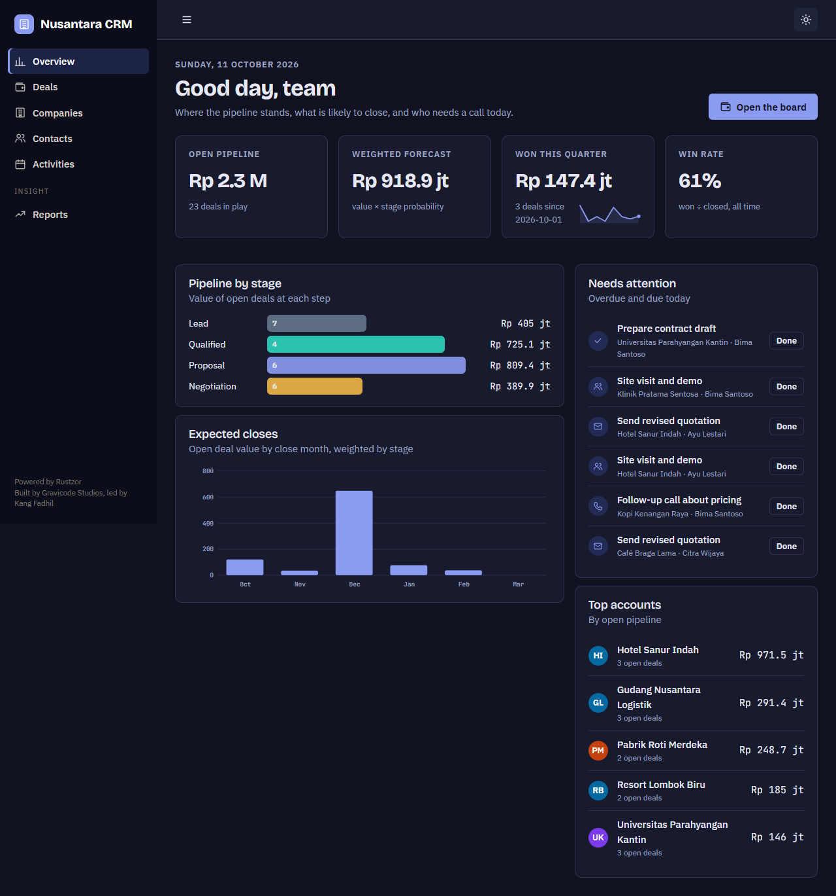 |

Menunjukkan: `AppShell`, `DataGrid`, chart, event drag and drop, route parameter (`/companies/{Id:long}`), SQLite dengan persistensi, uang dengan `decimal`.

## Kedai Senja POS

`samples/Pos` · `Rustzor.UI`, `Rustzor.Data` (IndexedDB), `Rustzor.Browser.DOM`

Mesin kasir kafe yang dirancang untuk tablet di meja kasir. Grid produk per kategori; opsi minuman (ukuran, panas atau dingin, gula, tambahan); pesanan yang sedang berjalan digambar seperti potongan kertas thermal; kode promo, pajak restoran PB1 10%, dan pembulatan ke Rp 100; pembayaran tunai dengan tombol nominal dan kembalian, QRIS, atau kartu; struk 58 mm yang bisa dicetak; riwayat pesanan dengan void dan cetak ulang; laporan shift dengan penjualan per jam dan per metode, produk terlaris, serta hitungan laci kas; dan editor menu dengan sakelar habis (sold-out). F2 untuk mencari, F9 untuk menagih.

| | |
| --- | --- |
|  | 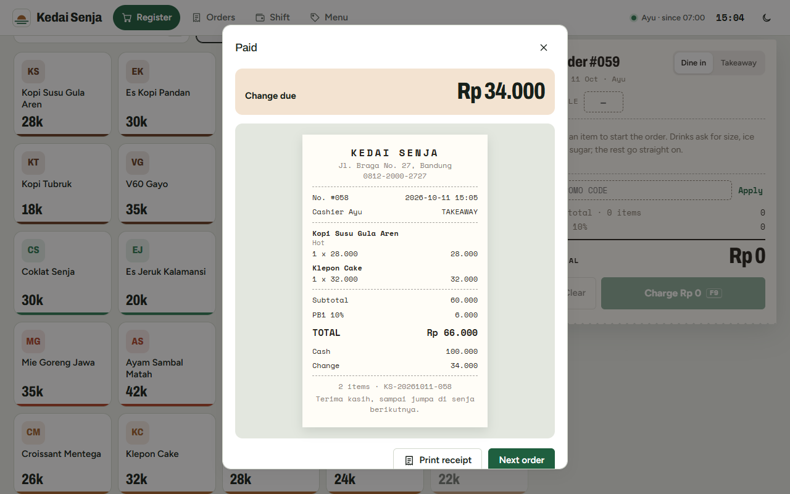 |
| 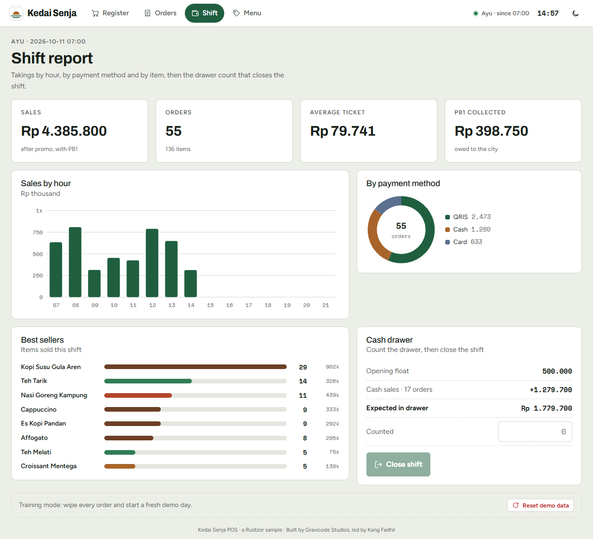 | 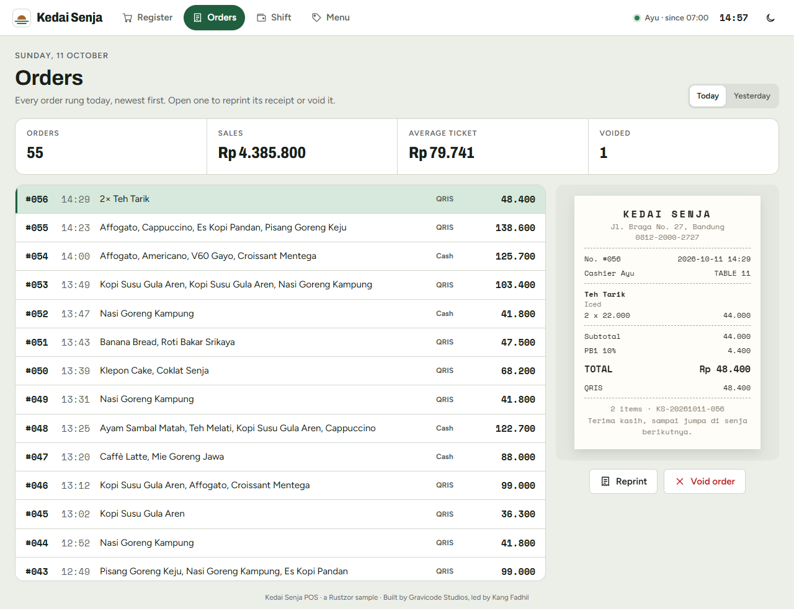 |

Menunjukkan: layout kustom tanpa sidebar, keyboard shortcut (`Window.OnKeyDown`), modal, CSS untuk cetak, store IndexedDB, layout ponsel dengan bar pesanan di bagian bawah.

## Jati Lestari ERP

`samples/Erp` · `Rustzor.UI`, `Rustzor.Data` (IndexedDB)

Back office sebuah workshop mebel jati di Tahunan, Jepara. Pembelian (purchase order, penerimaan barang yang menambah stok dan utang, pembayaran sesuai termin pemasok); penjualan (pesanan, surat jalan, faktur dengan PPN 11%, pembayaran; faktur yang lewat jatuh tempo ditandai); produksi (bill of materials beserta upah tukang, work order yang mengambil kayu, kain, dan perlengkapan dari gudang bahan lalu memasukkan barang jadi sebesar biayanya); persediaan di tiga gudang dengan harga pokok rata-rata bergerak, kartu stok per barang, dan transfer ke showroom Semarang; serta akuntansi berpasangan (double-entry) yang menerima jurnal dari setiap transaksi tadi: buku jurnal, neraca saldo, laba rugi per periode, dan neraca. Halaman persediaan mencocokkan nilai setiap kelompok stok dengan akunnya di buku besar. Riwayat sebelas minggu dibuat dengan menjalankan transaksi yang sama, jadi setiap angka berasal dari sebuah dokumen.

| | |
| --- | --- |
|  | 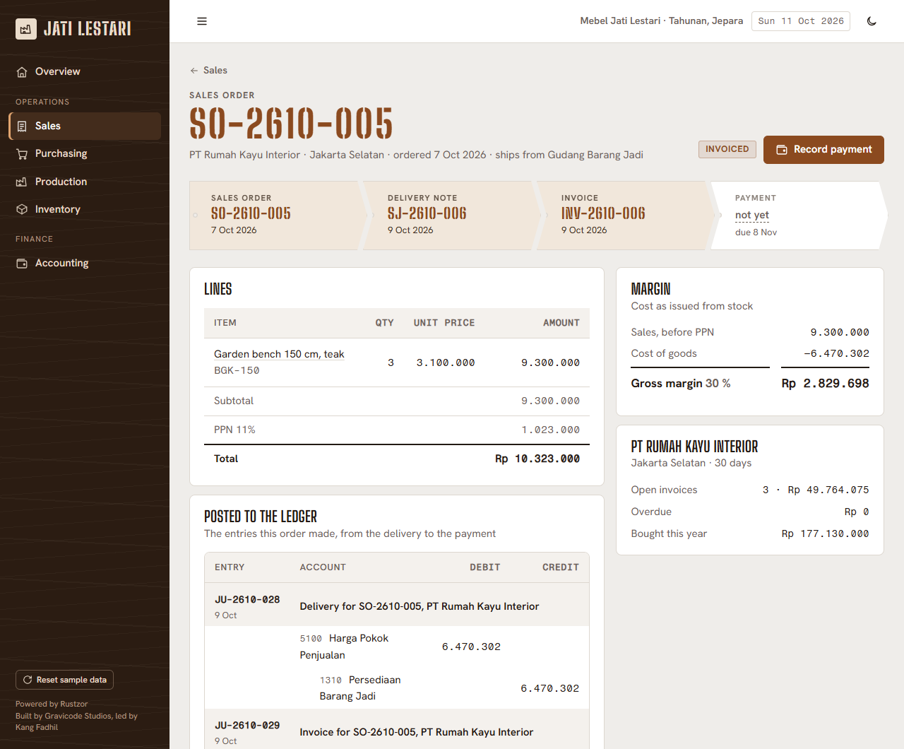 |
| 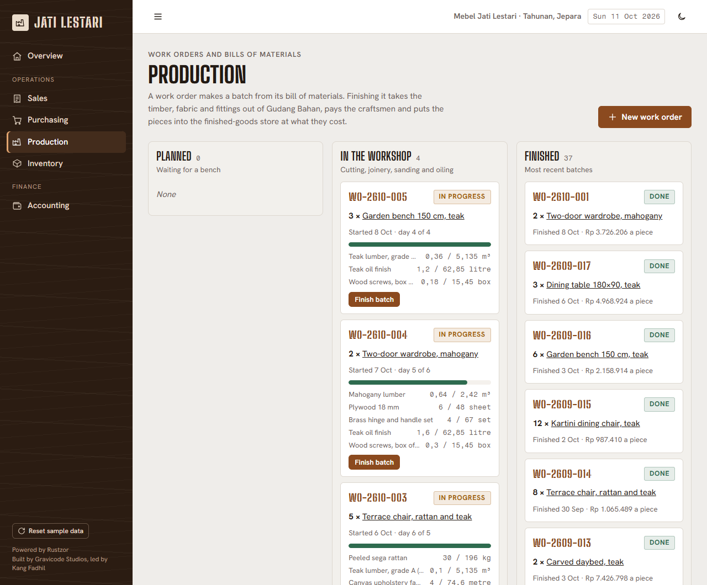 | 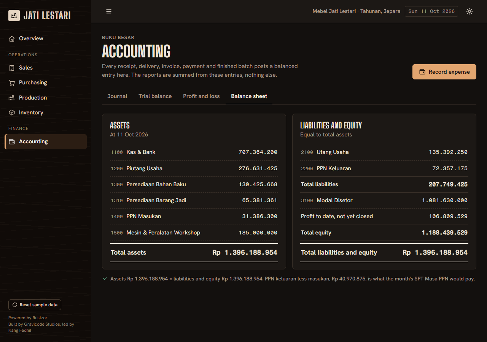 |

Menunjukkan: model domain yang setiap perubahannya membukukan jurnal seimbang, uang dengan `decimal`, laporan yang dihitung dari jurnal, parameter route (`/sales/{Id}`), query string, modal dengan baris pesanan yang bisa diubah, store IndexedDB, layout ponsel.

## Arus grid dashboard

`samples/Dashboard` · `Rustzor.UI`, `Rustzor.Charts.ECharts`

Tampilan ruang kendali untuk simulasi sistem kelistrikan Jawa–Bali yang diperbarui setiap dua detik: beban, frekuensi, spinning reserve, porsi energi terbarukan, dan intensitas karbon; pembangkitan 24 jam yang ditumpuk per sumber; diagram satu garis (single-line diagram) backbone 500 kV dengan garis putus-putus yang bergerak mengikuti aliran daya dan warna yang menunjukkan pembebanan; pembangkit, prakiraan beban, dan heatmap minggu-per-jam; log alarm; serta simulasi trip pembangkit sehingga Anda bisa melihat frekuensi turun lalu pulih. Nama pembangkit adalah nama tempat sungguhan; semua angkanya hasil simulasi.

| | |
| --- | --- |
|  |  |
| 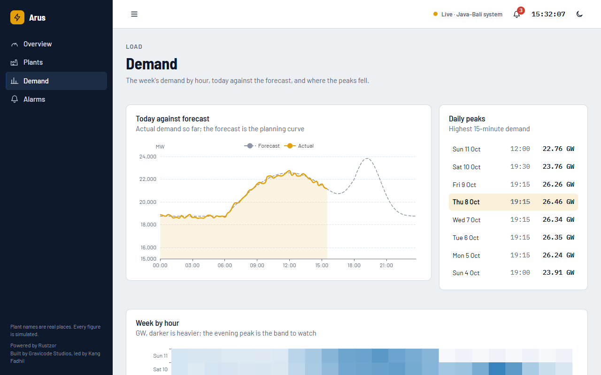 | 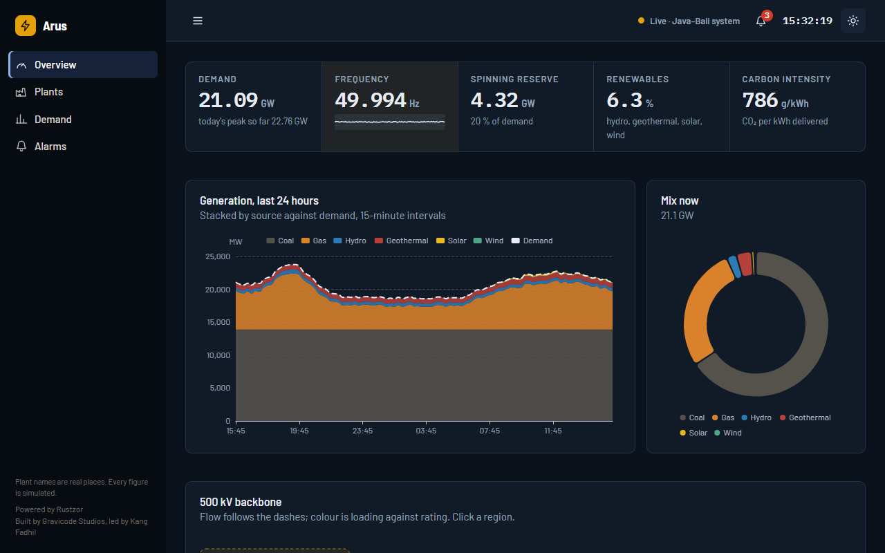 |

Menunjukkan: pembaruan live dengan `Scheduler.SetInterval`, option ECharts yang dibangun dari objek C#, diagram SVG yang di-generate di Razor dengan animasi CSS.

## Serambi chat

`samples/Chat` · `Rustzor.UI`, `Rustzor.Data`, `Rustzor.Browser.WebSocket` (`BroadcastChannel`), `Rustzor.Browser.Storage`, `Rustzor.Browser.FileSystem`

Chat tim untuk sebuah studio kecil. Setiap tab browser masuk sebagai satu orang; buka tab kedua sebagai orang lain dan keduanya bisa ngobrol secara live tanpa server: pesan disimpan di IndexedDB dan diumumkan ke tab lain lewat `BroadcastChannel`. Channel dan direct message dengan jumlah pesan belum dibaca, thread, reaksi, pin, edit, lampiran gambar, pencarian, indikator mengetik, Markdown-lite dengan HTML yang di-escape, @mention, dan tiga rekan tim simulasi yang membalas saat Anda me-mention mereka.

| | |
| --- | --- |
|  | 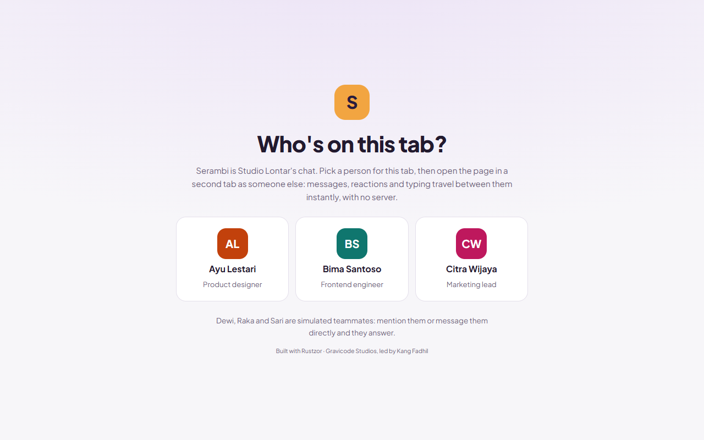 |
| 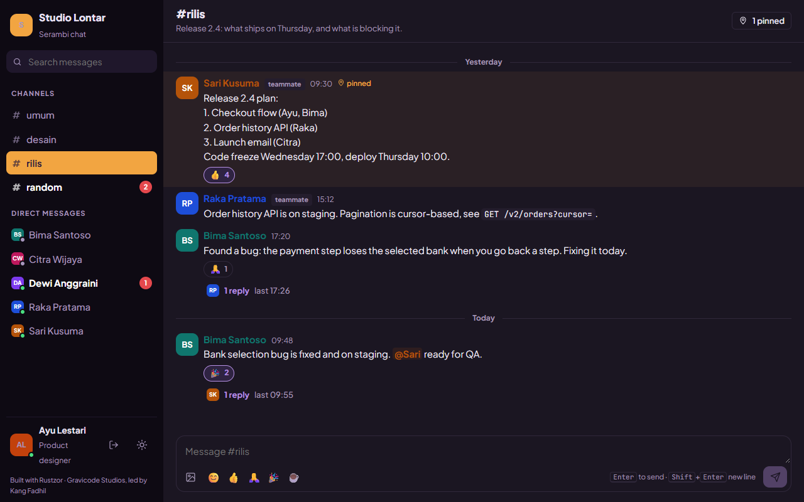 | 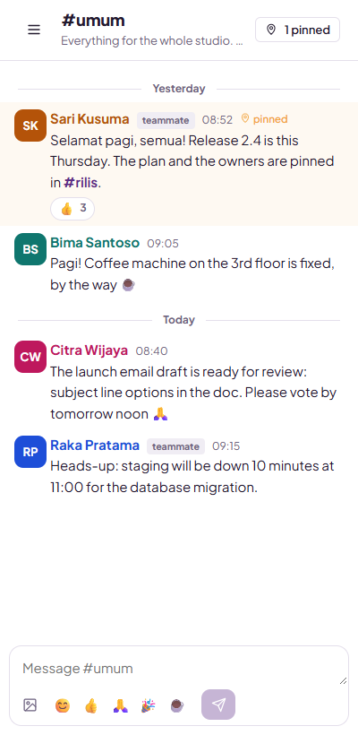 |

Menunjukkan: real-time antar-tab, `MarkupString` dengan escaping, identitas per tab di `sessionStorage`, komponen yang subscribe ke sebuah store.

## Ruang Redaksi video call

`samples/Meet` · `Rustzor.Browser.WebRTC`, `Rustzor.Browser.Media`, `Rustzor.Browser.WebSocket` (`BroadcastChannel`), `Rustzor.UI`

Ruang rapat Kabar Pesisir, koperasi lima redaksi pesisir (Makassar, Ambon, Bitung, Kendari, Ternate): rapat redaksi pukul 07.00, meja biro, dan meja liputan banjir. Video call sungguhan antar-tab dalam satu browser, tanpa server: setiap tab di sebuah ruang mengumumkan dirinya lewat `BroadcastChannel`, setiap pasangan tab bertukar offer, answer, dan kandidat ICE di sana, lalu gambar, suara, dan data channel berjalan peer to peer. Buka satu ruang di dua tab, masuk sebagai dua reporter, dan keduanya saling melihat dan mendengar.

- Pemeriksaan sebelum masuk: kamera di monitor preview dengan garis title-safe, mikrofon di PPM, pemilih kamera dan mikrofon, strap nama dan biro Anda, serta siapa yang sudah ada di ruang.
- Panggilan: grid yang menyesuaikan ukuran setiap tile dengan layar; strap lower-third di setiap tile; lampu tally merah pada siapa pun yang sedang bicara (dari tingkat suara); mute, kamera, dan berbagi layar (layar yang dibagikan tampil besar); chat, antrean angkat tangan, dan reaksi lewat data channel; rundown rapat yang bisa dimajukan siapa saja untuk semua orang; timecode; keluar, atau akhiri untuk semua.
- Perekaman: panggilan digabung di tab menjadi satu video 1280×720 (gambar setiap orang dalam grid dengan namanya, dan semua suara), diumumkan ke peserta lain selama berjalan, lalu disimpan di Recordings untuk diunduh.
- Tanpa kamera Anda masuk dengan mikrofon saja dan yang lain melihat inisial Anda di slate; tanpa keduanya Anda tetap bisa menonton, mendengar, dan chat.

| | |
| --- | --- |
|  | 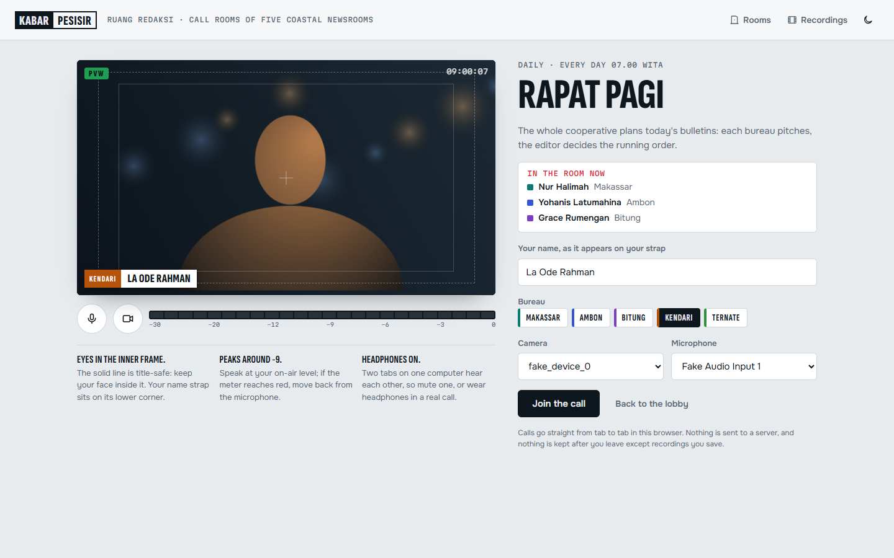 |
| 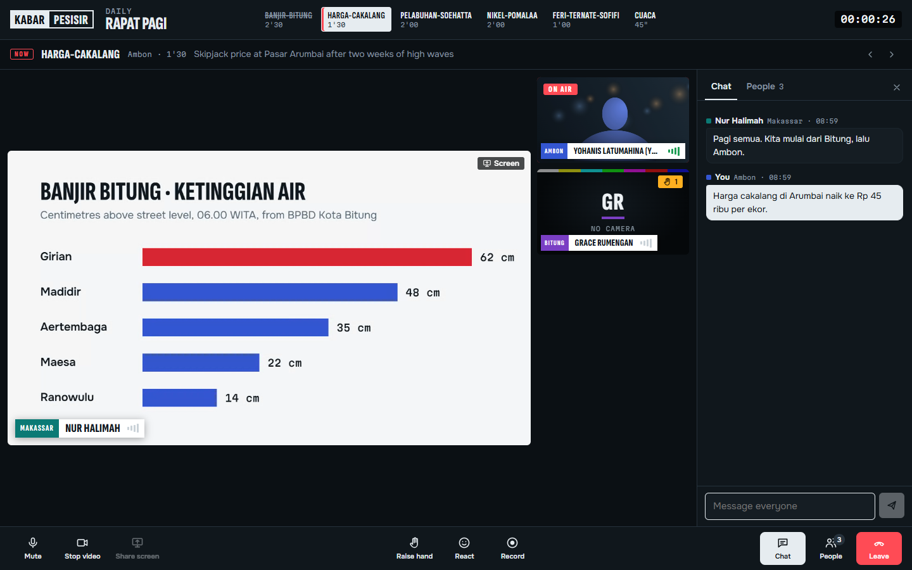 | 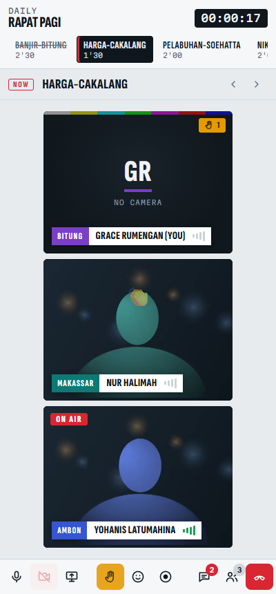 |

Menunjukkan: `PeerConnection` dengan signalling lewat `BroadcastChannel`, aturan pasangan (id yang lebih kecil yang memanggil) sehingga tidak ada offer ganda, `ReplaceTrackAsync` untuk berbagi layar tanpa negosiasi ulang, `MediaMixer` dan `MediaRecorder`, tingkat suara untuk pembicara aktif, unit container query untuk grid.

`node tools/e2e/meet.mjs http://localhost:5260` menjalankannya di Chrome headless dengan perangkat palsu: dua tab saling melihat video, chat, mute, angkat tangan, reaksi, rundown, tally, perekaman (video yang disimpan diperiksa per frame), berbagi layar, tab ketiga tanpa kamera, keluar, mengakhiri untuk semua, dan ponsel 400 px.

## Rupa, tool desain

`samples/Rupa` · `Rustzor.UI`, `Rustzor.Browser.FileSystem`, `Rustzor.Browser.Storage`, `Rustzor.Browser.DOM`, dan modul browser miliknya sendiri (`rustzor.module.js`)

Tool desain vektor ala Figma, bergaya cetak coba (*proof*) pracetak: tampilan grafit, kanvas seperti kertas kalkir, seleksi dan garis bantu warna magenta proses, sian untuk komponen, tanda register di penggaris. Dibuka dengan Lintas, tiga layar aplikasi KRL rekaan untuk Jabodetabek (beranda, jadwal, tiket) lengkap dengan komponen dan gaya warnanya.

- Kanvas tak terbatas: geser dengan Spasi+seret, tombol tengah, trackpad atau tool tangan; zoom dengan Ctrl+roda atau cubit, ke arah penunjuk; Shift+1 memuat semuanya, Shift+2 seleksinya. Penggaris dalam satuan kanvas menandai seleksi.
- Frame, persegi, elips, garis, pena untuk path bersegmen lurus, teks yang diketik langsung di kanvas, dan gambar dari file, seret-lepas atau clipboard.
- Pilih, Shift+klik, marquee, Ctrl+klik ke dalam grup, klik ganda ke dalam frame dan grup; pindahkan dengan snapping ke tepi dan tengah tetangga serta frame, dengan garis bantu dan angka jarak; ubah ukuran dari delapan pegangan (Shift menjaga proporsi, Alt dari tengah); putar dari sedikit di luar sudut (Shift per 15°). Grup, lepas grup, urutan tumpukan, duplikat, salin, tempel, hapus, geser per piksel; undo dan redo untuk setiap perubahan.
- Panel layer bersarang dengan ganti nama, sembunyikan dan kunci; properti posisi, ukuran, rotasi, opasitas, radius, isi, garis tepi dan tipografi; auto layout untuk frame (baris atau kolom, jarak, padding, perataan, *hug*).
- Komponen: frame dijadikan komponen dengan Ctrl+Alt+K; instansnya mengikuti setiap perubahan dan tetap memakai teksnya sendiri, yang diubah di panel; instans bisa dilepas menjadi frame biasa. Gaya warna dipakai bersama oleh semua layer yang menggunakannya.
- Ekspor seleksi atau semua frame ke SVG dan PNG (1× atau 2×, dengan font yang ikut disematkan). File tersimpan di browser (*origin-private file system*) dengan simpan otomatis; simpan salinan sebagai `.rupa.json` dan buka kembali.

| | |
| --- | --- |
|  | 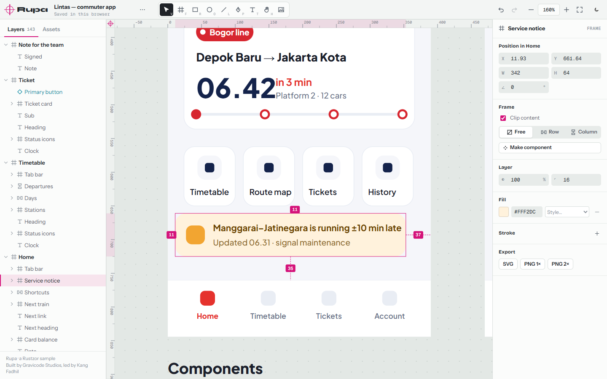 |
| 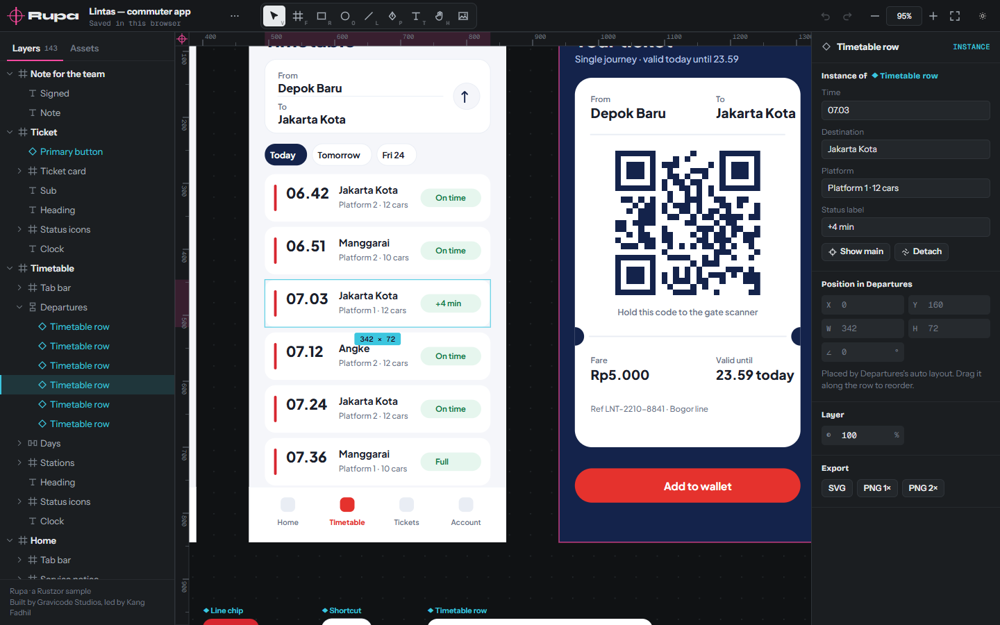 | 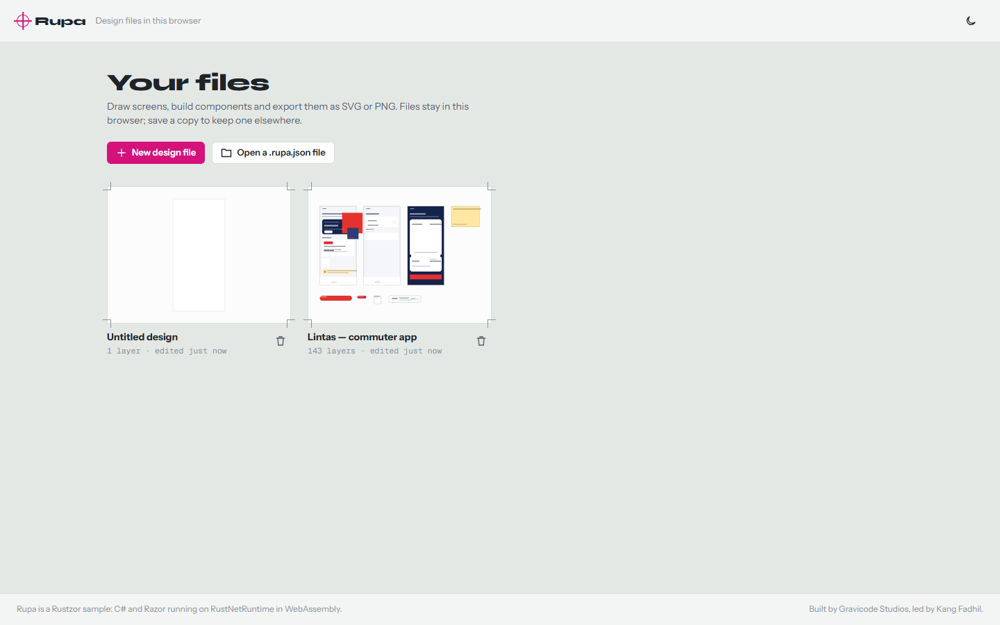 |

Menunjukkan: SVG yang digambar dari Razor dengan satu view per layer yang hanya di-render ketika layernya berubah (memindahkan satu bentuk di antara tiga ratus hanya menggambar ulang bentuk itu), seretan yang ditampilkan browser sementara C# memegang model dan menggambar ulang saat dilepas, snapping lewat pencarian biner pada tepi yang terurut, riwayat undo seluruh dokumen, dan aplikasi yang menyertakan modul browser sendiri.

`node tools/e2e/rupa.mjs http://localhost:5310` menjalankannya di Chrome headless dengan mouse dan keyboard, memeriksa model setelah setiap langkah (menggambar, snapping, mengubah ukuran, grup, undo dan redo, perubahan komponen yang sampai ke enam instans, override, teks, pena, ekspor SVG dan PNG, simpan otomatis setelah reload), dan mengukur seretan dengan 300 bentuk di halaman: sekitar 12 ms kerja per gerakan dan 56 frame per detik (laju frame Chrome headless). `node tools/e2e/rupa-shots.mjs` mengambil screenshot di atas.

## Kamar Gelap, editor foto

`samples/KamarGelap` · `Rustzor.UI`, `Rustzor.Browser.FileSystem`, dan modul browser miliknya sendiri (`rustzor.module.js`) yang mengerjakan piksel dengan WebGL2

Editor foto berlapis ala Photoshop, bergaya kamar gelap: tampilan hitam hangat, merah *safelight* untuk apa pun yang sedang aktif, kuning developer untuk angka, dan gambar yang dipegang dalam potongan film yang tepinya mencetak nomor frame, ukuran, jumlah layer, dan zoom. Dibuka dengan *Merapi dari Kaliurang*, fajar 2000 × 1500 di atas Merapi dan sawah terasering yang dilukis oleh aplikasinya sendiri (tidak ada yang diunduh, tidak ada lisensi), lengkap dengan suntingan yang biasa ditumpuk fotografer: langit lebih hangat, Levels bermasker untuk mengangkat terasering, vignette multiply, dan keterangan foto.

- Layer dengan opasitas, delapan blend mode (normal, multiply, screen, overlay, darken, lighten, soft light, difference), tampil/sembunyi, kunci, ganti nama, seret untuk mengubah urutan, dan masker layer (tampilkan semua, dari seleksi, aktif/nonaktif, terapkan, hapus; Q berpindah antara melukis masker dan piksel). Thumbnail asli untuk layer dan masker.
- Adjustment layer yang tidak pernah mengubah piksel di bawahnya: brightness dan contrast, levels, hue dan saturation, black and white dengan tint. Masing-masing punya masker sendiri.
- Filter pada layer piksel, di dalam seleksi, dengan pratinjau langsung: Gaussian blur, sharpen (unsharp mask), add noise.
- Tool: move, marquee persegi dan elips, lasso (*marching ants*), crop (Shift menjaga proporsi), brush dan eraser dengan ukuran, kekerasan, opasitas, flow, dan tekanan pena, clone stamp (Alt-klik sumbernya), gradient (linear, radial, ke transparan), paint bucket dengan toleransi, eyedropper, layer teks, hand. Shortcut Photoshop: V M L C B E S G I T H, X, D, [ dan ], 1–0, Ctrl+J, Ctrl+D, Alt+Backspace.
- Isi dan hapus seleksi, pilih semua, inverse, crop ke seleksi; riwayat 40 langkah terakhir yang bisa diklik untuk kembali; zoom ke arah penunjuk, geser, muat layar, ukuran asli; histogram langsung; pemilih warna dengan swatch.
- Buka foto (atau seret-lepas untuk menaruhnya sebagai layer), ekspor PNG, JPEG, atau WebP dengan pengaturan kualitas, simpan dan buka proyek `.kamar` beserta semua layer dan maskernya, dan simpan otomatis di IndexedDB yang ditawarkan halaman awal untuk dilanjutkan.

| | |
| --- | --- |
|  | 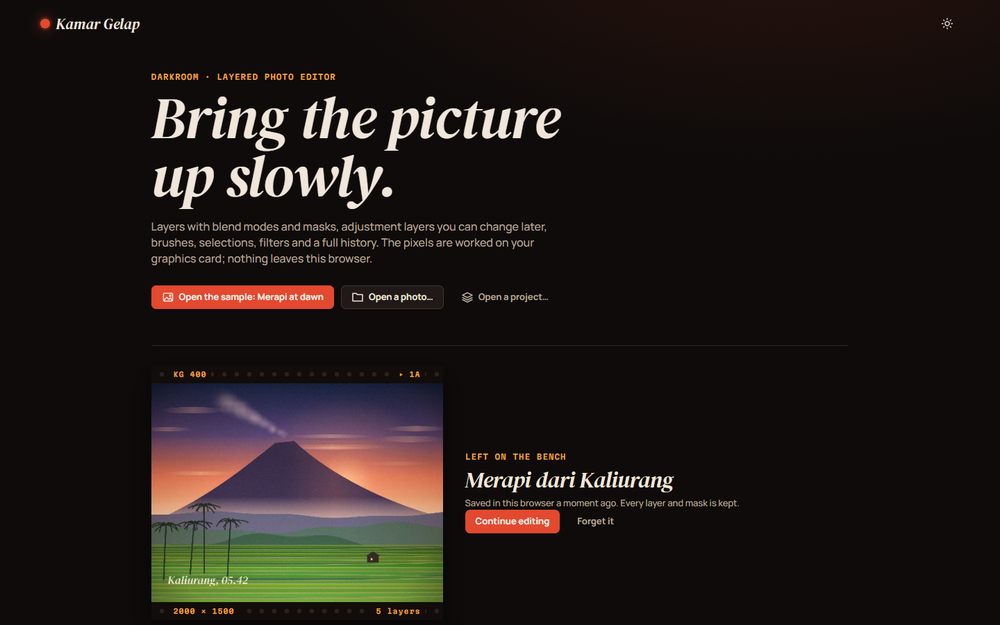 |
| 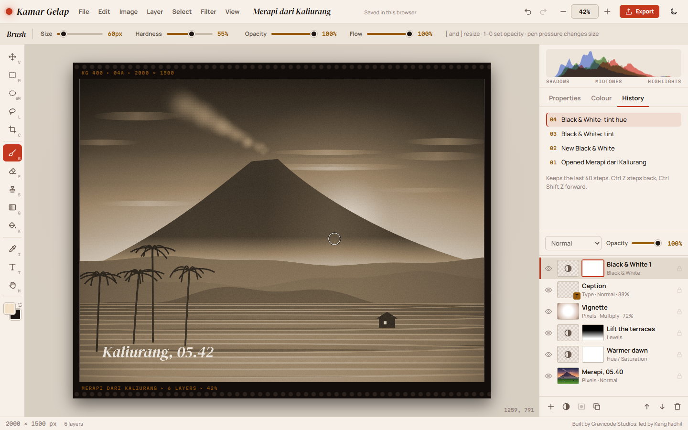 | 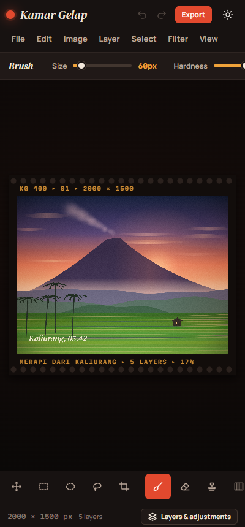 |

Menunjukkan: C# memegang dokumen (layer, adjustment, seleksi, urutan riwayat) dan mengirimkannya ke modul browser sebagai JSON, sementara piksel tetap di browser: satu kanvas 2D per layer dan masker, compositor WebGL2 yang memadukan tumpukan dengan mode, opasitas, dan masker setiap layer serta menjalankan adjustment layer sebagai shader, filter sebagai pass shader, dan snapshot *copy-on-write* untuk riwayat. Layer di bawah layer aktif di-cache, sehingga satu frame brush hanya menggabungkan ulang dari situ ke atas, dan hanya di area yang dilukis. Kerja per piksel di C# yang diinterpretasi akan memakan sekitar 1,4 µs per piksel, kira-kira empat detik untuk satu kali lewat gambar ini; di GPU satu frame utuh hanya sekitar 2 ms.

`node tools/e2e/kamargelap.mjs http://localhost:5320` menjalankannya di Chrome headless dan membaca piksel kembali setelah setiap langkah: goresan brush, layer multiply yang diisi di dalam seleksi (hasil gabungan sama dengan dasar dikali warna isian di dalamnya dan tidak berubah di luarnya), layer black & white yang dinyalakan lalu dimatikan (setiap nilai kembali), Gaussian blur (varians terasering turun separuh), undo dan redo, crop ke 1000 × 700, ekspor PNG yang didekode pada ukuran itu, dan simpan otomatis setelah reload. Pada sample 2000 × 1500 dengan lima layer, dengan menunggu GPU selesai, satu frame brush sekitar 2 ms (p95 2,5 ms), Gaussian blur 20 px sekitar 50 ms, sharpen sekitar 35 ms, dan noise sekitar 25 ms (Intel UHD 620). `node tools/e2e/kamargelap-shots.mjs` mengambil screenshot di atas.

## Siaga Citarum, peta banjir

`samples/Siaga` · `Rustzor.UI`, `Rustzor.Data` (IndexedDB), `Rustzor.Browser.FileSystem`, `Rustzor.Browser.Location`, dan modul browser miliknya sendiri (`rustzor.module.js`): mesin petanya

Meja pusdalops BPBD saat banjir Citarum di Cekungan Bandung, digambar seperti lembar peta topografi: blok judul dengan nama lembar, waktu situasi, dan datum; kontur cokelat, perairan biru dengan nama bercetak miring, batas kecamatan garis-titik ungu; tepi peta berisi graticule derajat dan menit yang mengikuti tampilan; wilayah di luar lembar diarsir di balik garis tepi. Satu-satunya warna mencolok adalah empat status siaga (Normal, Waspada, Siaga, Awas) pada papan pos duga air di atas peta. Nama tempatnya nyata; semua bentuk, bacaan, dan laporan dibuat oleh generator.

- Mesin peta sendiri, tanpa internet: Web Mercator, geser dengan inersia, zoom ke arah pointer dengan scroll atau cubit, label yang saling memberi tempat, skala batang, skala angka, dan koordinat pointer dalam derajat, menit, detik. Latar OpenStreetMap bisa dinyalakan saat online, lengkap dengan atribusinya; saat offline aplikasi memberi tahu dan mematikannya.
- Sebelas layer dalam sekitar 1 MB GeoJSON (46.000 titik): kontur tiap 25 m, kecamatan, sungai, Waduk Saguling, genangan banjir, jalan, laporan warga, pompa dan kolam retensi, fasilitas kesehatan, posko pengungsian, dan pos duga air.
- Panel layer dengan visibilitas, urutan, opasitas, dan gaya: satu warna, per kategori, kelas bergradasi dari kolom angka mana pun (kuantil atau interval sama, empat ramp warna), atau heat map, masing-masing dengan legendanya.
- Identifikasi (Shift menambah seleksi); tabel atribut yang bisa difilter, diurutkan, dan selalu selaras dengan peta; pencarian nama atau koordinat.
- Gambar titik, garis, dan area, sunting verteksnya (seret, tambah di titik tengah, Alt-klik untuk menghapus), beri nama dan catatan; semuanya tersimpan di browser ini.
- Ukur jarak (Haversine) dan luas (geodesik, di atas bola); pilih semua yang ada di dalam area yang digambar; buffer fitur apa pun (sungai, pos duga air, jalan, gambar Anda) dan daftar apa saja yang ada dalam jarak itu, dari yang terdekat.
- Impor GeoJSON atau CSV dengan kolom lat dan lon (pilih, seret, atau tempel), ekspor layer Anda sebagai GeoJSON; "lokasi saya" lewat Geolocation API, dengan penjelasan bila izin ditolak.
- `/laporan`, laporan situasi yang bisa dicetak dari layer yang sama: pos duga air terhadap batas siaganya, luas genangan yang diukur geodesik, KK terdampak per kecamatan, keterisian posko, dan laporan semalam per jam.

| | |
| --- | --- |
|  | 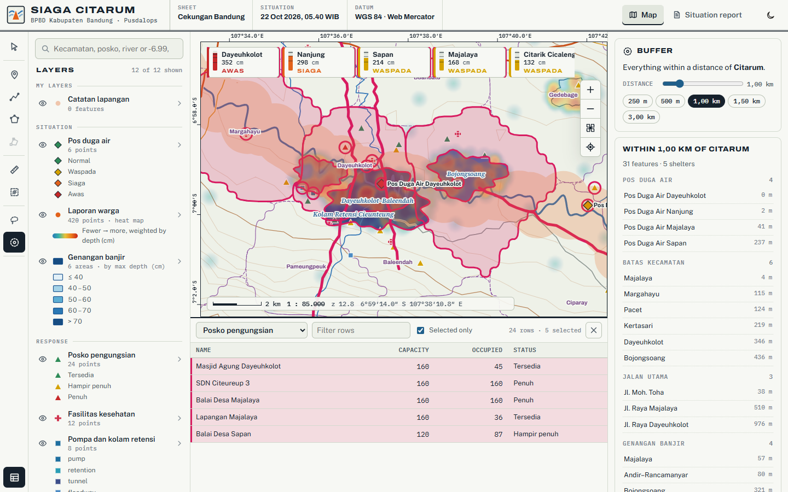 |
| 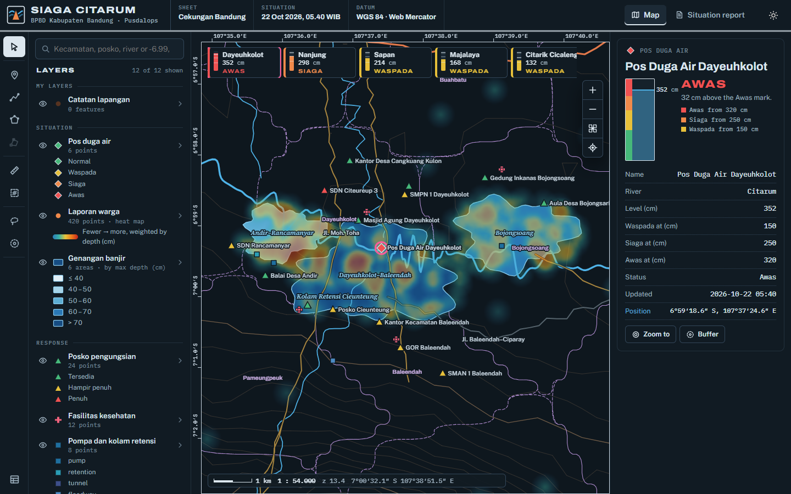 | 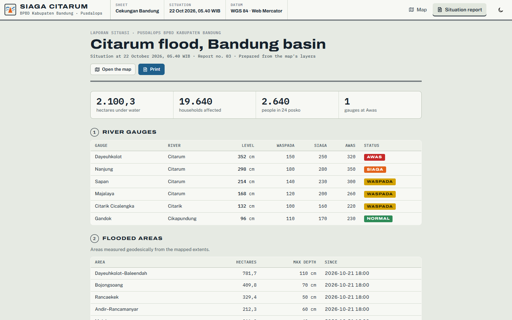 |

Menunjukkan: C# memegang layer, gaya, atribut, fitur buatan pengguna, serta setiap pengukuran dan kueri, sementara modul browser yang menggambar: GeoJSON diproyeksikan sekali ke meter dan disimpan sebagai objek `Path2D`, sehingga satu frame hanyalah satu transformasi dan beberapa fill dan stroke, dan menggeser peta tidak pernah masuk ke C#. Hit test, garis bantu saat menggambar, dan pegangan verteks dijawab di modul dalam frame yang sama; klik, sketsa yang selesai, dan suntingan dikirim kembali ke C#.

`node tools/e2e/siaga.mjs http://localhost:5330` menjalankannya di Chrome headless dan mencocokkan jawabannya dengan angka yang dihitung sendiri dari file GeoJSON yang sama: proyeksi terhadap rumus EPSG:3857 dan bolak-baliknya, geser dan zoom, identifikasi pada koordinat pos duga air, tabel dan peta yang saling memilih, luas geodesik dan keliling Haversine sebuah persegi yang digambar (selisih di bawah 1%), buffer 3 km dan pilih-dengan-area terhadap uji jarak dan point-in-polygon miliknya sendiri, GeoJSON yang ditempel lalu diekspor kembali tanpa berubah, suntingan verteks, gambar dan impor yang tetap ada setelah reload, reset, dan lokasi tanpa izin. Menggeser dan zoom di atas 46.000 titik menggambar satu frame dalam sekitar 4 ms (p95 7 ms). `node tools/e2e/siaga-shots.mjs` mengambil screenshot di atas; `node samples/Siaga/data/make-data.mjs` membuat ulang datanya.

## Tilik, tinjauan desain

`samples/Tilik` · `Rustzor.UI`, `Rustzor.Browser.Storage`, dan modul browser miliknya sendiri (`rustzor.module.js`): mesin viewer-nya

Seorang product engineer di produsen mesin pertanian di Surabaya meninjau revisi C RW-63, gear reducer dua tingkat, sebelum dilepas ke bengkel. Tampilannya tampilan bengkel mesin: netral baja dengan semburat ungu, ungu tinta layout masinis untuk struktur, kuning peringatan hanya untuk yang dipilih atau disematkan. Ciri khasnya konvensi gambar teknik: potongan mengisi setiap part yang terpotong dengan arsiran (part yang bersebelahan diarsir berlawanan arah, baja lebih rapat daripada besi tuang), dan pengukuran digambar sebagai garis dimensi dengan panah dan nilainya di dalam kotak feature control.

- Modelnya rakitan sungguhan: 36 part dalam lima grup (housing bawah dan atas dengan delapan baut; rakitan poros input, perantara, dan output dengan roda gigi, bearing, tutup, seal, dan pasaknya; breather, sumbat buang, dan kaca intip oli), 45.000 segitiga dalam glTF biner 1,15 MB. Dimodelkan di Blender dengan skrip, `samples/Tilik/assets-src/make_rw63.py`: roda gigi lurus involut (z14/z34 modul 2,5, z15/z38 modul 3, jadi 6,15 : 1), housing belah yang dibangun dengan boolean eksak dan di-bevel seperti coran, serta nomor part, material, massa jenis, dan buat/beli setiap part ditulis ke extras glTF. Jalankan skrip itu di Blender untuk membuat ulang filenya; skrip bekerja di scene-nya sendiri dan membiarkan file yang terbuka seperti semula.
- Mesin sendiri dengan WebGL2: GLB (dan STL) di-parse di browser, tiap part di buffer-nya sendiri; orbit dengan inersia, geser, zoom ke arah pointer, pinch; fit, tampilan standar, dan view cube yang ikut berputar bersama kamera; perspektif atau ortografis.
- Shaded, shaded dengan tepi (tepi fitur di tempat dua bidang bertemu lebih dari 35°), wireframe, dan x-ray.
- Pohon rakitan: sembunyikan, isolasi, pilih; klik di tampilan memilih part di bawah pointer dan membuka cabangnya. Panel detail memberi material, massa jenis, volume (dari mesh tertutup), massa, dimensi luar, dan jumlah segitiga.
- Potongan pada X, Y, atau Z, digeser dengan slider atau dengan menyeret di tampilan, dan setiap potongan ditutup dan diarsir: satu lintasan stencil per part menghitung di mana bidang berada di dalam benda.
- Ukur titik ke titik, panjang utuh sebuah tepi (segmen segaris digabung), dan sudut melalui tiga titik; titik menempel ke sudut terdekat pada part di bawah pointer, yaitu yang paling dekat dengan permukaan yang diklik.
- Catatan yang disematkan di model, bernomor, bisa ditandai selesai, disimpan di browser; pin di balik model memudar. Tampilan tersimpan menyimpan kamera, mode tampilan, potongan, explode, dan apa yang disembunyikan.
- Tampilan explode dengan slider; PNG dari tampilan beserta dimensi dan pinnya; buka `.glb` atau `.stl` apa saja lewat tombol atau dengan menjatuhkannya ke tampilan.
- `/bom`, daftar material (bill of materials) yang digabung per nomor part (delapan baut, empat bearing 6204), dengan massa dari volume dan massa jenis, serta unduhan CSV.

| | |
| --- | --- |
| 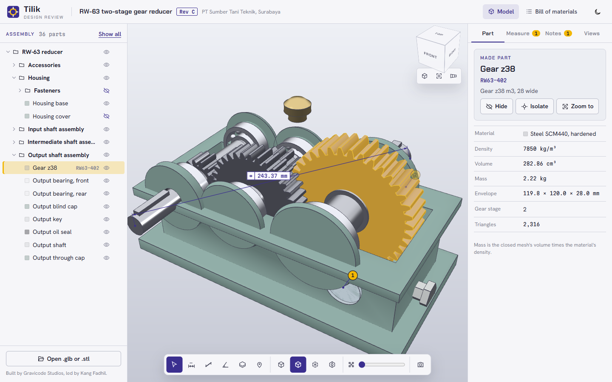 |  |
| 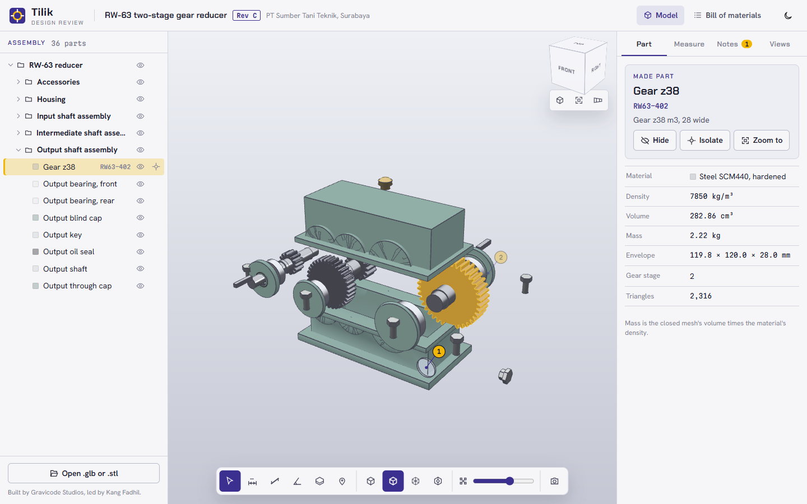 | 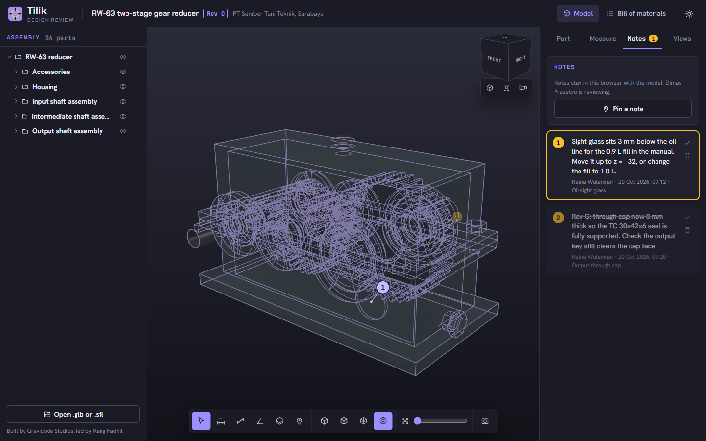 |

Memperlihatkan: C# memegang tinjauannya (pohon, apa yang tampil, pilihan, pengukuran, catatan, tampilan tersimpan, daftar material) sementara modul browser memegang semua yang dibutuhkan satu frame: parsing, menggambar, tutup potongan, picking dengan ray cast dan snapping, serta dimensi di overlay 2D. Orbit tidak pernah menyeberang ke C#; pick, pengukuran, dan tempat catatan kembali ke C#.

`node tools/e2e/tilik.mjs http://localhost:5340` menjalankannya di Chrome headless dan mencocokkannya dengan GLB itu sendiri: jumlah part, klik pada breather yang memilihnya di tampilan dan di pohon, menyembunyikan tutup (hilang dari daftar gambar dan dari piksel) dan mengisolasi rakitan output (8 part-nya), potongan Y yang tidak menyisakan apa pun di atas bidang dan bergeser saat diseret, jarak hasil snap antara dua kepala baut (140,00 mm, sama dengan di file), tepi (36,00 mm) dan sudut (90,0°) pada pasak input, slider explode, catatan dan tampilan tersimpan yang tetap ada setelah reload, CSV daftar material (23 baris, 36 part), kubus STL 8 cm³, screenshot PNG, dan waktu frame. Model terbuka dalam sekitar 0,45 detik; orbit menggambar satu frame dalam 0,6 ms (p95 0,9 ms) dan mengikuti 60 fps layar. `node tools/e2e/tilik-shots.mjs` mengambil screenshot di atas.

## Loket, meja layanan

`samples/Loket` · `Rustzor.AI`, `Rustzor.UI`, `Rustzor.Browser.Storage`, `Rustzor.Browser.FileSystem`, `Rustzor.Browser.Audio`, `Rustzor.Browser.DOM`, dan modul browser kecil (`rustzor.module.js`)

Meja layanan Kelurahan Kemuning Raya di Kota Sentosa (keduanya rekaan). Warga bertanya, dalam bahasa Indonesia atau Inggris, apa yang perlu dibawa untuk KTP-el, KK, akta kelahiran, atau surat domisili, dan asisten menjawab dari SOP kantor sendiri, dengan sumber di setiap pernyataan. Tampilannya tampilan loket: papan antrean dengan nomor tiket berwarna kuning marigold, setiap percakapan berupa tiket antrean bernomor, kutipan berupa stempel karet merah kecil, dan pemanggilan alat berupa slip yang diisi petugas. Bahasa Indonesia menjadi bawaan; antarmuka berganti ke bahasa Inggris dengan satu ketukan, dan jawaban mengikuti bahasa pertanyaan.

- **Chat streaming dengan tombol Hentikan.** Teks tampil saat tiba; Hentikan membatalkan permintaan HTTP di browser dan menyimpan yang sudah tertulis.
- **Markdown yang aman.** Judul, daftar, tabel, kutipan, tautan (hanya http, https, dan mailto), dan blok kode dengan tombol Salin. Setiap karakter di-escape lebih dulu, jadi `<script>` atau `` di pertanyaan maupun jawaban tampil sebagai teks.
- **Percakapan** ditampilkan sebagai tiket antrean: cari, ganti nama, hapus, semuanya tersimpan di browser ini; ekspor ke Markdown atau JSON.
- **Penyedia model:** model demo bawaan yang luring (tanpa kunci, tanpa jaringan, alatnya sama), Azure OpenAI, OpenAI, Anthropic Claude, dan endpoint apa pun yang kompatibel dengan OpenAI (Ollama, LM Studio, vLLM, DeepSeek, Groq), dengan uji sambungan. Kunci API tetap di penyimpanan browser ini dan hanya dikirim ke penyedia yang dipilih. Editor kepribadian (system prompt) dengan tiga preset.
- **Empat alat**, ditampilkan sebagai kartu berisi masukan dan hasilnya: kalkulator yang tepat (memahami `2.400.000` dan `15% dari` seperti tulisan orang Indonesia), jam kantor (WIB, dan apakah kantor sedang buka), pencarian dokumen, dan catatan untuk petugas yang muncul di `/catatan`.
- **Dokumen** (`/dokumen`): lima SOP bawaan, ditambah `.md`, `.txt`, atau `.pdf` apa pun yang dijatuhkan atau dipilih (teks PDF lewat pdf.js). Setiap dokumen dipotong per bagian dan dicari dengan BM25 di browser, dengan stemmer bahasa Indonesia sederhana; tidak perlu model embedding atau server. Kutipan membuka bagian asalnya, dan arsip terbuka tepat di bagian itu, disorot.
- **Gambar** untuk model yang bisa melihat (diperkecil ke 1280 px sebelum dikirim); **masukan suara** lewat Web Speech API bila browser mendukung, dan **jawaban dibacakan** lewat speech synthesis. Bila salah satunya tidak tersedia, tombolnya disembunyikan atau loket tetap diam.
- **Pemakaian:** token masuk dan keluar per jawaban dan per percakapan (angka dari penyedia bila dikirim), serta biaya dari harga per juta token yang bisa diubah.

| | |
| --- | --- |
|  | 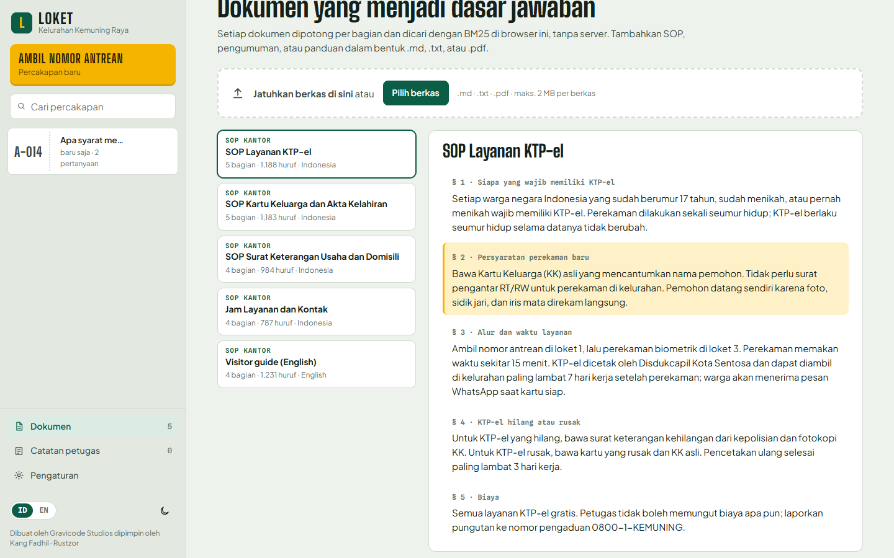 |
| 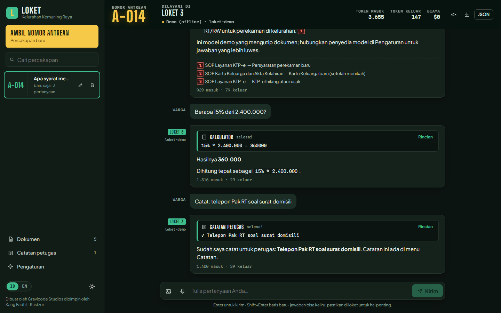 | 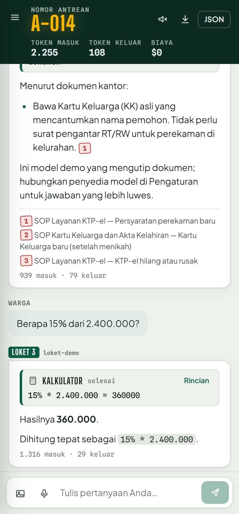 |

Menunjukkan: tool calling `Rustzor.AI` (`ChatTool`, `ToolAgent`, `IToolChatModel`) dan streaming yang bisa dibatalkan, jalur kode yang sama untuk model lokal dan tiga API jarak jauh, serta jawaban berbasis dokumen (RAG) dengan kutipan yang seluruhnya berjalan di browser.

`node tools/e2e/loket.mjs http://localhost:5360` menjalankannya di Chrome headless dengan model demo: jawaban yang mengalir sepotong demi sepotong, Hentikan yang mengakhiri jawaban lebih awal tanpa ada teks yang datang sesudahnya, tabel, daftar, dan blok kode Markdown dengan Salin, pemanggilan kalkulator yang kartunya berbunyi `15% * 2.400.000 = 360000`, catatan di daftar petugas, `<script>` dan `` yang tampil sebagai teks dan tidak pernah berjalan, berkas Markdown yang dijatuhkan lalu ditemukan oleh pertanyaan dan dikutip (kutipannya membuka bagian itu), hitungan token, percakapan yang bertahan setelah reload, dan penghapusan yang tetap terhapus. Skrip ini juga menjalankan penyedia yang kompatibel dengan OpenAI lewat HTTP sungguhan ke server tiruan lokal yang mengirim tool call sepotong-sepotong. Bila `LOKET_AZURE_ENDPOINT`, `LOKET_AZURE_KEY`, dan `LOKET_AZURE_MODEL` diisi, ditambah uji langsung: pemanggilan kalkulator sungguhan, jawaban yang mengalir, pencarian dokumen dengan kutipan, dan hitungan token dari penyedia. `node tools/e2e/loket-shots.mjs` mengambil tangkapan layar di atas.

## API Playground

`samples/ApiPlayground` · `Rustzor.Browser.Fetch`, `Rustzor.Browser.WebSocket`, `Rustzor.Net.SignalR`, `Rustzor.Net.GrpcWeb`

Server kecil ASP.NET Core .NET 10 (`Server/`) dan client Rustzor (`Client/`) yang mencoba empat cara browser berkomunikasi dengan backend, dengan log "wire" untuk setiap request, response, dan frame.

- **REST**: request builder dengan preset untuk katalog buku (`/api/books`): list, search, get, create, replace, delete, error validasi, 404, panggilan lambat, status apa pun. Response yang diformat rapi beserta waktu dan header-nya, plus kode C# yang setara.
- **WebSocket**: `/ws` memantulkan (echo) apa yang Anda kirim dan mengirim tick dari server setiap dua detik.
- **SignalR**: `/hubs/chat` dengan room dan presence, `InvokeAsync<int>("Add")`, countdown yang di-stream, dan method yang selalu gagal.
- **gRPC-Web**: `playground.Inventory`: panggilan unary, NOT_FOUND, list yang di-stream, dan harga live dengan cancellation, dengan setiap frame ditampilkan dalam hex.

| | |
| --- | --- |
| 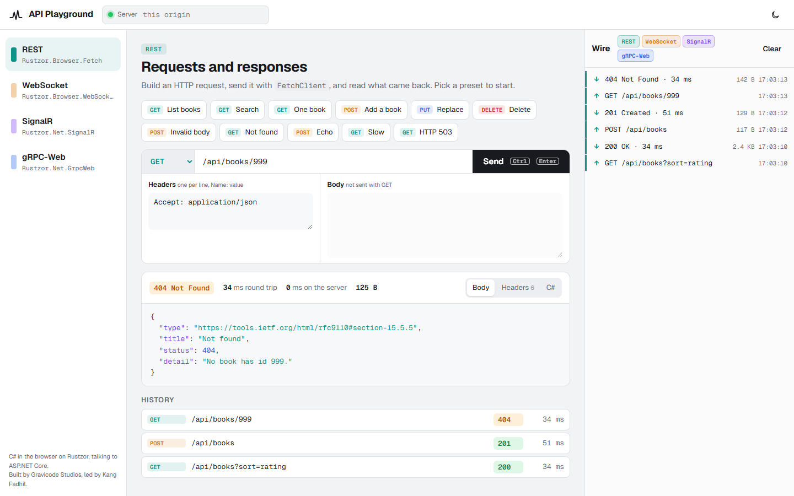 | 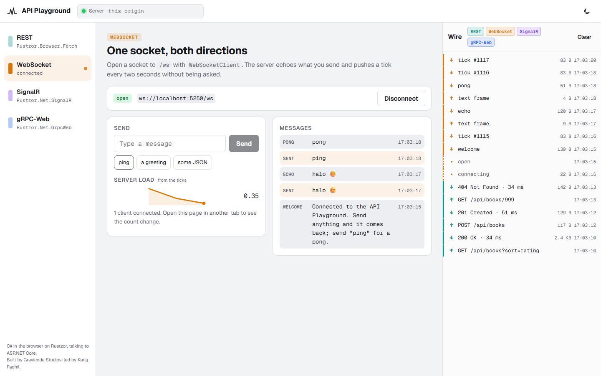 |
| 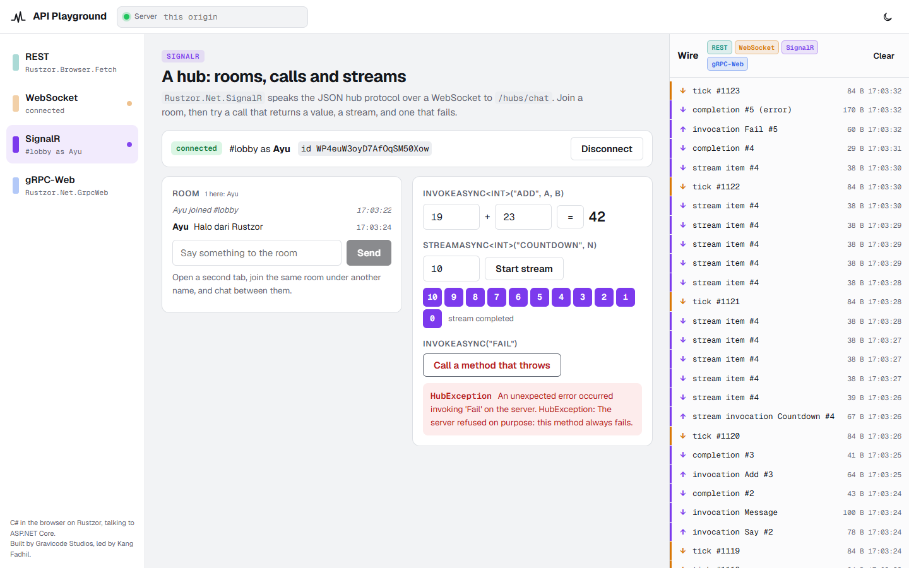 |  |

Cara menjalankannya (server juga menyajikan client yang sudah di-build):

```bash
dotnet build samples/ApiPlayground/Client
dotnet run --project samples/ApiPlayground/Server --urls http://localhost:5250
# buka http://localhost:5250
```

Untuk menyajikan client dari tempat lain, isi alamat server di bar atas; server mengizinkan panggilan cross-origin.

## Aplikasi lainnya

[RustzorAppGen](appgen.md) menyertakan 21 template (game, sains, bisnis, industri, pendidikan, simulator, tool) yang juga merupakan aplikasi lengkap. Dua sample lagi dari [roadmap](../../PLAN.md) sedang dikerjakan: game multiplayer dan digital twin.
